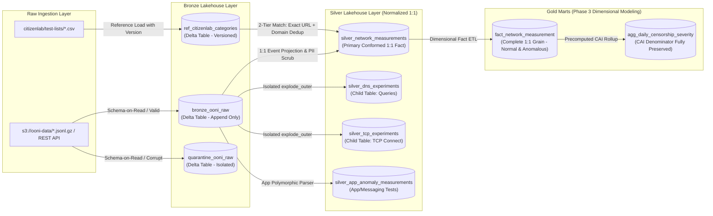

# Enterprise Data Dictionary & Schema Governance
## Project Panopticon: Global Cyber Warfare & Internet Censorship Lakehouse

---

### Document Overview
This Data Dictionary serves as the formal engineering contract and governance specification for **Project Panopticon**. It defines the schema, data types, primary keys, nullability constraints, and transformations across all layers of the **Medallion Lakehouse (Bronze $\rightarrow$ Silver $\rightarrow$ Operational Logs)**.

All ingestion pipelines and downstream analytical queries must strictly conform to the definitions herein.

---

## 1. Architectural Modeling Principles

1. **Strict Schema-on-Read**: Apache Spark schema inference (`inferSchema=True`) is strictly prohibited in production. Explicit PySpark `StructType` contracts are enforced at the raw boundary.
2. **Deterministic Primary Keys**: Telemetry records originating from distributed edge probes lack unified global auto-incrementing IDs. Deterministic surrogate keys are generated using cryptographic SHA-256 hashes of natural composite identifiers (`report_id`, `input`, and `measurement_start_time`).
3. **Immutability, Late Arrivals & Auditability**:
   - **Bronze**: Append-only raw landing table storing immutable measurements alongside lineage audit metadata (`load_timestamp`, `_source_file`, `_batch_id`).
   - **Silver**: Cleansed, PII-sanitized, and conformed table maintained via idempotent Delta Lake `MERGE INTO` (Upsert) operations. The merge reconciles a 3-day rolling lookback window ($T-3$ to $T$), inserting late-arriving measurements from offline/mobile probes (`whenNotMatchedInsertAll`) and updating enriched attributes (`content_category`, `tampering_vector`, `human_rights_risk_tier`) when taxonomy heuristics evolve (`whenMatchedUpdate`).
4. **Zero-PII Tolerance**: Raw IP addresses and session credentials must never enter Silver or Gold layers. Masking and salted hashing are applied prior to persisting Silver tables.

---

## 2. Bronze Layer Data Dictionary

### Table Name: `bronze_ooni_raw`
* **Storage Format**: Delta Lake (Snappy Compressed)
* **Physical Partitioning**: `PARTITIONED BY (probe_cc, measurement_date)`
* **Physical Storage Path**: `/Volumes/workspace/default/panopticon/bronze/bronze_ooni_raw` (Databricks Serverless / Unity Catalog) or `/FileStore/tables/panopticon/bronze/bronze_ooni_raw` (Classic DBFS)
* **Granularity**: One record per raw OONI network measurement probe.
* **Schema Contract**: [`data/schemas/bronze_ooni_schema.json`](../../data/schemas/bronze_ooni_schema.json)
* **Idempotency**: Dual-mode safe persistence:
  - Scoped `replaceWhere (probe_cc = '<cc>' AND measurement_date = '<target_date>')` eliminates cross-country and historical date deletion hazards.
  - Keyed Delta `MERGE INTO` with ANSI NULL-safe `<=>` matching on composite natural keys (`report_id`, `input`, `measurement_start_time`).

| Column Name | PySpark Data Type | Nullable | Constraint | Source Path / Origin | Description & Business Meaning | Sample Value |
| :--- | :--- | :---: | :---: | :--- | :--- | :--- |
| `measurement_uid` | `StringType` | Yes | Global Lineage | JSON `$.measurement_uid` / API Index | Stable globally unique measurement UUID from OONI collector/API backend. Preserved whenever available; fallback to composite hash for S3 portability. | `01202609277086878440000000000000` |
| `report_id` | `StringType` | No | Natural Key Part | JSON `$.report_id` | Unique report session identifier generated by the OONI probe collector. | `20260927T172931Z_webconnectivity_PK_9541_n1_abcdef1234` |
| `input` | `StringType` | Yes | Natural Key Part | JSON `$.input` | Tested network target endpoint or domain name. Null for whole-network tests (e.g., Tor, Psiphon). | `https://cloudflare-ech.com/cdn-cgi/trace` |
| `test_name` | `StringType` | No | Natural Key Part | JSON `$.test_name` | Protocol test classification (`web_connectivity`, `whatsapp`, `telegram`, `signal`, `tor`, `echcheck`). | `web_connectivity` |
| `measurement_start_time` | `StringType` | No | Natural Key Part | JSON `$.measurement_start_time` | Raw UTC timestamp string of probe execution start from collector. | `2026-09-27 17:29:31` |
| `test_start_time` | `StringType` | Yes | - | JSON `$.test_start_time` | Raw UTC timestamp string of initial probe process spawning. | `2026-09-27 17:29:30` |
| `probe_asn` | `StringType` | No | Fallback 'AS0' | JSON `$.probe_asn` | Autonomous System Number of probe network with 'AS' prefix. Emits 'AS0' if unresolved. | `AS9541` |
| `probe_cc` | `StringType` | No | Natural Key Part / Partition Key | JSON `$.probe_cc` | Two-letter ISO country code of testing agent location. | `PK` |
| `probe_id` | `StringType` | Yes | Lineage Audit | JSON `$.probe_id` | Pseudonymous client installation identifier emitted via OONI anonymous credentials. Dropped in Silver for activist safety. | `d2d5e1bc1dd97ec0189f8...` |
| `probe_ip` | `StringType` | Yes | Upstream Redacted | JSON `$.probe_ip` | Client IP address of probe runner (redacted upstream by OONI collectors to `127.0.0.1` on 100% of public records). | `127.0.0.1` |
| `probe_network_name` | `StringType` | Yes | - | JSON `$.probe_network_name` | Telecommunication provider / ISP commercial brand name. | `Cyber Internet Services (Private) Limited` |
| `resolver_asn` | `StringType` | Yes | - | JSON `$.resolver_asn` | Autonomous System Number routing the local DNS resolver. | `AS9541` |
| `resolver_ip` | `StringType` | Yes | Sensitive PII | JSON `$.resolver_ip` | Local ISP DNS resolver IP address (pseudonymized with salted HMAC in Silver). | `202.163.69.18` |
| `resolver_network_name` | `StringType` | Yes | - | JSON `$.resolver_network_name` | Operating telecom network of the local DNS resolver. | `Cyber Internet Services (Private) Limited` |
| `test_runtime` | `DoubleType` | Yes | $\ge 0$ | JSON `$.test_runtime` | Total wall-clock execution time of the probe test runner in seconds (not HTTP latency). | `4.2185` |
| `software_name` | `StringType` | Yes | - | JSON `$.software_name` | Client probe runtime engine (`ooniprobe-android`, `ooniprobe-desktop`). | `ooniprobe-android-unattended` |
| `software_version` | `StringType` | Yes | - | JSON `$.software_version` | Semantic software version of the client probe binary. | `3.30.0` |
| `test_version` | `StringType` | Yes | - | JSON `$.test_version` | Test protocol specification release version. | `0.4.0` |
| `data_format_version` | `StringType` | Yes | - | JSON `$.data_format_version` | OONI base data format specification version. | `0.2.0` |
| `annotations` | `StringType` | Yes | - | JSON `$.annotations` | Stringified platform, network engine, and architecture metadata dictionary. | `{"architecture": "arm64", "engine": "libooni"}` |
| `test_helpers` | `StringType` | Yes | - | JSON `$.test_helpers` | Stringified backend collector endpoints and DNS/TCP helper mappings. | `{"tcp-echo": "198.51.100.1:80"}` |
| `extensions` | `StringType` | Yes | - | JSON `$.extensions` | Stringified probe protocol engine extension versions (`dnst`, `httpt`, `netevents`). Serialized at ingestion to prevent silent reader drops. | `{"dnst": 2, "httpt": 1}` |
| `api_anomaly` | `BooleanType` | Yes | Ground Truth | API Index `$.anomaly` | Upstream OONI backend anomaly flag captured from Stage 1 REST API index. Preserves ground truth. | `true` |
| `api_confirmed` | `BooleanType` | Yes | Ground Truth | API Index `$.confirmed` | Upstream OONI backend confirmed censorship flag captured from Stage 1 REST API index. | `false` |
| `test_keys` | `StringType` | Yes | Polymorphic | JSON `$.test_keys` | **Stored as raw JSON string.** The `blocking` field within `test_keys` is typed `optional<string\|bool>` in the official OONI spec — a union type incompatible with a static PySpark `StructType`. Parsed per `test_name` in Silver using `from_json()`. *See Section 2.1.* | `{"blocking": false, "accessible": true, ...}` |
| `measurement_date` | `DateType` | No | Natural Key Part / Partition Key | Derived | Physical partition key derived via multi-format ISO parser from `measurement_start_time`. Corrupt dates routed to quarantine. | `2026-09-27` |
| `load_timestamp` | `TimestampType` | No | System Audit | `current_timestamp()` | **[Audit]** Exact UTC timestamp when record was appended into Bronze Delta Lake. | `2026-09-29 14:15:02.184` |
| `_source_file` | `StringType` | No | System Audit | `lit(source_provenance)` | **[Audit]** S3 URI or programmatic API origin label (`input_file_name()` replaced for Unity Catalog Serverless compliance). | `OONI_API_IR_2026-09-27` |
| `_batch_id` | `StringType` | No | System Audit | Parameter | **[Audit]** Ingestion batch identifier or execution date partition string. | `BATCH_20260927_INCREMENTAL` |
| `_corrupt_record` | `StringType` | Yes | Quarantine | Spark PERMISSIVE | **[Audit]** Traps unparseable raw JSON syntax; diverted to `quarantine_ooni_raw`. | `{"bad_json": ...` |

---

### 2.1 Bronze: `test_keys` Design Rationale

`test_keys` is stored as **`StringType` (raw serialized JSON string)** at the Bronze layer. This is a deliberate engineering decision, not a shortcut:

**Root Cause — Union Type:** The official OONI Web Connectivity specification (`ts-017-web-connectivity.md`) defines the `blocking` field as:
```
"blocking": "tcp_ip" | "dns" | "http-diff" | "http-failure" | false | null
```
The value `false` is a **JSON boolean** and `"dns"` is a **JSON string** — both can appear in the same column. PySpark's static `StructType` cannot represent this union type. Declaring `blocking` as `StringType` inside a nested `StructType` causes Spark's `PERMISSIVE` mode to route every record where `blocking=false` (the boolean) to `_corrupt_record`, silently discarding every benign test result.

**Root Cause — Schema Polymorphism by test_name:** The `test_keys` structure is not uniform across test types:

| `test_name` | Key `test_keys` Fields |
| :--- | :--- |
| `web_connectivity` | `blocking`, `accessible`, `queries`, `tcp_connect`, `tls_handshakes`, `requests`, `network_events` |
| `telegram` | `telegram_http_blocking`, `telegram_tcp_blocking` — **no `blocking` field** |
| `signal` | `signal_backend_status`, `signal_backend_failure` |
| `tor` | `targets` as `Map<String, StructType>` — incompatible with any ArrayType schema |
| `psiphon` | `bootstrap_time`, `failure` at root level only |

A single shared `StructType` across all these shapes would fail with schema conflicts or silent data loss.

**Solution:** `test_keys` is stored intact as a raw JSON string at Bronze. The Silver layer applies `from_json()` per `test_name` partition with a test-specific schema, giving strict typing where it counts.

**Silver-layer parsed structure for `web_connectivity`** (after `from_json()`):

```text
test_keys_parsed: StructType  ← result of from_json(test_keys, web_connectivity_schema)
 ├── blocking: StringType     ← JSON bool false → string "false" via StringType cast
 ├── accessible: BooleanType
 ├── dns_experiment_failure: StringType
 ├── http_experiment_failure: StringType
 ├── control_failure: StringType
 ├── dns_consistency: StringType
 ├── body_proportion: DoubleType
 ├── body_length_match: BooleanType
 ├── headers_match: BooleanType
 ├── status_code_match: BooleanType
 ├── title_match: BooleanType
 ├── queries: ArrayType       ← Normalized into child table silver_dns_experiments (SILVER-12, SILVER-13)
 │    └── StructType
 │         ├── engine: StringType
 │         ├── failure: StringType
 │         ├── hostname: StringType
 │         ├── query_type: StringType (A, AAAA, HTTPS)
 │         ├── resolver_hostname: StringType (nullable: true)
 │         ├── resolver_address: StringType
 │         ├── t0, t: DoubleType (timing)
 │         ├── transaction_id: LongType
 │         └── answers: ArrayType (nullable: true)
 │              └── StructType
 │                   ├── answer_type: StringType (A, CNAME)
 │                   ├── ipv4: StringType (nullable: true)
 │                   ├── ipv6: StringType (nullable: true)
 │                   ├── hostname: StringType (nullable: true)
 │                   ├── ttl: LongType (nullable: true)
 │                   ├── asn: LongType (nullable: true)
 │                   └── as_org_name: StringType (nullable: true)
 ├── tcp_connect: ArrayType   ← Normalized into child table silver_tcp_experiments (SILVER-12, SILVER-13)
 │    └── StructType
 │         ├── ip: StringType
 │         ├── port: LongType
 │         ├── t0, t: DoubleType (timing)
 │         ├── transaction_id: LongType
 │         └── status: StructType
 │              ├── blocked: BooleanType  ← OONI primary TCP confirmed blocking signal (SILVER-09)
 │              ├── failure: StringType (tcp_timed_out, connection_reset_by_peer)
 │              └── success: BooleanType
 └── tls_handshakes: ArrayType ← Evaluated conditionally for input LIKE 'https://%' (SILVER-10)
      └── StructType
           ├── network: StringType
           ├── address: StringType
           ├── failure: StringType (ssl_invalid_hostname, certificate_revoked)
           ├── server_name: StringType (SNI host tested)
           ├── tls_version: StringType (TLSv1.2, TLSv1.3)
           ├── cipher_suite: StringType
           ├── negotiated_protocol: StringType
           ├── no_tls_verify: BooleanType
           ├── t0, t: DoubleType (timing)
           └── transaction_id: LongType

**Critical Engineering Safeguards Applied in Schema:**
1. **Omission of Raw `response.body` (SILVER-11)**: Per OONI `df-001-httpt`, binary/compressed HTTP response bodies are serialized as JSON objects `{"data": "<base64>", "format": "base64"}`. Deserializing this union type as `StringType` in Spark causes `from_json()` to corrupt or nullify the struct. Raw HTML bodies are omitted from Silver; only status codes, headers, and failure strings are parsed.
2. **Omission of Micro-Level `network_events` (SILVER-13)**: Telemetry records contain 50–400 micro-level socket events per test. Storing or exploding them in Silver causes intra-row Cartesian explosions ($36 \times 34 \times 379 = 463,896$ rows per record) and triggers driver JVM OutOfMemory errors on Databricks Community Edition (15 GB RAM / ~9.5 GB usable heap). `network_events` is retained intact in raw Bronze JSON.
3. **Child Table Normalization (SILVER-12, SILVER-14)**: Nested arrays are projected into isolated child tables via `explode_outer()`. They are **never** exploded inside `silver_network_measurements`, which preserves its strict 1:1 primary key contract and prevents fatal Delta Lake MERGE errors (`DELTA_MULTIPLE_SOURCE_ROW_MATCHING_TARGET_ROW_IN_MERGE`).

---

## 3. Reference Datasets (Context Enrichment)

### 3.1 Table Name: `ref_citizenlab_categories`
* **Source**: [Citizen Lab Test Lists](https://github.com/citizenlab/test-lists) (Munk School of Global Affairs)
* **Physical Format**: Delta Lake (Broadcastable Table $\sim 68$ KB)
* **Physical Storage Path**: `/Volumes/workspace/default/panopticon/reference/citizenlab_categories` (Databricks Serverless / Unity Catalog) or `/FileStore/tables/panopticon/reference/...` (Classic DBFS)
* **Granularity**: One row per monitored URL.

| Column Name | PySpark Data Type | Nullable | Constraint | Description | Sample Value |
| :--- | :--- | :---: | :---: | :--- | :--- |
| `url` | `StringType` | No | Unique | Full target URL monitored for state censorship. | `https://discomaulvi.wordpress.com/` |
| `category_code` | `StringType` | No | Foreign Key | 3-5 character standard sociological category code. | `CULTR` |
| `category_description` | `StringType` | No | - | Human-readable category description. | `Culture` |
| `date_added` | `DateType` | Yes | - | Date when domain was added to Citizen Lab surveillance monitor. | `2014-04-15` |
| `source` | `StringType` | Yes | - | Contributing organization or researcher. | `citizenlab` |
| `notes` | `StringType` | Yes | - | Contextual threat intelligence or justification notes. | `Monitored for political speech suppression` |
| `taxonomy_version` | `StringType` | No | Reproducibility | Git commit SHA or retrieval timestamp pinning reference state for reproducible historical enrichment (SILVER-44). | `commit_7a8b9c2_20260927` |

### 3.2 Reference Taxonomy: Citizen Lab Categories & Human Rights Risk Tiers

| Category Code | Category Name | Associated Civil Risk Tier | Forensic Impact |
| :--- | :--- | :---: | :--- |
| `POL` | Political Opposition | **HIGH** | Suppression of democratic opposition and electoral candidate portals. |
| `NEWS` | Independent News Outlets | **HIGH** | State suppression of free press and independent investigative journalism. |
| `ANON` / `VPN`| Circumvention & Tor Tools | **HIGH** | Blocking VPNs, Shadowsocks, and Tor relays to isolate domestic population. |
| `HR` | Human Rights Monitors | **HIGH** | Disruption of Amnesty International, Human Rights Watch, and local NGOs. |
| `REL` | Minority Religions & Beliefs | **MEDIUM** | Sectarian or ideological state-enforced content filtering. |
| `CULTR` | Culture & Arts | **LOW** | Filtering of pop-culture, literature, or entertainment forums. |
| `COMM` | Commercial & Banking | **LOW** | Baseline economic infrastructure (used to measure collateral damage). |

---

## 4. Silver Layer Data Dictionary

The Silver layer enforces a **strictly normalized, 1:1 event architecture**. The primary conformed table (`silver_network_measurements`) holds exactly one row per network measurement event. Array sub-fields (`queries`, `tcp_connect`) are **never exploded into the primary table**—preventing intra-row Cartesian explosions, driver OOM on Databricks Community Edition (15 GB RAM / ~9.5 GB usable heap), and fatal Delta Lake MERGE errors (`DELTA_MULTIPLE_SOURCE_ROW_MATCHING_TARGET_ROW_IN_MERGE`). Granular protocol diagnostics are maintained in isolated child tables.

---

### 4.1 Primary Conformed Table: `silver_network_measurements`
* **Storage Format**: Delta Lake (Snappy Compressed)
* **Physical Partitioning**: `PARTITIONED BY (measurement_date)`
* **Physical Storage Path**: `/Volumes/workspace/default/panopticon/silver/silver_network_measurements` (Databricks Serverless / Unity Catalog) or `/FileStore/tables/panopticon/silver/...` (Classic DBFS)
* **Multidimensional Clustering**: `ZORDER BY (probe_cc, probe_asn, tampering_vector)`
* **Granularity**: **Strictly 1:1 — One row per normalized network measurement probe event.**
* **Schema Contract**: [`data/schemas/silver_conformed_schema.json`](../../data/schemas/silver_conformed_schema.json)

| Column Name | PySpark Data Type | Nullable | Constraint | Transformation / Lineage Logic | Description & Business Value | Sample Value |
| :--- | :--- | :---: | :---: | :--- | :--- | :--- |
| `measurement_id` | `StringType` | No | **Primary Key** | `coalesce(measurement_uid, sha2(concat_ws('\|\|', probe_cc, measurement_date, report_id, measurement_start_time, test_name, coalesce(input, 'NO_INPUT')), 256))` | Harmonized surrogate key matching all 6 Bronze natural key columns with `measurement_uid` priority (SILVER-16, SILVER-17, SILVER-18). | `a3b8c0...` (64-char hex) |
| `measurement_uid` | `StringType` | Yes | Lineage Audit | Direct from Bronze `measurement_uid` | Stable global UUID from OONI API backend for cross-layer audit traceability. | `01202609277086878440000000000000` |
| `report_id` | `StringType` | No | Lineage FK | Direct from Bronze `report_id` | Provenance link back to the raw OONI telemetry report batch. | `20260927T172931Z_webconnectivity_PK...` |
| `event_timestamp` | `TimestampType` | No | - | Multi-format coalesce: `coalesce(to_timestamp(t, 'yyyy-MM-dd HH:mm:ss'), to_timestamp(t, "yyyy-MM-dd'T'HH:mm:ss"), to_timestamp(t, "yyyy-MM-dd'T'HH:mm:ssXXX"))` | Standardized UTC timestamp for time-series anomaly detection. Invalid timestamps route to quarantine. | `2026-09-27 17:29:31.000` |
| `measurement_date` | `DateType` | No | Partition Key | `to_date(event_timestamp)` | Physical partition key. Enables Delta partition pruning during joins and merges. | `2026-09-27` |
| `target_url` | `StringType` | Yes | Sanitized | Regex token scrubber: strips session_id, token, auth query parameters | Tested URL with user tokens, authentication keys, and tracking IDs scrubbed. | `https://cloudflare-ech.com/cdn-cgi/trace` |
| `target_domain` | `StringType` | Yes | Join Key | `lower(regexp_extract(input, '^(?:https?://)?(?:www\.)?([^/:]+)', 1))` | Cleaned second-level domain name used for Citizen Lab fallback joins. | `cloudflare-ech.com` |
| `probe_asn` | `LongType` | Yes | Numeric FK | `coalesce(cast(regexp_extract(probe_asn, 'AS([0-9]+)', 1) as Long), 0L)` | Cleaned numeric ASN. Emits `0L` (`AS0`) on unmapped networks to prevent non-null constraint crashes (SILVER-03). | `9541` |
| `probe_cc` | `StringType` | No | ISO-3166 | Cleaned uppercase `trim(probe_cc)` | Two-letter ISO country code. Primary geospatial slice dimension. | `PK` |
| `probe_network_name` | `StringType` | Yes | - | Cleaned string from Bronze `probe_network_name` | Commercial ISP name operating the testing agent. | `Cyber Internet Services (Private) Limited` |
| `hashed_resolver_ip` | `StringType` | Yes | PII Pseudonym | `sha2(concat(resolver_ip, lit(PEPPER_SALT)), 256)` | Peppered SHA-256 hash preserving longitudinal query tracking with zero PII leakage (salted SHA-256, not HMAC). (Raw `probe_ip`, `resolver_ip`, and `probe_id` are dropped for activist safety — SILVER-02, SILVER-43). | `e3b0c44298fc1c149afbf4...` |
| `resolver_asn` | `LongType` | Yes | Numeric FK | `coalesce(cast(regexp_extract(resolver_asn, 'AS([0-9]+)', 1) as Long), 0L)` | Numeric ASN of the local DNS resolver. | `9541` |
| `test_name` | `StringType` | No | - | Cleaned string from Bronze `test_name` | Network test type. | `web_connectivity` |
| `ooni_anomaly` | `BooleanType` | Yes | Upstream Ground Truth | Direct from Bronze `api_anomaly` | Authoritative OONI backend anomaly flag. Preserves upstream ground truth (SILVER-41, SILVER-45). | `true` |
| `ooni_confirmed` | `BooleanType` | Yes | Upstream Ground Truth | Direct from Bronze `api_confirmed` | Authoritative OONI backend confirmed censorship flag. | `false` |
| `tampering_vector` | `StringType` | No | Categorical | Multi-signal classification engine (*See Section 4.5*) | Classification: `DNS_TAMPERING`, `TCP_RESET`, `TLS_DROP`, `HTTP_BLOCK`, `BENIGN`, `ANOMALY_UNCLASSIFIED`, `UNCLASSIFIED`. | `TCP_RESET` |
| `classification_status` | `StringType` | No | Governance | Status label: `CONFIRMED_BLOCKED`, `HEURISTIC_ANOMALY`, `BENIGN`, `UNCLASSIFIED` | Explicit epistemic confidence rating (SILVER-41, SILVER-47). | `HEURISTIC_ANOMALY` |
| `is_anomaly` | `BooleanType` | No | Binary Flag | True strictly if confirmed or verified heuristic tampering detected. Parser errors, benign records, and `UNCLASSIFIED` evaluate strictly to `false` (SILVER-41). | Ground-truth censorship indicator. | `true` |
| `dns_anomaly_flag` | `IntegerType` | No | Measure | `case when tampering_vector = 'DNS_TAMPERING' then 1 else 0 end` | Binary flag for Power BI sum measures. | `0` |
| `tcp_anomaly_flag` | `IntegerType` | No | Measure | `case when tampering_vector = 'TCP_RESET' then 1 else 0 end` | Binary flag for Power BI sum measures. | `1` |
| `tls_anomaly_flag` | `IntegerType` | No | Measure | `case when tampering_vector = 'TLS_DROP' then 1 else 0 end` | Binary flag for Power BI sum measures. | `0` |
| `http_anomaly_flag`| `IntegerType` | No | Measure | `case when tampering_vector = 'HTTP_BLOCK' then 1 else 0 end` | Binary flag for Power BI sum measures. | `0` |
| `dns_experiment_failure` | `StringType` | Yes | - | Direct from `test_keys_parsed.dns_experiment_failure` | DNS failure code string. | `dns_lookup_error` |
| `http_experiment_failure`| `StringType` | Yes | - | Direct from `test_keys_parsed.http_experiment_failure` | HTTP connection failure code. | `connection_refused` |
| `test_runtime_seconds` | `DoubleType` | Yes | $\ge 0$ | Direct from Bronze `test_runtime` | Total wall-clock duration of probe runner execution in seconds (not HTTP latency — SILVER-40). | `4.2185` |
| `content_category` | `StringType` | No | Enrichment | Joined via 2-tier Citizen Lab matcher (see §4.6). Default `'UNCATEGORIZED'`. | Sociological content classification. | `NEWS` |
| `category_description` | `StringType` | Yes | Enrichment | Joined Citizen Lab `category_description` | Full human-readable category description. | `News Outlets` |
| `human_rights_risk_tier`| `StringType`| No | Governance | Mapped from category: `HIGH`, `MEDIUM`, `LOW` | Vulnerability assessment tier. | `HIGH` |
| `category_match_type` | `StringType` | No | Provenance | Match origin: `'EXACT_URL'`, `'DOMAIN_FALLBACK'`, `'UNMATCHED'` (SILVER-42) | Enrichment provenance tracking. | `EXACT_URL` |
| `taxonomy_version` | `StringType` | No | Lineage Audit | Joined Citizen Lab `taxonomy_version` | Pinned reference taxonomy version (SILVER-44, SILVER-46). | `commit_7a8b9c2_20260927` |
| `load_timestamp` | `TimestampType` | No | System Audit | `current_timestamp()` | **[Audit]** Exact UTC timestamp when record was upserted into Silver. | `2026-09-29 14:18:22.012` |
| `_batch_id` | `StringType` | No | System Audit | Passed batch parameter | **[Audit]** Ingestion execution identifier. | `BATCH_20260927_INCREMENTAL` |

*(Note: `masked_probe_subnet` is deliberately excluded. Public OONI probes redact `probe_ip` to `127.0.0.1` on 100% of public records, rendering `/24` subnet masks useless. Network slice analytics rely on `probe_asn`, `probe_network_name`, and `hashed_resolver_ip` — SILVER-02. Raw `test_keys` string is also dropped for data minimization — SILVER-43).*

---

### 4.2 Normalized Protocol Child Table: `silver_dns_experiments`
* **Storage Format**: Delta Lake (Snappy Compressed)
* **Physical Partitioning**: `PARTITIONED BY (measurement_date)`
* **Granularity**: One row per DNS query executed during a probe measurement.
* **Schema Contract**: [`data/schemas/silver_dns_experiments_schema.json`](../../data/schemas/silver_dns_experiments_schema.json)
* **Purpose**: Detailed DNS protocol diagnostics (A/AAAA/CNAME answer analysis and bogon verification) without row multiplication in the main fact table. Preserves privacy by eliminating raw `resolver_address` (SILVER-48).

| Column Name | PySpark Data Type | Nullable | Primary Key | Description |
| :--- | :--- | :---: | :---: | :--- |
| `dns_experiment_id` | `StringType` | No | **PK** | Composite child key: `sha2(concat_ws('\|\|', measurement_id, lit(query_index), coalesce(lit(answer_index), lit('0'))), 256)`. |
| `measurement_id` | `StringType` | No | **FK** | Foreign key link to parent `silver_network_measurements`. |
| `measurement_date` | `DateType` | No | Partition Key | Physical partition key matching parent record. |
| `event_timestamp` | `TimestampType` | No | - | Standardized UTC timestamp of measurement start. |
| `probe_cc` | `StringType` | No | - | ISO 3166-1 alpha-2 country code. |
| `probe_asn` | `LongType` | Yes | - | Autonomous System Number of tester network. |
| `query_name` | `StringType` | No | - | Target FQDN hostname requested by probe resolver. |
| `query_type` | `StringType` | No | - | DNS record query type (`A`, `AAAA`, `HTTPS`, `CNAME`). |
| `hashed_resolver_ip` | `StringType` | Yes | PII Pseudonym | Peppered SHA-256 pseudonymized resolver IP (raw `resolver_address` dropped to prevent PII leakage — SILVER-48). |
| `answer_type` | `StringType` | Yes | - | DNS answer record type (`A`, `AAAA`, `CNAME`, `PTR`). |
| `answer_value` | `StringType` | Yes | - | Resolved IP address or CNAME alias target hostname (supports non-IP answers — SILVER-48). |
| `answer_asn` | `LongType` | Yes | - | Autonomous system number of resolved answer IP. |
| `answer_as_org_name` | `StringType` | Yes | - | Commercial ISP or CDN of resolved answer IP. |
| `dns_failure` | `StringType` | Yes | Anomaly Signal | DNS resolution error code (`dns_nxdomain_error`, `dns_lookup_error`). Preserved even if answers are null (SILVER-08, SILVER-14). |
| `is_bogon` | `BooleanType` | No | - | True if answer IP falls in private / unroutable IP bogon space (RFC 1918/5735/6598). |
| `is_nxdomain` | `BooleanType` | No | - | True if resolver returned non-existent domain NXDOMAIN status. |
| `dns_tampered` | `BooleanType` | No | - | True if DNS answer is spoofed, bogon, or blocked. |
| `load_timestamp` | `TimestampType` | No | Audit | UTC timestamp of ingestion into Silver Lakehouse (Course Requirement P2-2d). |
| `_batch_id` | `StringType` | No | Audit | Ingestion execution batch identifier. |

---

### 4.3 Normalized Protocol Child Table: `silver_tcp_experiments`
* **Storage Format**: Delta Lake (Snappy Compressed)
* **Physical Partitioning**: `PARTITIONED BY (measurement_date)`
* **Granularity**: One row per TCP connect attempt executed during a probe measurement.
* **Schema Contract**: [`data/schemas/silver_tcp_experiments_schema.json`](../../data/schemas/silver_tcp_experiments_schema.json)
* **Purpose**: TCP-level handshake failure and RST injection diagnostics without row multiplication in the main fact table.

| Column Name | PySpark Data Type | Nullable | Primary Key | Description |
| :--- | :--- | :---: | :---: | :--- |
| `tcp_experiment_id` | `StringType` | No | **PK** | Composite child key: `sha2(concat_ws('\|\|', measurement_id, lit(connect_index)), 256)`. |
| `measurement_id` | `StringType` | No | **FK** | Foreign key link to parent `silver_network_measurements`. |
| `measurement_date` | `DateType` | No | Partition Key | Physical partition key matching parent record. |
| `event_timestamp` | `TimestampType` | No | - | Standardized UTC timestamp of measurement start. |
| `probe_cc` | `StringType` | No | - | ISO 3166-1 alpha-2 country code. |
| `probe_asn` | `LongType` | Yes | - | Autonomous System Number of tester network. |
| `destination_ip` | `StringType` | No | - | Remote endpoint IP address targeted by TCP handshake. |
| `destination_port` | `IntegerType` | No | - | Remote destination TCP port (e.g., 80, 443). |
| `connect_success` | `BooleanType` | No | - | True if TCP 3-way handshake completed successfully (`status.success`). |
| `connect_blocked` | `BooleanType` | No | Anomaly Signal | OONI confirmed TCP blocked indicator (`status.blocked` — SILVER-09). |
| `connect_failure` | `StringType` | Yes | - | Socket-level error string (`tcp_timed_out`, `connection_reset_by_peer`). |
| `is_tcp_blocked` | `BooleanType` | No | - | True if `connect_blocked == true` or `connect_failure == 'connection_reset_by_peer'`. |
| `load_timestamp` | `TimestampType` | No | Audit | UTC timestamp of ingestion into Silver Lakehouse (Course Requirement P2-2d). |
| `_batch_id` | `StringType` | No | Audit | Ingestion execution batch identifier. |

---

### 4.4 Dedicated App Anomaly Table: `silver_app_anomaly_measurements`
* **Storage Format**: Delta Lake (Snappy Compressed)
* **Physical Partitioning**: `PARTITIONED BY (measurement_date)`
* **Granularity**: One row per messaging/circumvention app measurement (`whatsapp`, `telegram`, `signal`, `tor`, `psiphon`, `echcheck`).
* **Schema Contract**: [`data/schemas/silver_app_anomaly_schema.json`](../../data/schemas/silver_app_anomaly_schema.json)
* **Purpose**: Prevents dropping non-web tests (SILVER-07) and applies app-specific censorship detection heuristics.

| Column Name | PySpark Data Type | Nullable | Primary Key | Description |
| :--- | :--- | :---: | :---: | :--- |
| `app_measurement_id` | `StringType` | No | **PK** | Composite key: `sha2(concat_ws('\|\|', measurement_id, test_name, coalesce(target_endpoint, lit('DEFAULT'))), 256)`. |
| `measurement_id` | `StringType` | No | **FK** | Foreign key link to parent measurement. |
| `measurement_date` | `DateType` | No | Partition Key | Physical partition key. |
| `event_timestamp` | `TimestampType` | No | - | Standardized UTC timestamp of measurement start. |
| `probe_cc` | `StringType` | No | - | ISO country code. |
| `probe_asn` | `LongType` | Yes | - | Cleaned numeric Autonomous System Number. |
| `test_name` | `StringType` | No | - | Monitored application (`whatsapp`, `telegram`, `signal`, `tor`, `psiphon`, `echcheck`). |
| `target_endpoint` | `StringType` | Yes | - | Target bridge, relay, or bootstrap endpoint. |
| `target_type` | `StringType` | Yes | - | Target role (`HTTP_REGISTRATION_SERVER`, `TCP_RELAY`, `BRIDGE`, `OR_PORT`). |
| `app_accessible` | `BooleanType` | Yes | - | App-specific accessibility verdict. |
| `app_tampering_vector` | `StringType` | No | - | Attack label: `ENDPOINT_BLOCKED`, `BRIDGE_REACHABILITY_FAILURE`, `HANDSHAKE_RESET`, `BENIGN`. |
| `is_anomaly` | `BooleanType` | No | - | Censorship anomaly flag derived from app-specific failure attributes. |
| `failure_detail` | `StringType` | Yes | - | Specific error extracted from app test keys (e.g. Signal `failed_operation`, Psiphon `failure`). |
| `load_timestamp` | `TimestampType` | No | Audit | UTC timestamp of ingestion into Silver Lakehouse (Course Requirement P2-2d). |
| `_batch_id` | `StringType` | No | Audit | Ingestion execution batch identifier. |

---

### 4.5 Multi-Signal Tampering Vector Classification Logic (PySpark Specification)
The `tampering_vector` is computed using a **multi-signal composite rule** that evaluates DNS failures, TCP connect blocks, TLS handshake resets, HTTP experiment failures, and upstream OONI backend annotations. This eliminates the HTTPS blind spot (SILVER-06) and prevents parser errors from being falsely counted as state censorship (SILVER-41).

```python
from pyspark.sql.functions import col, when, lit

# 1. Multi-signal vector derivation
df_classified = df_wc.withColumn(
    "tampering_vector",
    # DNS Tampering: OONI blocking is 'dns' OR DNS experiment explicitly failed
    when(
        (col("test_keys_parsed.blocking") == "dns") |
        col("test_keys_parsed.dns_experiment_failure").isNotNull(),
        lit("DNS_TAMPERING")
    )
    # TCP Reset: OONI blocking is 'tcp_ip' OR TCP connection was blocked/reset
    .when(
        (col("test_keys_parsed.blocking") == "tcp_ip") |
        (col("test_keys_parsed.tcp_connect")[0]["status"]["blocked"] == True) |
        (col("test_keys_parsed.tcp_connect")[0]["status"]["failure"] == "connection_reset_by_peer"),
        lit("TCP_RESET")
    )
    # TLS Drop: Handshake failure OR SSL/TLS experiment error (SILVER-06 fix)
    .when(
        col("test_keys_parsed.tls_handshakes")[0]["failure"].isNotNull() |
        col("test_keys_parsed.http_experiment_failure").rlike("(?i)(ssl|tls|handshake|certificate)"),
        lit("TLS_DROP")
    )
    # HTTP Block / Blockpage: Status code mismatch or server blockpage
    .when(
        col("test_keys_parsed.blocking").isin("http-failure", "http-diff") |
        col("test_keys_parsed.http_experiment_failure").isNotNull(),
        lit("HTTP_BLOCK")
    )
    # Upstream Anomaly Fallback: Backend flagged anomaly without specific protocol match
    .when(
        (col("ooni_anomaly") == True) | (col("ooni_confirmed") == True),
        lit("ANOMALY_UNCLASSIFIED")
    )
    # Benign: No failure signals and blocking is null or false
    .when(
        (col("test_keys_parsed.blocking").isNull() | (col("test_keys_parsed.blocking") == "false")) &
        col("test_keys_parsed.dns_experiment_failure").isNull() &
        col("test_keys_parsed.http_experiment_failure").isNull() &
        (col("ooni_anomaly") == False),
        lit("BENIGN")
    )
    .otherwise(lit("UNCLASSIFIED"))
)

# 2. Epistemic Anomaly Guard (SILVER-41):
# is_anomaly is strictly True ONLY for confirmed or verified heuristic tampering.
# UNCLASSIFIED, BENIGN, and parse errors evaluate strictly to FALSE.
df_classified = df_classified.withColumn(
    "is_anomaly",
    col("tampering_vector").isin("DNS_TAMPERING", "TCP_RESET", "TLS_DROP", "HTTP_BLOCK") |
    (col("ooni_confirmed") == True)
).withColumn(
    "classification_status",
    when(col("ooni_confirmed") == True, lit("CONFIRMED_BLOCKED"))
    .when(col("is_anomaly") == True, lit("HEURISTIC_ANOMALY"))
    .when(col("tampering_vector") == "BENIGN", lit("BENIGN"))
    .otherwise(lit("UNCLASSIFIED"))
)
```

---

### 4.6 Two-Tier Citizen Lab Join Logic (Exact URL + Deduplicated Domain Fallback)
Joining solely on extracted bare domains strips path context (e.g. `wikipedia.org/wiki/Human_rights` vs `wikipedia.org`) and causes over-generalization (SILVER-42). The production pipeline implements a **two-stage tiered join**:
1. **Stage 1 (Exact URL Match)**: Matches normalized test target URL against full Citizen Lab URL entries.
2. **Stage 2 (Deduplicated Domain Fallback)**: For unmatched records, matches extracted domain against window-ranked deduplicated Citizen Lab domains (resolving category conflicts deterministically).

```python
from pyspark.sql.functions import col, lower, regexp_extract, regexp_replace, broadcast, coalesce, lit, row_number
from pyspark.sql.window import Window

# Normalize target URL (strip default ports and trailing slashes)
df_silver_prepped = df_silver.withColumn(
    "norm_target_url",
    lower(regexp_replace(col("target_url"), r':(?:80|443)/?$', ''))
)

# Prepare Citizen Lab Reference: Stage 1 (Full URL) & Stage 2 (Deduplicated Domain)
df_cl_norm = df_citizenlab.withColumn(
    "norm_cl_url",
    lower(regexp_replace(col("url"), r':(?:80|443)/?$', ''))
).withColumn(
    "cl_domain",
    lower(regexp_extract(col("url"), r'^(?:https?://)?(?:www\.)?([^/:?#]+)', 1))
)

# Window-ranked deduplication for domain fallback (prioritizes high-risk categories)
window_spec = Window.partitionBy("cl_domain").orderBy(
    when(col("category_code").isin("POL", "NEWS", "ANON", "HR"), 1).otherwise(2),
    col("load_timestamp").desc()
)
df_cl_domain_dedup = df_cl_norm.withColumn("rank", row_number().over(window_spec)).filter(col("rank") == 1)

# Tier 1 Join: Exact URL
df_tier1 = df_silver_prepped.join(
    broadcast(df_cl_norm.select(
        col("norm_cl_url"),
        col("category_code").alias("cl_cat_url"),
        col("category_description").alias("cl_desc_url"),
        col("taxonomy_version").alias("cl_tax_url")
    )),
    df_silver_prepped.norm_target_url == col("norm_cl_url"),
    "left"
)

# Tier 2 Join: Domain Fallback for rows where Tier 1 was unmatched
df_tier2 = df_tier1.join(
    broadcast(df_cl_domain_dedup.select(
        col("cl_domain"),
        col("category_code").alias("cl_cat_domain"),
        col("category_description").alias("cl_desc_domain"),
        col("taxonomy_version").alias("cl_tax_domain")
    )),
    (df_tier1.cl_cat_url.isNull()) & (df_tier1.target_domain == col("cl_domain")),
    "left"
)

# Final Consolidated Category Columns with Match Provenance (SILVER-42)
df_silver_enriched = df_tier2.withColumns({
    "content_category": coalesce(col("cl_cat_url"), col("cl_cat_domain"), lit("UNCATEGORIZED")),
    "category_description": coalesce(col("cl_desc_url"), col("cl_desc_domain"), lit("Uncategorized Web Content")),
    "taxonomy_version": coalesce(col("cl_tax_url"), col("cl_tax_domain"), lit("UNVERSIONED")),
    "category_match_type": when(col("cl_cat_url").isNotNull(), lit("EXACT_URL"))
                           .when(col("cl_cat_domain").isNotNull(), lit("DOMAIN_FALLBACK"))
                           .otherwise(lit("UNMATCHED"))
}).drop("norm_target_url", "norm_cl_url", "cl_cat_url", "cl_desc_url", "cl_tax_url", "cl_domain", "cl_cat_domain", "cl_desc_domain", "cl_tax_domain")
```

---

## 5. Quarantine Table Data Dictionary

### Table Name: `quarantine_ooni_raw`
* **Storage Format**: Delta Lake (Snappy Compressed)
* **Physical Storage Path**: `/Volumes/workspace/default/panopticon/bronze/quarantine_ooni_raw` (Databricks Serverless / Unity Catalog) or `/FileStore/tables/panopticon/quarantine/...` (Classic DBFS)
* **Retention Policy**: 30 Days (auto-vacuumed)
* **Purpose**: Isolates malformed JSON, corrupted timestamps, or schema drift violations without failing the ingestion pipeline.

| Column Name | PySpark Data Type | Nullable | Description |
| :--- | :--- | :---: | :--- |
| `quarantine_id` | `StringType` | No | Unique UUID generated upon routing (`uuid()`). |
| `quarantine_timestamp` | `TimestampType` | No | Exact UTC timestamp when record was quarantined. |
| `_source_file` | `StringType` | No | S3 URI / file path where the corrupt payload was found. |
| `_batch_id` | `StringType` | No | Ingestion batch ID. |
| `rejection_reason` | `StringType` | No | Cause: `JSON_SYNTAX_ERROR`, `NULL_PRIMARY_KEY`, `INVALID_TIMESTAMP`, `SCHEMA_DRIFT`. |
| `raw_payload` | `StringType` | Yes | Unparsed raw record text captured via `_corrupt_record`. |

---

## 6. Operational Logging Data Dictionary

### Table Name: `pipeline_execution_logs`
* **Storage Format**: Delta Lake
* **Physical Storage Path**: `/Volumes/workspace/default/panopticon/logs/pipeline_execution_logs` (Databricks Serverless / Unity Catalog) or `/FileStore/tables/panopticon/logs/...` (Classic DBFS)
* **Write Pattern**: **MERGE-based** (not append-only). Each pipeline run writes an initial `status='Running'` row via `whenNotMatchedInsertAll()`, then MERGEs final metrics (`status`, `end_time`, `duration_seconds`, row counts) via `whenMatchedUpdate()` at completion. This ensures exactly one row per run and prevents orphaned `'Running'` records if the pipeline crashes before logging completion.
* **Granularity**: One record per pipeline execution stage.

| Column Name | PySpark Data Type | Nullable | Primary Key | Description & Audit Value | Sample Value |
| :--- | :--- | :---: | :---: | :--- | :--- |
| `log_id` | `StringType` | No | **PK** | Unique execution UUID generated per run (`uuid()`). | `c4b12d8a-93ef-4b47-a829-d51e70e9a3b2` |
| `pipeline_layer` | `StringType` | No | - | Execution boundary: `Raw-to-Bronze`, `Bronze-to-Silver`, `Silver-to-Gold`. | `Raw-to-Bronze` |
| `batch_parameter`| `StringType` | No | - | Target date or file parameter processed. | `2026-09-27` |
| `load_type` | `StringType` | No | - | Ingestion execution mode: `Full`, `Incremental`, `Backfill`. | `Incremental` |
| `start_time` | `TimestampType` | No | - | UTC timestamp when processing initiated. | `2026-09-29 14:15:00.000` |
| `end_time` | `TimestampType` | No | - | UTC timestamp when processing completed. | `2026-09-29 14:15:42.150` |
| `duration_seconds` | `DoubleType` | No | - | Total elapsed execution runtime in seconds. | `42.15` |
| `status` | `StringType` | No | - | Execution status: `Success`, `Failure`, `Partial_Quarantine`. | `Success` |
| `rows_read` | `LongType` | No | - | Total count of raw rows scanned from input source. | `2458920` |
| `rows_inserted` | `LongType` | No | - | Net new rows written to target Delta table. | `2458905` |
| `rows_updated` | `LongType` | No | - | Existing rows updated via Delta `MERGE INTO`. | `0` |
| `rows_quarantined`| `LongType`| No | - | Corrupt records diverted to `quarantine_ooni_raw`. | `15` |
| `error_message` | `StringType` | Yes | - | Exception stack trace if status is `Failure`. | `null` |

---

## 7. End-to-End Data Lineage & Traceability Matrix



| Source Field | Bronze Target Field | Silver Target Field | Transformation Rule |
| :--- | :--- | :--- | :--- |
| `$.report_id` | `report_id` | `report_id` | Direct mapping (session batch lineage) |
| `$.measurement_uid` | `measurement_uid` | `measurement_uid`, `measurement_id` | Stable global UUID; used as primary component in `measurement_id` (SILVER-04, SILVER-18) |
| Composite Natural Key | Natural key columns | `measurement_id` | `coalesce(measurement_uid, sha2(concat_ws('\|\|', probe_cc, measurement_date, report_id, measurement_start_time, test_name, coalesce(input, 'NO_INPUT')), 256))` (SILVER-16, SILVER-17) |
| `$.measurement_start_time` | `measurement_start_time` | `event_timestamp`, `measurement_date` | Multi-format ISO coalesce; invalid dates route to quarantine without silent batch_date masking (SILVER-37) |
| `$.input` | `input` | `target_url`, `target_domain` | Token scrub regex; lowercased second-level domain extraction for fallback join |
| `$.resolver_ip` | `resolver_ip` | `hashed_resolver_ip` | Salted HMAC-SHA256 (`PEPPER_SALT`); raw IP dropped from Silver |  
| `$.probe_ip` | `probe_ip` | *(Dropped)* | Redacted upstream to `127.0.0.1`; dropped from Silver. Network analytics use `probe_asn` + `hashed_resolver_ip` (SILVER-02) |
| `$.probe_id` | `probe_id` | *(Dropped)* | Dropped from Silver to protect volunteer activists from longitudinal tracking (SILVER-43) |
| `$.probe_asn` | `probe_asn` | `probe_asn` | Strip `'AS'` prefix, cast to Long with `coalesce(..., 0L)` fallback (SILVER-03) |
| `$.test_runtime` | `test_runtime` | `test_runtime_seconds` | Preserved as probe wall-clock experiment runtime in seconds (not HTTP latency — SILVER-40) |
| `$.api_anomaly`, `$.api_confirmed` | `api_anomaly`, `api_confirmed` | `ooni_anomaly`, `ooni_confirmed` | Preserved directly to maintain upstream ground truth vs internal derived heuristics (SILVER-41) |
| `$.test_keys` | `test_keys` (Raw JSON) | `tampering_vector`, `is_anomaly` | Parsed per `test_name`; multi-signal classification engine; raw `test_keys` string dropped in Silver (SILVER-43) |
| `$.test_keys.queries` | `test_keys` (Raw JSON) | `silver_dns_experiments` | Normalized into child table via `explode_outer()`; never exploded into parent table (SILVER-12, SILVER-14) |
| `$.test_keys.tcp_connect` | `test_keys` (Raw JSON) | `silver_tcp_experiments` | Normalized into child table via `explode_outer()`; preserves `status.blocked` (SILVER-09, SILVER-12) |
| `citizenlab.csv:url` | `ref_citizenlab_categories` | `content_category`, `risk_tier`, `category_match_type` | 2-tier join: exact normalized URL match first, window-deduplicated domain fallback second (SILVER-42) |
| `citizenlab.csv` metadata | `ref_citizenlab_categories` | `taxonomy_version` | Git commit SHA or retrieval timestamp pinning taxonomy version for reproducibility (SILVER-44) |
