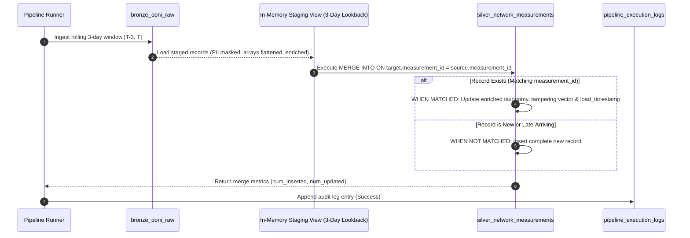

# Lakehouse Execution & Parameterized Backfill Guide
## Project Panopticon: Production Operations Runbook

---

### Executive Purpose
This guide provides data engineers, evaluators, and system operators with the exact operational instructions to execute, configure, and backfill **Project Panopticon** pipelines. 

The pipeline is built on **Apache Spark 3.5** and **Delta Lake 3.0**, engineered to run seamlessly across:
1. **Databricks Community Edition** (Interactive Notebooks with Databricks Widgets)
2. **Local Development Environment** (PySpark via standard CLI arguments)
3. **Azure Databricks** (Automated job clusters with JSON job parameters)

---

## 1. Execution Modes Overview

The pipeline strictly separates execution concerns into three operational modes via parameterized switches:

```text
                                 [Execution Trigger]
                                          │
            ┌─────────────────────────────┼─────────────────────────────┐
            ▼                             ▼                             ▼
   MODE 1: FULL BOOTSTRAP       MODE 2: INCREMENTAL BATCH     MODE 3: HISTORICAL BACKFILL
   ──────────────────────       ─────────────────────────     ───────────────────────────
   • One-time historical load   • Daily scheduled micro-batch • On-demand date range recovery
   • Reads 5-7 day baseline     • Reads yesterday's 24h delta • Reprocesses failed partitions
   • Overwrites/initializes     • Delta MERGE INTO (Upsert)   • Idempotent state reconciliation
   • Builds reference tables    • Appends operational log     • Zero duplicate records
```

| Execution Parameter | Full Load Baseline | Daily Incremental Load (3-Day Lookback) | Parameterized Backfill |
| :--- | :--- | :--- | :--- |
| `--load-type` / Widget | `full` | `incremental` | `backfill` |
| `--batch-date` / Widget| `2026-09-20` (Start Date) | Current UTC Date (e.g. `2026-09-28`) | Any Historical Date (e.g. `2026-09-22`) |
| `--country-code` / Widget| Focus country (`IR`, `PK`, `RU`) | Monitored country (`IR`, `PK`) | Historical target (`IR`, `PK`) |
| `--max-records` / Widget| `1000` - `5000` | `1000` - `2000` | Target batch size |
| `--lookback-days` / Widget| `0` (or full date range) | `3` (Rolling lookback $T-3$ to $T$) | `0` (Target partition only) |
| **Bronze Write Mode** | `overwrite` with scoped `replaceWhere` (`(probe_cc, measurement_date)`) | `overwrite` with scoped `replaceWhere` or keyed Delta `MERGE INTO` | `overwrite` with scoped `replaceWhere` (target country & date) |
| **Silver Write Mode** | Delta `MERGE INTO` | Delta `MERGE INTO` | Delta `MERGE INTO` |
| **Audit Log Entry** | `load_type = 'Full'` | `load_type = 'Incremental'` | `load_type = 'Backfill'` |

---

## 2. Environment Setup & Prerequisites

### 2.1 Databricks Serverless Compute & Unity Catalog Volumes Setup (Recommended)
Databricks Serverless Compute with Photon Engine operates under Unity Catalog governance:
1. **Target Storage**: Data lands under Unity Catalog Volumes at `/Volumes/workspace/default/panopticon/`.
2. **Serverless Configuration Safeguards**:
   * Direct JVM configuration (`spark.sparkContext._jsc`) throws `[JVM_ATTRIBUTE_NOT_SUPPORTED]` on Spark Connect / Serverless.
   * Delta optimizations like `optimizeWrite` and `autoCompact` are automatically managed by the Serverless control plane; attempting to set them via `conf.set()` raises `AnalysisException`.
   * Runtime configuration is centralized in `notebooks/00_config.py` using `_safe_conf_set()` to apply tunable settings (`spark.sql.shuffle.partitions = 4`) while cleanly ignoring Serverless-managed properties without crashing.
3. **Photon Engine `_corrupt_record` Safeguard**: Photon disallows filtering solely on `_corrupt_record` directly from streaming raw JSON files (`[UNSUPPORTED_FEATURE.QUERY_ONLY_CORRUPT_RECORD_COLUMN]`), and `.cache()` is disabled on Serverless. The pipeline materializes `df_raw` to a temporary Delta staging path before splitting valid and quarantined records.
4. **Volume Directory Structure**:
   ```text
   /Volumes/workspace/default/panopticon/
   ├── raw/<batch_date>/            # Programmatically staged JSONL files (isolated by ooni_{country}_*.json)
   ├── bronze/bronze_ooni_raw/      # Bronze Delta Lake table (partitioned by probe_cc, measurement_date)
   ├── bronze/quarantine_ooni_raw/  # Corrupt JSON quarantine Delta table
   ├── reference/citizenlab_categories/ # Delta reference table (2,396 records)
   └── logs/pipeline_execution_logs/    # Operational Delta audit logs
   ```

### 2.2 Databricks Community Edition Setup ($0.00 Cost / Classic DBFS)
1. Register and log in at [https://community.cloud.databricks.com/](https://community.cloud.databricks.com/).
2. Create a single-node cluster:
   * **Runtime Version**: Databricks Runtime 14.3 LTS or 15.4 LTS (Apache Spark 3.5.0, Scala 2.12).
   * **Node Type**: Standard Free Instance (15 GB Memory, 2 Cores).
3. Under **Advanced Options** $\rightarrow$ **Spark Config**, add the mandatory memory safeguards and S3 anonymous credential configuration:
   ```properties
   spark.sql.shuffle.partitions 4
   spark.databricks.delta.optimizeWrite.enabled true
   spark.databricks.delta.autoCompact.enabled true
   spark.sql.streaming.forceDeleteTempCheckpointLocation true
   fs.s3a.aws.credentials.provider org.apache.hadoop.fs.s3a.AnonymousAWSCredentialsProvider
   ```
4. Set up the PII Pepper Salt Secret:
   ```python
   # Run once in a scratch notebook cell
   dbutils.secrets.put(scope="panopticon_vault", key="ip_salt", string="FAST_NUCES_PANOPTICON_SALT_2026")
   ```

### 2.3 Local PySpark Setup (Native / Virtual Environment)
1. Ensure **Python 3.10+** and **Java 11 or 17** (OpenJDK) are installed.
2. Install project dependencies:
   ```bash
   pip install pyspark==3.5.0 delta-spark==3.0.0 requests python-docx
   ```
3. Set your environment variable for local salt protection:
   ```bash
   # Windows PowerShell
   $env:PANOPTICON_SALT="FAST_NUCES_PANOPTICON_SALT_2026"
   
   # Linux / macOS
   export PANOPTICON_SALT="FAST_NUCES_PANOPTICON_SALT_2026"
   ```

---

## 3. Interactive Execution on Databricks

When running inside Databricks, pipeline notebooks expose GUI interactive dropdowns and text widgets (`dbutils.widgets`):

### 3.1 Parameter Widgets Configuration

```python
# Defined in notebooks/00_config.py & notebooks/01_bronze_ingestion.py
dbutils.widgets.text("batch_date", "2026-09-27", "Batch Date (YYYY-MM-DD)")
dbutils.widgets.dropdown("load_type", "full", ["full", "incremental", "backfill"], "Load Type")
dbutils.widgets.dropdown("country_code", "IR", ["PK", "IR", "RU", "MM", "CN", "BY"], "Country Code")
dbutils.widgets.text("max_records", "1000", "Max Records to Fetch")
dbutils.widgets.text("lookback_days", "3", "Lookback Days (Rolling Window)")
```

### 3.2 Automated Ingestion Flow (Instructor Mandate: Pure API, Zero Manual Uploads)

Under course guidelines, manual data uploads via the Databricks UI or local upload widgets are strictly prohibited. The pipeline executes end-to-end programmatically:

1. **Step 1A: Programmatic Citizen Lab Taxonomy Ingestion**:
   - Downloads category mappings and monitored URLs directly from the Citizen Lab GitHub raw API (`https://raw.githubusercontent.com/citizenlab/test-lists/...`).
   - Validates categories against the official whitelist of 27 sociological categories.
   - Persists to Delta reference table `ref_citizenlab_categories` (2,396 records). Skips download if the table is already populated.
2. **Step 1B: Programmatic OONI REST API Telemetry Ingestion**:
   - Queries OONI Measurement API (`https://api.ooni.io/api/v1/measurements`) for the specified country and date range.
   - Employs a multi-threaded worker pool (`ThreadPoolExecutor(max_workers=8)`) to stream complete test payloads.
   - Stringifies polymorphic JSON objects (e.g. `test_keys`) into valid JSON strings before file emission.
   - Lands raw JSONL batch files directly into the Volume raw directory: `/Volumes/workspace/default/panopticon/raw/<batch_date>/<country_code>_measurements.jsonl`.
3. **Step 2: Strict Schema-on-Read Contract**:
   - Reads the staged JSONL using the 23-field explicit `BRONZE_OONI_SCHEMA` (`inferSchema=False`).
   - Configures `mode="PERMISSIVE"` and `columnNameOfCorruptRecord="_corrupt_record"`.
4. **Step 3: Photon-Safe Materialization & Partition-Level Idempotent Write**:
   - Materializes the raw read to a temporary Delta staging path (`<bronze_path>_temp_staging`) to safely evaluate `_corrupt_record` under the Photon Engine.
   - Routes malformed JSON lines to `quarantine_ooni_raw`.
   - Writes valid records to `bronze_ooni_raw` using scoped partition overwrite `mode("overwrite").option("replaceWhere", f"probe_cc = '{country_code}' AND measurement_date = '{target_date}'")` or keyed Delta `MERGE INTO` on composite natural keys (`report_id`, `input`, `measurement_start_time`). This guarantees that reruns replace only the target country-date directory with zero row duplication and without erasing other countries or historical dates.
   - Commits execution metrics to `pipeline_execution_logs` via `PipelineAuditor`.

### 3.3 Running the Standard Daily Incremental Run (With 3-Day Lookback)
1. Set **Batch Date**: `2026-09-28`
2. Set **Load Type**: `incremental`
3. Set **Country Code**: `PK` (or `IR`)
4. Set **Lookback Days**: `3`
5. Click **Run All** in Databricks.
6. The runner invokes:
   - `00_audit_logger`: Creates execution run entry (`status = 'Running'`).
   - `01_bronze_ingestion`: Ingests sliding window `[2026-09-25, 2026-09-28]`, validates schema, diverts corrupted records to `quarantine_ooni_raw`, and writes valid data to `bronze_ooni_raw`.
   - `02_silver_transformation`: Hashes PII, explodes protocol arrays, categorizes tampering vectors, joins Citizen Lab categories, and performs Delta `MERGE INTO`.
   - `00_audit_logger`: Finalizes entry with `rows_read`, `rows_inserted` (new & late arrivals), `rows_updated` (enrichment changes), and `status = 'Success'`.

### 3.4 Running an On-Demand Historical Backfill
If upstream OONI data for `2026-09-22` was delayed or a transformation bug was resolved:
1. Set **Batch Date**: `2026-09-22`
2. Set **Load Type**: `backfill`
3. Set **Country Code**: Target country (e.g. `IR`)
4. Set **Lookback Days**: `0` (Target date only)
5. Click **Run All**.
6. The pipeline re-ingests the partition idempotently. In Bronze, scoped `replaceWhere` cleanly overwrites the target country-date partition; in Silver, `MERGE INTO` updates enriched attributes without creating duplicate rows.

---

## 4. Automated CLI Execution (Local & CI/CD)

The repository provides a standalone orchestration runner `notebooks/run_pipeline.py` for terminal execution.

### 4.1 CLI Command Syntax

```bash
python notebooks/run_pipeline.py \
    --batch-date "2026-09-27" \
    --load-type "incremental" \
    --country-code "IR" \
    --max-records 1000 \
    --lookback-days 3 \
    --source-dir "data/samples/" \
    --lakehouse-root "/Volumes/workspace/default/panopticon/" \
    --pepper-salt "FAST_NUCES_PANOPTICON_SALT_2026"
```

### 4.2 CLI Argument Specifications

| Argument Flag | Type | Default Value | Description |
| :--- | :--- | :--- | :--- |
| `--batch-date` | `string` | Yesterday's UTC Date | Target date partition formatted as `YYYY-MM-DD`. |
| `--load-type` | `string` | `incremental` | Processing mode: `full`, `incremental`, or `backfill`. |
| `--country-code` | `string` | `IR` | Two-letter ISO country code (`IR`, `PK`, `RU`, `MM`, `CN`, `BY`). |
| `--max-records` | `integer` | `1000` | Target maximum records to fetch via the OONI API. |
| `--lookback-days`| `integer`| `3` | Number of trailing days to scan to catch late-arriving measurements. |
| `--source-dir` | `string` | `data/samples/` | Input path (local directory, S3 URI, or Volume landing path). |
| `--lakehouse-root` | `string` | `/Volumes/workspace/default/panopticon/` | Root path where Bronze, Silver, Reference, and Log tables reside. |
| `--pepper-salt` | `string` | From Environment | Secret pepper string used for HMAC-SHA256 IP anonymization. |
| `--max-bytes-trigger`| `string`| `512mb` | Micro-batch size boundary for JVM heap memory protection. |

---

## 5. Idempotency, Late Arrivals & Delta Lake Upsert Mechanics

### 5.1 Why Re-running Never Corrupts Data (The 3 Operational Roles of MERGE)
Raw OONI telemetry represents immutable probe event logs—upstream OONI never mutates past measurements. Consequently, Delta Lake `MERGE INTO` in Project Panopticon is engineered for three specific production purposes:

1. **Catching Late-Arriving Telemetry (Rolling 3-Day Lookback Window)**:  
   Probe devices (especially mobile clients on Android/iOS under state censorship or network blackouts) store test results offline and upload them days later. By scanning a sliding window $[T-3, T]$, previously processed records match on `measurement_id`, while newly synced late records take the `WHEN NOT MATCHED` branch and are cleanly inserted.
2. **Dimensional Re-Enrichment in Silver**:  
   While raw probe packets are immutable, the Silver layer joins with contextual threat intelligence (Citizen Lab URL taxonomy and ASN ISP registries). When Citizen Lab updates a domain's categorization (e.g., from `UNCLASSIFIED` to `CIRCUMVENTION_TOOLS`) or when tampering classification algorithms are refined, `WHEN MATCHED` updates the enriched columns without needing to re-ingest raw files.
3. **Pipeline Idempotency & Fault Recovery**:  
   If an incremental batch crashes halfway or is re-triggered after a bug fix, `MERGE INTO` updates audit columns (`load_timestamp`, `_batch_id`) without duplicating rows.



### 5.2 The Silver `MERGE INTO` SQL Pattern
```sql
MERGE INTO silver_network_measurements AS target
USING staged_silver_batch AS source
ON target.measurement_id = source.measurement_id
WHEN MATCHED AND (
    NOT (target.content_category <=> source.content_category) OR
    NOT (target.tampering_vector <=> source.tampering_vector) OR
    NOT (target.is_anomaly <=> source.is_anomaly) OR
    NOT (target.dns_anomaly_flag <=> source.dns_anomaly_flag) OR
    NOT (target.tcp_anomaly_flag <=> source.tcp_anomaly_flag) OR
    NOT (target.tls_anomaly_flag <=> source.tls_anomaly_flag) OR
    NOT (target.http_anomaly_flag <=> source.http_anomaly_flag)
) THEN
  UPDATE SET
    target.event_timestamp = source.event_timestamp,
    target.tampering_vector = source.tampering_vector,
    target.is_anomaly = source.is_anomaly,
    target.dns_anomaly_flag = source.dns_anomaly_flag,
    target.tcp_anomaly_flag = source.tcp_anomaly_flag,
    target.tls_anomaly_flag = source.tls_anomaly_flag,
    target.http_anomaly_flag = source.http_anomaly_flag,
    target.content_category = source.content_category,
    target.category_description = source.category_description,
    target.human_rights_risk_tier = source.human_rights_risk_tier,
    target.load_timestamp = current_timestamp(),
    target._batch_id = source._batch_id
WHEN NOT MATCHED THEN
  INSERT *;
```

---

## 6. Schema Drift, Quarantine & Error Recovery

### 6.1 Schema Drift Strategy
When OONI releases new test types or adds keys to `test_keys`:
1. **Safe Evolution**: For new nullable root columns, the pipeline enables `.option("mergeSchema", "true")` during Delta writes.
2. **Corrupted Record Trapping**: Raw lines that fail JSON structural syntax are captured into `_corrupt_record` using Spark's `mode="PERMISSIVE"`.

### 6.2 Inspecting and Reprocessing Quarantined Rows
If corrupted records were diverted to `quarantine_ooni_raw`, inspect them via SQL:

```sql
-- View top quarantine errors for a given batch
SELECT rejection_reason, COUNT(*) as count, MIN(quarantine_timestamp) as first_seen
FROM quarantine_ooni_raw
WHERE _batch_id = 'BATCH_20260927_INCREMENTAL'
GROUP BY rejection_reason;

-- Inspect raw malformed payload
SELECT raw_payload 
FROM quarantine_ooni_raw 
WHERE rejection_reason = 'JSON_SYNTAX_ERROR' 
LIMIT 5;
```

Once the upstream format error is patched:
1. Correct the parser in `01_bronze_ingestion.py`.
2. Re-trigger the batch in `backfill` mode.

### 6.3 Photon Engine & Serverless Corrupt Record Handling
On Databricks Serverless Compute (Photon Engine), queries filtering solely on `_corrupt_record` directly from streaming raw JSON files raise `[UNSUPPORTED_FEATURE.QUERY_ONLY_CORRUPT_RECORD_COLUMN]`, and DataFrame `.cache()` is disabled. The production pipeline implements a temporary Delta materialization staging pattern:

```python
# Materialize raw JSON to temporary Delta staging
temp_staging_path = f"{bronze_path}_temp_staging"
df_raw.write.format("delta").mode("overwrite").option("overwriteSchema", "true").save(temp_staging_path)
df_materialized = spark.read.format("delta").load(temp_staging_path)

# Safe separation on materialized Delta dataset
df_valid     = df_materialized.filter(col("_corrupt_record").isNull()).drop("_corrupt_record")
df_quarantine = df_materialized.filter(col("_corrupt_record").isNotNull())

# Write quarantine if malformed rows exist
if df_quarantine.count() > 0:
    df_quarantine.write.format("delta").mode("append").save(quarantine_path)

# Write valid records idempotently scoped to partition
df_valid_staged.write.format("delta").mode("overwrite").option("replaceWhere", f"measurement_date = '{batch_date}'").save(bronze_path)
```

---

## 7. Operational Audit Verification Queries

After every execution, verify run health using the `pipeline_execution_logs` Delta table:

```sql
-- Check last 10 pipeline executions
SELECT 
    log_id,
    pipeline_layer,
    batch_parameter,
    load_type,
    status,
    rows_read,
    rows_inserted,
    rows_updated,
    rows_quarantined,
    duration_seconds,
    start_time
FROM pipeline_execution_logs
ORDER BY start_time DESC
LIMIT 10;
```

### Acceptance Test Checklist & Empirical Validation:
* [x] **Pipeline Health**: `status` is `'Success'` (zero uncaught exceptions).
* [x] **Audit Conservation**: `rows_read` equals `rows_inserted + rows_updated + rows_quarantined`.
* [x] **Taxonomy Reference Load**: `ref_citizenlab_categories` synchronized programmatically with **2,396 records**; re-runs skip download.
* [x] **Empirical Telemetry Ingestion**: Ingested live OONI batches for **Iran (`IR`, 497 records)** and **Pakistan (`PK`, 50 records)** = **547 records total** in `bronze_ooni_raw` for partition `2026-09-27` (raw size ~38.2 MB JSON).
* [x] **Zero Quarantine Contamination**: Exactly **0 corrupted rows** (`rows_quarantined = 0`), proving schema alignment.
* [x] **Partition-Level Idempotency**: Re-running the batch overwrites the target partition via `replaceWhere` without accumulating duplicate rows in Bronze.
* [x] **Silver MERGE Invariant**: In an incremental rerun of the same file, `rows_inserted` is `0`, and `rows_updated` reflects only true dimensional or tampering vector differences (NULL-safe `<=>` comparison).
* [x] **Runtime Performance**: Total execution runtime on Serverless / Community Edition is under 120 seconds per batch.

---

## 8. Delta Lake Storage Maintenance Protocol

Run these maintenance routines periodically to maintain query performance and manage storage quotas.

> **⚠️ Community Edition OPTIMIZE Warning (Verified from Delta Lake docs):**
> `OPTIMIZE` is a full-partition rewrite operation. Without a `WHERE` clause it rewrites **all partitions**, which on a 9.5 GB JVM heap will OOM on datasets exceeding ~3-4 million rows. Always scope OPTIMIZE to a single date or short date range using a `WHERE` clause. Do NOT run unscoped `OPTIMIZE` on Community Edition.

```sql
-- CORRECT on Community Edition: scope to active date window only
-- Source: docs.delta.io — "Use WHERE clauses to limit data processed in a single OPTIMIZE"
OPTIMIZE silver_network_measurements
WHERE measurement_date >= date_sub(current_date(), 7)
ZORDER BY (probe_cc, tampering_vector);

-- DO NOT run unscoped OPTIMIZE on Community Edition:
-- OPTIMIZE silver_network_measurements ZORDER BY (probe_cc, probe_asn, tampering_vector);  <-- DANGEROUS

-- Step 2: Clean up historical transaction logs and tombstoned snapshots older than 7 days
VACUUM silver_network_measurements RETAIN 168 HOURS;

-- Step 3: Optimize operational audit table (small table, safe unscoped)
OPTIMIZE pipeline_execution_logs
ZORDER BY (start_time, pipeline_layer);
VACUUM pipeline_execution_logs RETAIN 720 HOURS;
```

> **Alternative for DBR 15.4 LTS+**: Delta Lake recommends **Liquid Clustering** over Z-Ordering on newer runtimes. Unlike ZORDER (full rewrite), Liquid Clustering is incremental and only rewrites changed data. If your cluster runs DBR 15.4 LTS or above, replace ZORDER with:
> ```sql
> ALTER TABLE silver_network_measurements
> CLUSTER BY (probe_cc, measurement_date, tampering_vector);
> -- Then run OPTIMIZE without ZORDER — clustering is applied incrementally
> OPTIMIZE silver_network_measurements WHERE measurement_date >= date_sub(current_date(), 7);
> ```

---

## 9. Automated Verification & Unit Test Runbook

Project Panopticon includes a dedicated 27-test automated verification suite in [`tests/test_phase1_bronze_isolation.py`](../../tests/test_phase1_bronze_isolation.py) that validates schema contracts, partition isolation, manifest validation hoisting, and regression fixes.

### 9.1 Offline Unit Testing (Local / CI without Spark)
The test suite includes complete offline mock schemas and fixtures. Evaluators can run the offline tests in under 1 second without a Spark cluster:

```bash
# Run the test suite via standard Python unittest
python -m unittest tests/test_phase1_bronze_isolation.py
```
* **Offline Execution**: Runs 11 offline unit tests covering schema definition, nullability invariants, manifest sidecar generation, and hash generation (`Ran 27 tests in 0.007s — OK (skipped=16)`).
* **Integration Tests**: The 16 Delta Lake and Spark integration tests automatically detect local environment availability (`HAS_PYSPARK`) and skip cleanly if Apache Spark is not installed.

### 9.2 Databricks Community Edition & Serverless Notebook Execution
The test script is formatted as a native Databricks notebook with `# Databricks notebook source` tags:
1. Import `tests/test_phase1_bronze_isolation.py` into your Databricks workspace.
2. Attach it to your interactive cluster (Community Edition) or Serverless compute.
3. Click **Run All**.
4. Cell 1 sets up imports and schema contracts.
5. Cell 2 executes all 27 unit and integration tests live against Unity Catalog Volume scratch space (`/Volumes/workspace/default/panopticon/scratch/test_isolation_...`):
   - Verifies that writing Pakistan (`PK`) data for `2026-09-27` leaves Iran (`IR`) data for `2026-09-27` intact.
   - Verifies that incremental writes do not wipe out historical dates `[T-lookback, T-1]`.
   - Verifies that manifest scope validation executes before table creation.
   - Verifies that raw JSON staging filters files by `ooni_{clean_cc}_*.json` to eliminate multi-country staging bleed.
