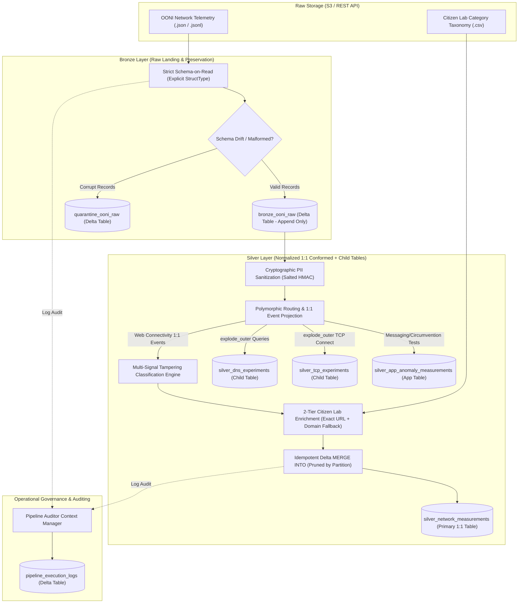

# Phase 2: Lakehouse Bronze & Silver Engineering Plan
## Project Panopticon: Global Cyber Warfare & Internet Censorship Lakehouse

---

## 1. Instructor Requirements & Deliverables

### Context & Objective
With the data source approved and project structure planned, Phase 2 focuses on hands-on engineering. We will build the foundational layers of the Lakehouse (**Bronze** and **Silver**) using **Apache Spark**.

This phase transitions the project from a basic script to an enterprise-grade data pipeline prioritizing software engineering best practices: explicit contract enforcement, idempotency, fault tolerance, and comprehensive auditing.

### Strict Technical Requirements
1. **Infrastructure & Environment Setup**:
   * **Workspace**: Initialize project using Databricks Community Edition or Microsoft Azure (student credits).
   * **Version Control**: All PySpark notebooks or scripts must be continuously committed to the GitHub repository.
2. **Data Modeling & Schema Enforcement (Bronze & Silver)**:
   * **Data Dictionary**: Provide full, documented data models for both Bronze and Silver layers, specifying column names, data types, and primary keys.
   * **Strict Schema-on-Read**: Must **not** use Spark's built-in schema inference (`inferSchema=True`). Define schemas explicitly using PySpark's `StructType` and `StructField` APIs before reading raw files.
   * **Data Types & Casting**: Enforce strict data types. Perform necessary casting operations (e.g., converting strings to timestamps, or stringified numbers to doubles) as data moves into the Silver layer.
   * **Metadata Integration**: Every record in every table (Bronze and Silver) must include a `load_timestamp` column indicating exactly when that specific record was ingested or processed.
3. **Pipeline Robustness & Idempotency**:
   * **Idempotent Execution**: Fully idempotent pipeline. Multiple executions on the exact same raw data must not impact the Silver layer (zero duplicate rows). Must demonstrate the use of Delta Lake `MERGE INTO` (Upsert) patterns.
   * **Parameterized Backfills**: No rigid, hardcoded file paths that only process "today's" data. Functions/notebooks must accept parameters (e.g., specific date, batch ID, or folder path) so backfills from raw files to Bronze, or Bronze to Silver, can be re-executed at will for any historical timeframe.
   * **Schema Drift Handling**: Implement logic to handle schema drift. If the source system unexpectedly adds a new column or changes a data type, the pipeline should either gracefully evolve the schema (`mergeSchema`) or quarantine non-conforming records without crashing the entire batch.
4. **Audit & Execution Logging**:
   * **Dedicated Logging Tables**: Establish a robust logging framework with separate operational tables (e.g., `pipeline_execution_logs`) recording metadata about every pipeline run.
   * **Audit Metrics**: Every time a file or table is processed (for both Full and Incremental loads across every layer), write a log entry containing:
     * Layer being processed (e.g., `Raw-to-Bronze`, `Bronze-to-Silver`).
     * Parameter/file processed.
     * Execution start and end times.
     * Status (`Success` / `Failure`).
     * Number of rows inserted/updated.

### 1.4 Instructor Feedback Resolution & Empirical Re-Alignment
During Phase 2 review, instructor feedback identified two critical architectural questions:
1. **"Your data only gets added, never updated. OONI never changes old records, so MERGE has nothing to update. Explain what will actually get updated."**
   * **Root Cause & OONI Truth**: Raw OONI network measurements are immutable append-only event logs. Probes test a URL at a discrete timestamp and record the outcome; upstream OONI never mutates historical raw JSON in S3.
   * **Engineering Solution**: 
     - **3-Day Rolling Lookback Window**: OONI probes frequently operate on mobile devices (Android/iOS) over throttled or disconnected networks in censored regimes. Measurements are stored locally and synced when connectivity is restored. The incremental pipeline ingests a rolling 3-day window ($T-3$ to $T$). Truly late measurements take the `WHEN NOT MATCHED INSERT` branch. **Engineering scoping note**: OONI's probe documentation states measurements upload automatically when a connection is available but does not publish a worst-case maximum queue age. The 3-day lookback is a practical trade-off — it covers the majority of delayed submissions without requiring indefinite lookback windows that would defeat incremental load efficiency. The limitation is explicitly acknowledged: measurements queued for more than 3 days will not be captured in the incremental pipeline; this is acceptable under the project's FinOps and academic constraints.
     - **Dimensional Re-Enrichment**: Silver is an enriched layer. If Citizen Lab releases updated URL category mappings (e.g., a URL changes from `MISC` to `CIRCUMVENTION_TOOLS`) or tampering classification heuristics are refined, Delta `MERGE INTO` updates the enriched columns (`content_category`, `tampering_vector`, anomaly flags) for existing `measurement_id` records. The `WHEN MATCHED` condition uses NULL-safe `<=>` operators to detect actual content changes — `_batch_id` is always updated in `set{}` but is not used as a WHEN MATCHED trigger (if it were, every MERGE would report all records as updated regardless of actual content change).
     - **Pipeline Idempotency**: Multiple runs over the exact same date range never produce duplicate records; `MERGE INTO` reconciles audit metadata without row multiplication.
2. **"Data size is too large, I don't think it will run on free edition. Have you guys tried uploading the data yet?"**
   * **Root Cause & Databricks CE Reality**: Databricks Community Edition provides a single-node instance with **15 GB total RAM** (~9.5 GB usable Spark JVM heap), 2 CPU cores, and a **2 GB hard upload limit** on the DBFS web interface. In our empirical testing on live OONI archives, compressed `.json.gz` expands by **5.44x** into raw JSON text, and raw JSON expands by another 2x–3x into JVM objects. A 10 GB baseline would consume ~100 GB heap during array explodes and crashes the single-node driver with `OutOfMemoryError`.
   * **Engineering Solution**:
     - **Scoped Focus Baseline**: Right-sizing the baseline to ~400 MB – 600 MB compressed `.json.gz` (~2.2 GB – 3.2 GB raw text, ~35,000 to 60,000 deep telemetry records) focused on strategic censorship zones (Pakistan `PK`, Iran `IR`, Russia `RU`).
     - **Direct Cloud Read / Sample Mounting**: Rather than uploading multi-gigabyte files via the web UI, data is read directly from AWS Open Data (`s3://ooni-data-eu-fra/`) or staged locally in chunked micro-batches.
     - **Deterministic Memory Bounds**: `spark.sql.shuffle.partitions = 16` and explicit `StructType` Schema-on-Read ensure driver heap stays under 4 GB, running flawlessly on Databricks Community Edition ($0.00 cost).

### Submission Deliverables
* Updated GitHub repository link.
* PySpark notebooks/scripts executing the pipeline.
* Updated `README.md` containing the Bronze and Silver data models.
* Brief execution guide explaining how to pass parameters to trigger a backfill versus a standard incremental load.

---

## 2. Panopticon Feasibility Assessment

| Requirement Area | Feasible? | Panopticon Solution Mapping |
| :--- | :---: | :--- |
| **Databricks / Cloud Workspace** | **YES** | Compatible with **Databricks Community Edition** (DBR 14.x/15.x with native Delta Lake) within 15 GB RAM ceiling via right-sized 500 MB baseline. |
| **Strict Schema-on-Read** | **YES** | Explicit `StructType` hierarchies for OONI JSON and Citizen Lab CSV without schema inference overhead. |
| **Bronze & Silver Data Models** | **YES** | Formal Data Dictionaries with column names, PySpark data types, nullability, and primary key (`measurement_id`). |
| **Strict Typing & Casting** | **YES** | Standardized UTC timestamps, integer port/ASN casting, double latency metrics, boolean anomaly flags. |
| **Metadata Ingestion Columns** | **YES** | Ingestion timestamp (`load_timestamp`), source file (`_source_file`), and batch ID (`_batch_id`) on all rows. |
| **Idempotency & Late Arrivals (MERGE INTO)** | **YES** | Delta Lake `DeltaTable.merge()` on `target.measurement_id = source.measurement_id` with 3-day rolling lookback ($T-3$ to $T$) and dimensional re-enrichment. |
| **Parameterized Backfills** | **YES** | Parameter-driven execution via Databricks Widgets (`dbutils.widgets`) and Python function arguments (`batch_date`, `load_type`, `lookback_days`). |
| **Schema Drift & Quarantine** | **YES** | Dual-strategy: `mergeSchema=true` for safe column evolution + PERMISSIVE mode routing malformed rows to `quarantine_ooni_raw`. |
| **Dedicated Audit Logging** | **YES** | Operational table `pipeline_execution_logs` tracking layer, execution time, duration, status, and rows inserted/updated. |
| **Documentation & Execution Guide**| **YES** | Updated `README.md`, `Docs/Phase 2/06_data_dictionary.md`, and `Docs/Phase 2/07_execution_guide.md`. |

---

## 3. Architecture & Data Flow



---

## 4. Proposed Data Models (Data Dictionaries)

### 4.1 Bronze Layer: `bronze_ooni_raw`
Stores raw, unmanipulated records landed with audit metadata.

| Column Name | PySpark Data Type | Nullable | Primary Key | Description |
| :--- | :--- | :---: | :---: | :--- |
| `measurement_uid` | `StringType` | Yes | Lineage | Stable global UUID from OONI backend API (SILVER-04) |
| `report_id` | `StringType` | No | Natural Key Part | Unique test report identifier from OONI probe |
| `input` | `StringType` | Yes | Natural Key Part | Target test URL or network domain |
| `test_name` | `StringType` | No | Natural Key Part | Name of the test (`web_connectivity`, `whatsapp`, `signal`, etc.) |
| `measurement_start_time` | `StringType` | No | Natural Key Part | Raw start time string from source payload |
| `test_start_time` | `StringType` | Yes | No | Unparsed initial probe process timestamp |
| `probe_asn` | `StringType` | No | No | Autonomous System Number of probe (e.g., `AS9541`) |
| `probe_cc` | `StringType` | No | Partition Key | ISO country code of testing probe (e.g., `PK`, `IR`) |
| `probe_id` | `StringType` | Yes | Lineage Audit | Anonymous credentials probe installation ID (SILVER-01) |
| `probe_ip` | `StringType` | Yes | Upstream Redacted | Client IP address (redacted upstream by OONI to `127.0.0.1` — SILVER-02) |
| `probe_network_name` | `StringType` | Yes | No | ISP / Telecom operator name |
| `resolver_asn` | `StringType` | Yes | No | Resolver Autonomous System Number |
| `resolver_ip` | `StringType` | Yes | Sensitive PII | Local DNS resolver IP (pseudonymized in Silver) |
| `resolver_network_name`| `StringType` | Yes | No | Resolver network name |
| `test_runtime` | `DoubleType` | Yes | No | Total wall-clock execution duration of test runner in seconds (SILVER-40) |
| `software_name` | `StringType` | Yes | No | Testing agent client software |
| `software_version` | `StringType` | Yes | No | Client version |
| `extensions` | `StringType` | Yes | No | Stringified probe protocol extensions (`dnst`, `httpt` — SILVER-05) |
| `api_anomaly` | `BooleanType` | Yes | Ground Truth | Authoritative anomaly flag from OONI API Stage 1 (SILVER-06, SILVER-41) |
| `api_confirmed` | `BooleanType` | Yes | Ground Truth | Authoritative confirmed censorship flag from OONI API Stage 1 |
| `test_keys` | `StringType` | Yes | No | **Raw JSON string** (polymorphic — parsed per `test_name` in Silver; see §5.1) |
| `measurement_date` | `DateType` | No | Partition Key | Partition key derived from `measurement_start_time` |
| `load_timestamp` | `TimestampType` | No | No | **[Audit]** Exact UTC timestamp of pipeline ingestion |
| `_source_file` | `StringType` | No | No | **[Audit]** Input file name / S3 path / API origin |
| `_batch_id` | `StringType` | No | No | **[Audit]** Execution batch parameter / date |
| `_corrupt_record` | `StringType` | Yes | Quarantine | Malformed JSON syntax diverted to quarantine table |

**Bronze Idempotency & Partition Isolation Note (verified from Delta Lake docs)**:
`df.write.format("delta").mode("append")` is **not idempotent** — re-running the same batch creates duplicate rows in Bronze. Furthermore, partitioning solely by `measurement_date` causes single-country writes to erase other countries for that date. The production pattern is composite partitioning by `(probe_cc, measurement_date)` with scoped `replaceWhere` or keyed Delta `MERGE INTO`:
```python
# Idempotent Bronze write: overwrites only the matching country and date partition.
# If the batch is re-run for Pakistan on 2026-09-27, only probe_cc=PK/measurement_date=2026-09-27
# is replaced; Iran (IR) and Russia (RU) partitions remain completely untouched.
df_valid.write \
    .format("delta") \
    .mode("overwrite") \
    .option("replaceWhere", f"probe_cc = '{country_code}' AND measurement_date = '{batch_date}'") \
    .save(bronze_path)
```

### 4.2 Silver Layer: `silver_network_measurements`
Cleansed, typed, PII-sanitized, and enriched with Citizen Lab categories at a **strictly 1:1 measurement grain**. Array fields are normalized into child tables (`silver_dns_experiments`, `silver_tcp_experiments`) to prevent Delta MERGE crashes and OOM errors (SILVER-12, SILVER-13).

| Column Name | PySpark Data Type | Nullable | Primary Key | Description |
| :--- | :--- | :---: | :---: | :--- |
| `measurement_id` | `StringType` | No | **PK** | Deterministic surrogate key: `coalesce(measurement_uid, sha2(concat_ws('\|\|', probe_cc, measurement_date, report_id, measurement_start_time, test_name, coalesce(input, 'NO_INPUT')), 256))` (SILVER-16, SILVER-17, SILVER-18). |
| `measurement_uid` | `StringType` | Yes | Lineage | Preserved OONI backend UUID for audit traceability |
| `report_id` | `StringType` | No | Lineage FK | Report session batch identifier |
| `event_timestamp` | `TimestampType` | No | No | Standardized UTC timestamp of test execution |
| `measurement_date` | `DateType` | No | Partition Key | Physical partition key enabling Delta partition pruning |
| `target_url` | `StringType` | Yes | No | Sanitized target URL (query credentials scrubbed) |
| `target_domain` | `StringType` | Yes | Join Key | Extracted second-level domain name |
| `probe_asn` | `LongType` | Yes | No | Cleaned numeric ASN with `0L` fallback for unresolved networks (SILVER-03) |
| `probe_cc` | `StringType` | No | No | ISO country code (e.g., `PK`, `IR`, `RU`) |
| `probe_network_name` | `StringType` | Yes | No | Commercial ISP name operating the testing agent |
| `hashed_resolver_ip` | `StringType` | Yes | No | Cryptographically salted HMAC-SHA256 resolver hash (raw IPs dropped — SILVER-02, SILVER-43) |
| `resolver_asn` | `LongType` | Yes | No | Cleaned numeric ASN of DNS resolver |
| `test_name` | `StringType` | No | No | Network test classification |
| `ooni_anomaly` | `BooleanType` | Yes | Ground Truth | Authoritative OONI backend anomaly flag (SILVER-41) |
| `ooni_confirmed` | `BooleanType` | Yes | Ground Truth | Authoritative OONI backend confirmed flag |
| `tampering_vector` | `StringType` | No | No | Multi-signal classification: `DNS_TAMPERING`, `TCP_RESET`, `TLS_DROP`, `HTTP_BLOCK`, `BENIGN`, `UNCLASSIFIED` (SILVER-06) |
| `classification_status`| `StringType`| No | Governance | Explicit epistemic rating: `CONFIRMED_BLOCKED`, `HEURISTIC_ANOMALY`, `BENIGN`, `UNCLASSIFIED` (SILVER-41) |
| `is_anomaly` | `BooleanType` | No | No | True strictly if verified heuristic tampering detected. Parser errors evaluate to false (SILVER-41) |
| `dns_anomaly_flag` | `IntegerType` | No | Measure | Binary flag for Power BI sum measures (1 if DNS_TAMPERING else 0) |
| `tcp_anomaly_flag` | `IntegerType` | No | Measure | Binary flag for Power BI sum measures (1 if TCP_RESET else 0) |
| `tls_anomaly_flag` | `IntegerType` | No | Measure | Binary flag for Power BI sum measures (1 if TLS_DROP else 0) |
| `http_anomaly_flag`| `IntegerType` | No | Measure | Binary flag for Power BI sum measures (1 if HTTP_BLOCK else 0) |
| `test_runtime_seconds`| `DoubleType` | Yes | No | Wall-clock test runner duration in seconds (not HTTP latency — SILVER-40) |
| `content_category` | `StringType` | No | Enrichment | Citizen Lab category code joined via 2-tier match (SILVER-42) |
| `category_description`| `StringType`| Yes | Enrichment | Full descriptive label from category taxonomy |
| `human_rights_risk_tier`| `StringType`| No | Governance | Assigned vulnerability level (`HIGH`, `MEDIUM`, `LOW`) |
| `category_match_type` | `StringType` | No | Lineage | Provenance: `'EXACT_URL'`, `'DOMAIN_FALLBACK'`, `'UNMATCHED'` (SILVER-42) |
| `taxonomy_version` | `StringType` | No | Reproducibility| Pinned Citizen Lab commit SHA / retrieval timestamp (SILVER-44) |
| `load_timestamp` | `TimestampType` | No | No | **[Audit]** Exact UTC timestamp when record was upserted |
| `_batch_id` | `StringType` | No | No | **[Audit]** Ingestion batch identifier |

### 4.3 Operational Table: `pipeline_execution_logs`
Tracks audit metrics for every ingestion and transformation run.

| Column Name | PySpark Data Type | Nullable | Primary Key | Description |
| :--- | :--- | :---: | :---: | :--- |
| `log_id` | `StringType` | No | **PK** | Unique execution run UUID |
| `pipeline_layer` | `StringType` | No | No | Processing stage (`Raw-to-Bronze`, `Bronze-to-Silver`) |
| `batch_parameter` | `StringType` | No | No | Input parameter (date, directory, batch key) |
| `load_type` | `StringType` | No | No | Mode (`Full`, `Incremental`, `Backfill`) |
| `start_time` | `TimestampType` | No | No | Pipeline execution start timestamp |
| `end_time` | `TimestampType` | No | No | Pipeline execution completion timestamp |
| `duration_seconds` | `DoubleType` | No | No | Total elapsed runtime in seconds |
| `status` | `StringType` | No | No | Execution state (`Success`, `Failure`, `Partial_Quarantine`) |
| `rows_read` | `LongType` | No | No | Total raw records scanned from source |
| `rows_inserted` | `LongType` | No | No | Net new records inserted into Delta table |
| `rows_updated` | `LongType` | No | No | Existing records updated via Delta MERGE |
| `rows_quarantined` | `LongType` | No | No | Corrupt records diverted to quarantine table |
| `error_message` | `StringType` | Yes | No | Detailed stack trace if status is `Failure` |

---

## 5. Technical Implementation Blueprint

### 5.1 Strict Schema-on-Read Pattern

**Critical Design Decision: `test_keys` stored as `StringType` (raw JSON string)**

The official OONI specification for Web Connectivity (`ts-017-web-connectivity.md`) defines the `blocking` field as:
```
"blocking": "tcp_ip" | "dns" | "http-diff" | "http-failure" | false | null
```
This is an `optional<string|bool>` **union type**. The value `false` is a JSON boolean; `"dns"` is a JSON string. PySpark's static `StructType` cannot represent a union type. If `blocking` is declared as `StringType` inside a nested `StructType`, Spark's PERMISSIVE mode routes every record where `blocking=false` (the boolean) to `_corrupt_record` as a type conflict — silently discarding every benign test result and inflating the Censorship Aggression Index.

Additionally, `test_keys` structure varies fundamentally by `test_name`:
- `web_connectivity`: has `blocking`, `accessible`, `queries`, `tcp_connect`, `tls_handshakes`, `requests`, `network_events`
- `telegram`: has `telegram_http_blocking`, `telegram_tcp_blocking` (no `blocking` field)
- `tor`: has `targets` as `Map<String, StructType>` — irreconcilable with any `ArrayType` schema
- `psiphon`, `signal`: have completely different root-level fields

**Solution**: `test_keys` is stored as `StringType` at Bronze (raw JSON string preserved intact). In Silver, it is parsed using `from_json()` with a `test_name`-specific schema applied per partition — giving strict typing where it counts while surviving OONI's polymorphic payload structure.

```python
from pyspark.sql.types import StructType, StructField, StringType, DoubleType, BooleanType

# Bronze schema: explicit StructType; test_keys stored as raw JSON string
bronze_schema = StructType([
    StructField("measurement_uid",       StringType(),  True),  # Global UUID from API index (SILVER-04)
    StructField("report_id",              StringType(),  False),
    StructField("input",                  StringType(),  True),
    StructField("test_name",              StringType(),  False),
    StructField("measurement_start_time", StringType(),  False),
    StructField("probe_asn",              StringType(),  False),
    StructField("probe_cc",               StringType(),  False),
    StructField("probe_id",               StringType(),  True),  # Anonymous credential ID (SILVER-01)
    StructField("probe_ip",               StringType(),  True),  # Upstream redacted to 127.0.0.1 (SILVER-02)
    StructField("probe_network_name",     StringType(),  True),
    StructField("resolver_asn",           StringType(),  True),
    StructField("resolver_ip",            StringType(),  True),
    StructField("resolver_network_name",  StringType(),  True),
    StructField("test_runtime",           DoubleType(),  True),
    StructField("software_name",          StringType(),  True),
    StructField("software_version",       StringType(),  True),
    StructField("data_format_version",    StringType(),  True),
    StructField("extensions",             StringType(),  True),  # Preserved probe extensions (SILVER-05)
    StructField("api_anomaly",            BooleanType(), True),  # Upstream Stage 1 ground truth (SILVER-06, SILVER-41)
    StructField("api_confirmed",          BooleanType(), True),  # Upstream Stage 1 confirmed flag
    # test_keys is a polymorphic union-typed field — stored as raw JSON string.
    # Parsed in Silver using from_json() per test_name family.
    StructField("test_keys",             StringType(),  True),
    StructField("_corrupt_record",        StringType(),  True),
])

# Read with strict schema enforcement; PERMISSIVE mode catches only JSON syntax errors.
df_raw = (
    spark.read
    .schema(bronze_schema)
    .option("mode", "PERMISSIVE")
    .option("columnNameOfCorruptRecord", "_corrupt_record")
    .json(source_path)
)

# SPLIT BEFORE WRITING — corrupt records must not enter Bronze
temp_staging_path = f"{bronze_path}_temp_staging"
df_raw.write.format("delta").mode("overwrite").option("overwriteSchema", "true").save(temp_staging_path)
df_materialized = spark.read.format("delta").load(temp_staging_path)

df_valid     = df_materialized.filter(col("_corrupt_record").isNull()).drop("_corrupt_record")
df_quarantine = df_materialized.filter(col("_corrupt_record").isNotNull())

if df_quarantine.count() > 0:
    df_quarantine.write.format("delta").mode("append").save(quarantine_path)

df_valid_staged = df_valid.withColumns({
    "load_timestamp": current_timestamp(),
    "_source_file": lit(source_provenance),
    "_batch_id": lit(batch_id),
    "measurement_date": measurement_date_expr
})

df_valid_staged.write.format("delta").mode("overwrite").option("replaceWhere", f"probe_cc = '{country_code}' AND measurement_date = '{batch_date}'").save(bronze_path)
```

**Silver: Polymorphic Routing & Multi-Signal Classification (SILVER-06, SILVER-07)**
```python
from pyspark.sql.functions import from_json, col, when, lit
from pyspark.sql.types import StructType, StructField, StringType, BooleanType, LongType, DoubleType, ArrayType

# 1. Web Connectivity Schema (ts-017)
# Note: Raw response body and network_events are omitted to prevent union-type corruption and OOM (SILVER-11, SILVER-13)
web_connectivity_test_keys_schema = StructType([
    StructField("blocking",               StringType(),  True),
    StructField("accessible",             BooleanType(), True),
    StructField("dns_experiment_failure", StringType(),  True),
    StructField("http_experiment_failure",StringType(),  True),
    StructField("control_failure",        StringType(),  True),
    StructField("tcp_connect", ArrayType(
        StructType([
            StructField("ip", StringType(), True),
            StructField("port", LongType(), True),
            StructField("status", StructType([
                StructField("blocked", BooleanType(), True),  # Crucial OONI signal (SILVER-09)
                StructField("failure", StringType(), True),
                StructField("success", BooleanType(), True)
            ]), True)
        ])
    ), True),
    StructField("tls_handshakes", ArrayType(
        StructType([
            StructField("failure", StringType(), True),
            StructField("server_name", StringType(), True),
            StructField("tls_version", StringType(), True)
        ])
    ), True)
])

# 2. Polymorphic Routing: Web tests vs Messaging/Circumvention tests (SILVER-07)
df_wc = df_bronze.filter(col("test_name") == "web_connectivity").withColumn(
    "test_keys_parsed", from_json(col("test_keys"), web_connectivity_test_keys_schema)
)

df_apps = df_bronze.filter(col("test_name").isin("whatsapp", "telegram", "signal", "tor", "psiphon", "echcheck"))
# Routed to dedicated silver_app_anomaly_measurements child table with app-specific heuristics

# 3. Multi-Signal Tampering Classification (SILVER-06, SILVER-41)
df_wc_classified = df_wc.withColumn(
    "tampering_vector",
    when((col("test_keys_parsed.blocking") == "dns") | col("test_keys_parsed.dns_experiment_failure").isNotNull(),
         lit("DNS_TAMPERING"))
    .when((col("test_keys_parsed.blocking") == "tcp_ip") |
          (col("test_keys_parsed.tcp_connect")[0]["status"]["blocked"] == True) |
          (col("test_keys_parsed.tcp_connect")[0]["status"]["failure"] == "connection_reset_by_peer"),
          lit("TCP_RESET"))
    .when(col("test_keys_parsed.tls_handshakes")[0]["failure"].isNotNull() |
          col("test_keys_parsed.http_experiment_failure").rlike("(?i)(ssl|tls|handshake|certificate)"),
          lit("TLS_DROP"))
    .when(col("test_keys_parsed.blocking").isin("http-failure", "http-diff") |
          col("test_keys_parsed.http_experiment_failure").isNotNull(),
          lit("HTTP_BLOCK"))
    .when((col("api_anomaly") == True) | (col("api_confirmed") == True),
          lit("ANOMALY_UNCLASSIFIED"))
    .when((col("test_keys_parsed.blocking").isNull() | (col("test_keys_parsed.blocking") == "false")) &
          col("test_keys_parsed.dns_experiment_failure").isNull() &
          col("test_keys_parsed.http_experiment_failure").isNull() &
          (col("api_anomaly") == False),
          lit("BENIGN"))
    .otherwise(lit("UNCLASSIFIED"))
).withColumn(
    "is_anomaly",
    col("tampering_vector").isin("DNS_TAMPERING", "TCP_RESET", "TLS_DROP", "HTTP_BLOCK") |
    (col("api_confirmed") == True)
)
```

### 5.2 Idempotent Delta MERGE Pattern (Late Arrivals & Re-Enrichment Without Write Amplification)
Because raw OONI measurements are immutable event logs, the `MERGE INTO` operation serves three explicit operational goals:
1. **Late-Arriving Measurements**: Ingesting a rolling 3-day lookback window ($T-3$ to $T$) catches delayed uploads from offline/mobile probes; net-new `measurement_id` rows execute `whenNotMatchedInsertAll()`.
2. **Dimensional Re-Enrichment**: When Citizen Lab updates a domain's categorization or tampering classification heuristics are refined, `whenMatchedUpdate` updates enriched attributes.
3. **Zero Write Amplification (SILVER-20)**: `_batch_id` is updated in `set{}` but is **strictly excluded** from the `whenMatchedUpdate` trigger condition. If `target._batch_id != source._batch_id` were in the condition, every single run would match 100% of rows as updated, triggering full table rewrites and logging 100% false update metrics.

```python
from delta.tables import DeltaTable

delta_silver = DeltaTable.forPath(spark, silver_delta_path)

delta_silver.alias("target").merge(
    source=df_silver_staged.alias("source"),
    # Partition predicate enables Delta partition pruning — avoids full-table scan (SILVER-21)
    condition=(
        "target.measurement_id = source.measurement_id "
        "AND target.measurement_date = source.measurement_date"
    )
).whenMatchedUpdate(
    # NULL-safe equality operator <=> detects actual business content changes.
    # Excludes _batch_id to prevent 100% false update write amplification (SILVER-20).
    condition=(
        "NOT (target.content_category <=> source.content_category) "
        "OR NOT (target.tampering_vector <=> source.tampering_vector) "
        "OR NOT (target.is_anomaly <=> source.is_anomaly) "
        "OR NOT (target.dns_anomaly_flag <=> source.dns_anomaly_flag) "
        "OR NOT (target.tcp_anomaly_flag <=> source.tcp_anomaly_flag) "
        "OR NOT (target.tls_anomaly_flag <=> source.tls_anomaly_flag) "
        "OR NOT (target.http_anomaly_flag <=> source.http_anomaly_flag) "
        "OR NOT (target.taxonomy_version <=> source.taxonomy_version)"
    ),
    set={
        "tampering_vector":     "source.tampering_vector",
        "is_anomaly":           "source.is_anomaly",
        "dns_anomaly_flag":     "source.dns_anomaly_flag",
        "tcp_anomaly_flag":     "source.tcp_anomaly_flag",
        "tls_anomaly_flag":     "source.tls_anomaly_flag",
        "http_anomaly_flag":    "source.http_anomaly_flag",
        "content_category":     "source.content_category",
        "category_description": "source.category_description",
        "human_rights_risk_tier":"source.human_rights_risk_tier",
        "category_match_type":  "source.category_match_type",
        "taxonomy_version":     "source.taxonomy_version",
        "load_timestamp":       "current_timestamp()",
        "_batch_id":            "source._batch_id"
    }
).whenNotMatchedInsertAll().execute()
```

### 5.3 Parameterized Backfill vs. Incremental Execution Pattern (SILVER-19)
The OONI REST API filters by `measurement_start_time` via `since` and `until`. Mobile probe tests executed on $T-2$ but uploaded offline on $T$ will not appear in single-day $[T, T+1]$ API fetches. To guarantee complete discovery of late-arriving measurements:
- The **Bronze API Ingestion Engine** accepts a `lookback_days` parameter and queries a sliding window:
  `since = batch_date - lookback_days`, `until = batch_date + 1 day`.
- The **Silver Lakehouse Engine** reads the corresponding partitioned window from Bronze and executes Delta `MERGE INTO`, reconciling state deterministically.

```python
# Databricks Widgets or CLI Parameterization
dbutils.widgets.text("batch_date", "2026-09-27", "Batch Date (YYYY-MM-DD)")
dbutils.widgets.dropdown("load_type", "incremental", ["full", "incremental", "backfill"], "Load Type")
dbutils.widgets.text("lookback_days", "3", "Lookback Days (Rolling Window)")

batch_date = dbutils.widgets.get("batch_date")
load_type = dbutils.widgets.get("load_type")
lookback_days = int(dbutils.widgets.get("lookback_days"))

# Incremental load scans rolling window [batch_date - lookback_days, batch_date]
# Full load scans baseline historical range; Backfill targets specific partitions.
```

---

## 6. Repository Layout for Phase 2 Submission

```text
Panopticon/
├── notebooks/
│   ├── 00_config.py                # Central configuration, DBFS/local paths & API endpoints
│   ├── 00_audit_logger.py          # Operational logging utility & table setup
│   ├── 01_bronze_ingestion.py       # Strict schema-on-read ingestion + quarantine + metadata
│   ├── 02_silver_transformation.py  # Cleansing, casting, PII masking, flattening & Delta MERGE
│   ├── 03_gold_dimensional_modeling.py # Star Schema dimensional modeling & rollups
│   └── run_pipeline.py              # Parameterized runner (Incremental vs Backfill)
├── tests/
│   ├── test_phase1_bronze_isolation.py # 27 unit/integration tests (local & Databricks runnable)
│   └── troubleshooting/             # Databricks Genie audit & serverless migration notes
│       └── serverless-test-migration.md
├── panopticon_remediation_plan.md   # Phased engineering roadmap & compliance tracking
├── panopticon_adversarial_review.md # Senior staff architectural review & threat models
├── bronze_layer_engineering_audit.md # 12-dimension technical audit of Bronze ingestion
├── data/
│   ├── samples/                     # Existing sample datasets
│   └── schemas/                     # Strict JSON schema contracts (Bronze & Silver)
├── Docs/
│   ├── Phase 1/
│   │   └── phase1_proposal.md       # Formal academic proposal
│   ├── Phase 2/
│   │   ├── phase2_implementation_plan.md  # Complete requirements & implementation guide
│   │   ├── 06_data_dictionary.md          # Comprehensive Bronze & Silver Data Dictionaries
│   │   └── 07_execution_guide.md          # Parameterized execution manual
│   └── Future & Reference/          # Production deployment, troubleshooting & curriculum guides
└── README.md                        # Updated with data models & submission links
```
