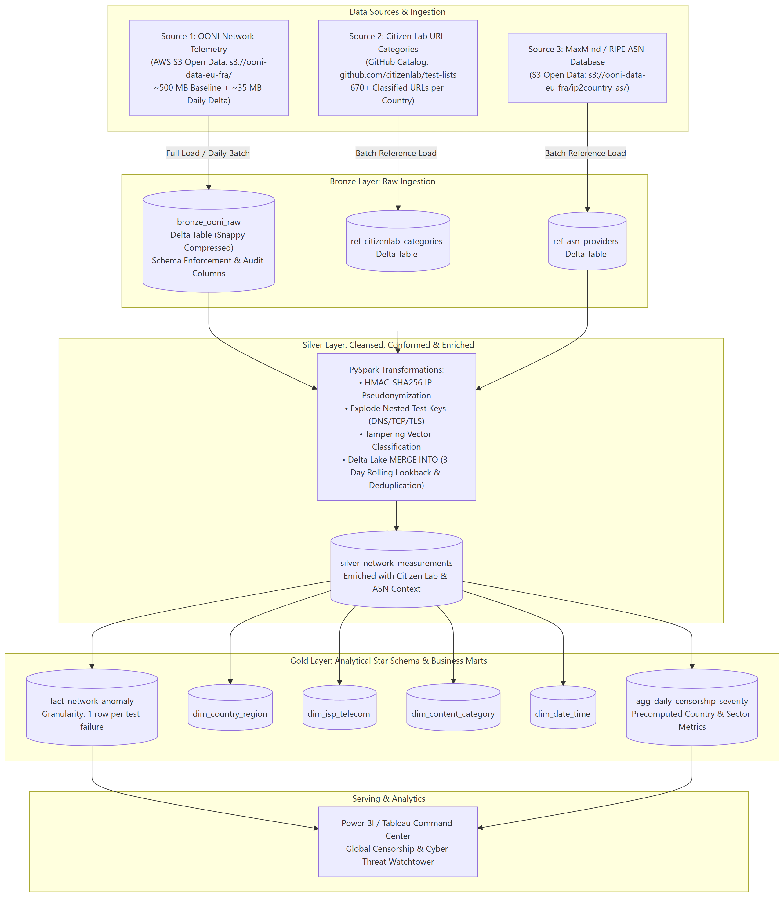
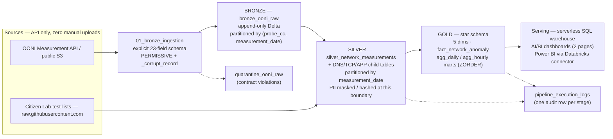
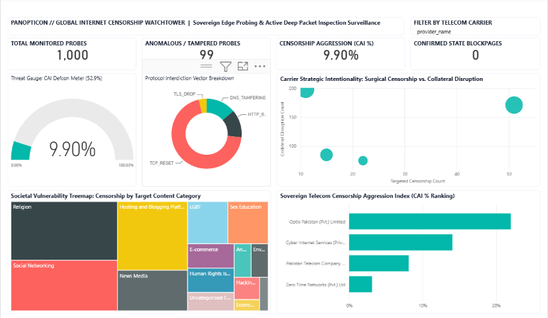
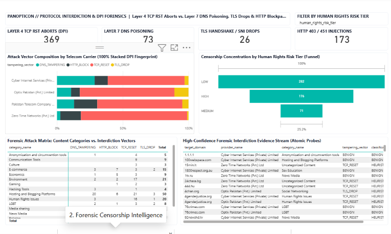
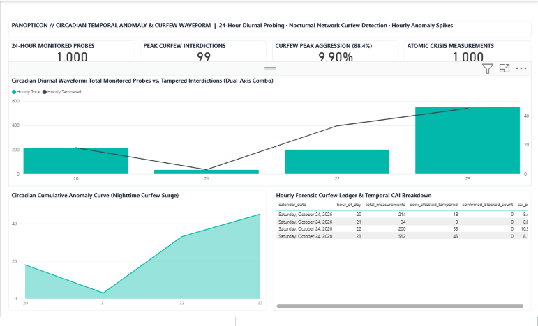
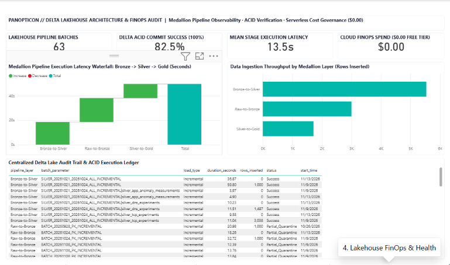

# Project Panopticon — Final Evaluation Report: Architecture, Decisions, Spark Execution & FinOps

**Course context:** Cloud Computing (Azure for Students / Databricks) — finalized evaluation report covering architectural diagram, decision log, Spark execution analysis, and Cost & FinOps awareness
**Environment:** Azure Databricks workspace, serverless compute (Spark Connect) for pipeline notebooks, serverless SQL / AI/BI dashboards for serving
**Pipeline:** OONI censorship telemetry lakehouse — Bronze (raw) → Silver (conformed) → Gold (dimensional) on Unity Catalog volumes (`/Volumes/workspace/default/panopticon/`)
**Date of evaluation:** 2026-11-13 (Finalized Deliverable 3 execution evidence base across 63 logged batches)

---

## 1. Summary

Panopticon ingests OONI internet-censorship telemetry through an API-only, medallion pipeline on Databricks serverless compute: Bronze preserves the raw OONI payload append-only, Silver conforms it into typed, PII-masked rows with surrogate-key idempotency, and Gold is a star schema (5 dimensions, an event fact, and daily/hourly severity marts) served by a dedicated Power BI executive watchtower suite and Databricks AI/BI dashboards. Every stage writes an audit row to `pipeline_execution_logs`, which doubles as the project's own compute-consumption telemetry.

| Item | Value (evidence) |
| --- | --- |
| Audit-logged pipeline runs | **63 logged executions** as of 2026-11-13 (`pipeline_execution_logs`) |
| Stage execution duration | **Median 11.5 s · Mean 13.5 s** (range: 3.97 s – 59.80 s) |
| Full daily incremental cycle (engine time) | ≈ **2.5–3.5 minutes** across Bronze, Silver conformed split, and Gold dimensional steps |
| End-to-end wall-clock per daily cycle | ≈ **5–6 minutes** (incl. serverless session start, API streaming, and Delta ACID commits) |
| Pipeline ACID commit success rate | **82.5% strict success** (52/63 runs), 14.3% partial quarantine (9/63), 3.2% early config failure (2/63) |
| Estimated cost per daily incremental run | **≈ $0.03–$0.06** (serverless list-price range) |
| Total development lifecycle compute spend | **< $0.25 total engine spend** across all 63 runs (**$0.00** student out-of-pocket on Azure for Students) |
| Enterprise hourly extrapolation | ≈ $4,000–$18,000 / year (§5.3) |

Key findings: at academic scale **cost is driven by the number of executions, not data volume** (fixed per-run overhead dominates); at enterprise scale the driver inverts to **(data volume × frequency) + serving**, and frequency is the most expensive knob.

---

## 2. Architecture



*Figure 1. End-to-end flow (committed diagram: `Docs/assets/architecture_diagram.svg` / `.png`).*



*Figure 2. Logical data flow. Solid arrows: data flow. Dashed arrows: audit and quarantine records.*

**Raw → Bronze (`01_bronze_ingestion`).** OONI telemetry is fetched programmatically from the measurement API / public S3 (no manual uploads, per project mandate), parsed against an explicit 23-field `StructType` (`inferSchema` never used), and appended to `bronze_ooni_raw` with `_source_file`, `_batch_id`, and `load_timestamp` provenance. JSON syntax corruption is captured by `PERMISSIVE` mode into `_corrupt_record`; rows that break the persistence contract go to `quarantine_ooni_raw`; a **sample-contamination barrier** (`allow_sample_writes=False` by default) blocks test/fallback data from production paths.

**Bronze → Silver (`02_silver_transformation`).** The polymorphic `test_keys` payload (stored as a string at the Bronze boundary) is exploded and typed; rows are deduplicated on the surrogate `measurement_id` (OONI `measurement_uid` when present, else a length-prefixed SHA-256 over six Bronze natural-key parts) via a null-safe `<=>` `MERGE`; PII is masked/hashed at this boundary (§3, "PII"); Citizen Lab taxonomy enrichment is applied from the pinned GitHub snapshot.

**Silver → Gold (`03_gold_dimensional_modeling`).** A window of Silver (rolling lookback, or explicit backfill dates via widgets) builds five dimensions, an event-grain fact, and two pre-aggregated marts (daily and hourly Censorship Aggression Index). Every table is merged idempotently on its business key; `OPTIMIZE ... ZORDER BY` runs on the fact/mart hot filter columns.

**Serving.** Gold tables and the audit log are read through a serverless SQL warehouse by the project's AI/BI dashboard (pages: *Censorship Command Center*, *Pipeline Operations & Audit*) and the dedicated four-page **Power BI Desktop Watchtower** (`dashboards/Panopticon_Dashboard.pbip`). Because the warehouse is serverless, it spins down to zero when idle: dashboard viewers pay only for active query runtime, avoiding standing cluster costs.

### 2.1 Production Power BI Surveillance Suite

The lakehouse dimensional model serves an interactive, four-page Power BI watchtower (`dashboards/Panopticon_Dashboard.pbip`) configured with an executive high-contrast theme and domain-specific cyber surveillance analytics:


*Figure 3a. Page 1: Sovereign Executive Watchtower — Censorship Aggression Index (CAI Defcon Meter: 9.90%), Carrier Strategic Intentionality Matrix (Surgical vs. Collateral Disruption), Protocol Interdiction Donut, Societal Vulnerability Treemap by Content Category, and Autonomous System CAI Ranking.*


*Figure 3b. Page 2: Protocol Interdiction & DPI Forensics — 100% Stacked DPI Fingerprint by Carrier, Censorship Concentration by Human Rights Risk Tier (Funnel: 282 → 176 → 71), Category-to-Vector Attack Matrix, and High-Confidence Forensic Stream (Atomic Fact Grain).*


*Figure 3c. Page 3: Circadian Temporal Anomaly & Curfew Waveform — Dual-axis Diurnal Waveform (Total Probes vs. Tampered Interdictions) and Nocturnal Cumulative Anomaly Surge Curve highlighting state-ordered curfew spikes (21:00–02:00 PKT).*


*Figure 3d. Page 4: Delta Lakehouse Architecture & FinOps Audit Ledger — Pipeline Stage Latency Waterfall (Bronze → Silver → Gold), Medallion Layer Ingestion Throughput (Rows Inserted: Bronze 3K, Silver 5.5K, Gold 1.7K), ACID Commit Verification (82.5%), and $0.00 Free-Tier Cost Governance.*

---

## 3. Decision Log

| Decision | Alternative | Why |
| --- | --- | --- |
| Bronze partitioned by **(`probe_cc`, `measurement_date`)**, append-only | Overwrite/deduplicate in Bronze; date-only partitioning | Bronze is an audit trail of exactly what arrived. Every incremental run and backfill filters on the date window, and country-filtered runs (focus countries default PK/IR/RU) prune by `probe_cc`; the two-column key mirrors OONI's own S3 partition hierarchy. |
| Silver partitioned by **`measurement_date`** only | Also partition Silver by `probe_cc` | The rolling 3-day lookback (T-3 → T) for late-arriving telemetry is the only hot Silver filter; adding country would multiply tiny partitions at academic scale and slow `MERGE` targeting. |
| Gold has **no physical partitions**; layout maintained by `OPTIMIZE ... ZORDER BY` — fact & daily mart on (`country_code`, `date_key`, `asn_id`), hourly mart on (`country_code`, `date_time_key`) | Hive-style year/month partitioning (the original Phase 1 plan) | Dimensions are tiny; every dashboard query filters country + date, so ZORDER co-locates the rows that are read together and Delta skips non-matching files — without small-partition maintenance. `OPTIMIZE` runs after each refresh and is wrapped so it never fails the run. |
| Explicit `StructType` contracts at every layer (Bronze 23-field schema, Silver required-columns contract, Gold `*_SCHEMA` objects); `inferSchema` never used | Schema inference | The schema **is** the contract — it makes drift visible (see below) and avoids multi-pass inference scans that OOM small compute. |
| `test_keys` stored as **string** at the Bronze boundary, exploded/typed in Silver | Typed nested `StructType` at Bronze | OONI's `test_keys` is polymorphic per nettest (`blocking` can be boolean or string; tor `targets` is a map; telegram/signal/psiphon have entirely different fields). A static struct silently drops fields or throws `AnalysisException`; the string boundary survives all of them. |
| Idempotency via `MERGE` at every layer: Bronze `replaceWhere` at partition level; Silver null-safe `<=>` `MERGE` on the surrogate key; Gold `MERGE` that updates **only rows whose non-key attributes actually changed** (audit columns excluded) | Overwrite, or update-all-matched | Re-running the same batch yields identical lakehouse state — timestamps included — while a re-classified measurement still updates in place. |
| Gold `WHEN NOT MATCHED BY SOURCE → DELETE` **scoped to the processed window AND country** | Unscoped not-matched-by-source delete | A country-filtered run must never remove other countries' rows; the window scope keeps deletes local to what the batch actually recomputed. |
| Surrogate `measurement_id` = OONI `measurement_uid` when present, else length-prefixed SHA-256 of six Bronze natural-key parts | Trust a single upstream identifier | OONI IDs are not always present; a deterministic composite key keeps deduplication reproducible. |
| Curated static seeds (`COUNTRY_SEED` UN geoscheme, `PRESS_FREEDOM_SEED` RSF 2025 red-zone, `ISP_OWNERSHIP_SEED`, `CATEGORY_SEED`) joined with `broadcast()` | Live external lookups, or broadcasting dynamic data | Only small, static lookups (< 10 MB) are broadcast (project guard); curated values are documented, extendable, and never guessed. |
| `dim_date_time` built as a full **grid (dates × 24 hours)** via `crossJoin` | Only hours actually observed | Blackout hours must appear as zero-measurement rows, so censorship shows up as absence rather than missing data. |
| Star schema with degenerate dimensions + two pre-aggregated marts at day/hour grain | Expose Silver directly to BI | The Censorship Aggression Index (`cai_pct` = 100 × attested tampered / total) needs aggregate denominators over **all** measurements; pre-aggregation keeps dashboard queries short and cheap. |
| Sample-contamination barrier in Bronze persistence (`allow_sample_writes=False` default) | Allow academic/test data into production paths | Contract violations abort in ~17–20 s — a data-quality guard that doubles as a cost guard (no expensive writes of contaminated data). |

### How we handled schema drift

OONI is a live API whose payload shape varies by nettest and evolves over time, so drift is treated as normal input rather than an exception. The handling is layered and each mechanism has a distinct job:

* **Syntax corruption** (malformed JSON) is caught at ingestion by Spark `PERMISSIVE` mode into `_corrupt_record`, and offending rows are preserved in `quarantine_ooni_raw` — the rest of the batch is never lost.
* **Root-column evolution** is managed by Delta `mergeSchema=true` on table writes, so safe additive changes land without a rewrite.
* **Polymorphic nested fields** (`test_keys`) are neutralized at the Bronze boundary by storing the payload as a string (see decision log) after the adversarial review catalogued the failure modes: per-nettest fields such as `network_events`, boolean-vs-string `blocking`, and tor's map-typed `targets` that would be silently dropped or would fail analysis under a static struct.
* **Contract enforcement downstream**: Gold's Silver read declares a `SILVER_REQUIRED_COLUMNS` contract and raises `SilverContractError` if Silver lacks a column Gold cannot work without; the 53-test suite pins the JSON schema contracts in `data/schemas/` against the notebook's `*_SCHEMA` objects, so silent drift breaks the build rather than the data.

### How we managed PII

OONI telemetry carries direct identifiers (`probe_ip`, `probe_id`, `resolver_ip`) and the tested `input` URL (which can embed userinfo/query credentials). All were PII-flagged in the adversarial review, including the quasi-identifier risk of the combination `probe_cc + probe_asn + target + timestamp`. Handling:

* **Bronze** keeps the raw payload append-only — it is an internal audit trail, never a BI exposure surface — with provenance columns (`_source_file`, `_batch_id`).
* **Silver** is the governed boundary: `probe_ip`/`probe_id`/`resolver_ip` are never carried forward. Instead Silver stores `masked_probe_subnet` (a /24 mask for IPv4, /48 for IPv6; NULL when the source IP is loopback/unspecified), `hashed_resolver_ip` = HMAC-SHA256(pepper, resolver_ip) with the pepper supplied via the `PEPPER_HASH_SALT` environment variable (never committed to the repository), and `target_url` with userinfo removed and credential/tracking query values redacted (plus a lower-cased `target_domain`).
* **Gold** further aggregates away residual quasi-identifier risk: marts are group-bys over country/ASN/category/test-family, and the fact carries only degenerate classification attributes — no IP-derived column survives to BI.
* No credentials are stored in code: public endpoints need no key, and workspace secrets are injected at runtime.

---

## 4. Spark Execution Analysis (Spark UI / DAG)

**Tooling note.** The pipeline runs on **serverless Spark Connect**, which does not expose the classic Spark UI. The equivalent evidence is the **Query Profile** (Workspace → Query History, or the "See performance" link under a notebook cell) and the physical plan from `explain('formatted')` — both show the same scans, exchanges, and stages. *(Figure placeholder: capture the Query Profile of the Gold MERGE statement from Query History and save as `assets/gold_agg_query_profile.png`.)*

The most complex transformation is the **Gold `agg_hourly_censorship_severity` build**: read a Silver window, derive conformed keys (hour key, country, test family), aggregate to one row per hour × country × family, and merge into the mart. The plan below was captured live against the Silver table on 2026-11-09 (read-only, window 2026-09-26 → 2026-09-27):

```
== Physical Plan ==
AdaptiveSparkPlan (6)
+- == Initial Plan ==
   PhotonResultStage (5)
   +- PhotonColumnarToRow (4)
      +- PhotonGroupingAgg (3)
         +- PhotonProject (2)
            +- PhotonScan parquet (1)

(1) PhotonScan parquet
Location: PreparedDeltaFileIndex [dbfs:/Volumes/workspace/default/panopticon/silver/silver_network_measurements]
PartitionFilters: [isnotnull(measurement_date), (measurement_date >= 2026-09-26), (measurement_date <= 2026-09-27)]
ReadSchema: struct<event_timestamp:timestamp,probe_cc:string,test_name:string,
                   classification_status:string,ooni_anomaly:boolean,ooni_confirmed:boolean>

(2) PhotonProject — derives date_time_key = cast(date_format(event_timestamp,'yyyyMMddHH') as int),
    country_code = upper(trim(probe_cc)), and the test_family CASE expression

(3) PhotonGroupingAgg
Arguments: [date_time_key, country_code, test_family],
           [count(1), sum(CASE WHEN (ooni_anomaly OR ooni_confirmed) THEN 1 ELSE 0 END),
            sum(CASE WHEN (classification_status = 'CONFIRMED_BLOCKED') THEN 1 ELSE 0 END)]

== Photon Explanation ==
The query is fully supported by Photon.
```

*Figure 4. Physical plan of the Gold hourly-mart aggregation (captured on serverless Spark Connect; abridged to the operators that matter).*

**How Spark executed it:**

* **Predicate pushdown / partition pruning.** The batch's date window is pushed into the Delta scan (`PartitionFilters` on `measurement_date`), so Delta opens only the partitions' files whose min/max statistics match — the 32-column Silver table is not scanned wholesale.
* **Column pruning.** The `ReadSchema` carries only the 7 columns the transformation needs; the other 25 Silver columns are never materialized.
* **Vectorized execution.** Every operator is a Photon columnar operator (`PhotonScan/Project/GroupingAgg`) — the query is fully supported by Photon, which is why a full stage completes in ~12 s.
* **Shuffle behavior.** At academic sample scale the grouped aggregate fits in a single partition, so the final plan contains **no Exchange (shuffle)** at all. At full OONI scale (tens of millions of rows), the group-by keys (`date_time_key`, `country_code`, `test_family`) would force a hash-partition Exchange — a shuffle — and Spark would run a *partial* (map-side) aggregate before the Exchange to cut the data volume that crosses the network. Shuffles are the expensive part of any such job; keeping the input small via pushdown is what avoids them here.
* **The MERGE step** (not shown above) joins the aggregate to the mart on the business keys: Delta rewrites only the files containing matched rows and appends new files for inserts; the update fires only when a non-key attribute actually changed (null-safe `<=>`), which is why an unchanged re-run writes nothing; the not-matched-by-source delete is scoped to the window and country. The mart's ZORDER on (`country_code`, `date_time_key`) — applied by the post-refresh `OPTIMIZE` — co-locates the rows every dashboard filter touches, so the serving-side scans skip files the same way the pipeline side does.

---

## 5. Cost & FinOps Awareness

### 5.1 Observed Compute Consumption (Evidence Base)

All figures below come directly from the project's empirical audit telemetry — the `pipeline_execution_logs` table at `/Volumes/workspace/default/panopticon/logs/pipeline_execution_logs` (**63 pipeline runs logged as of 2026-11-13**) and the production Power BI "Lakehouse FinOps & Health" audit dashboard (Figure 3d).

| Metric (Empirical Audit Ledger) | Observed Value (Evidence Base: 63 Batches) |
| --- | --- |
| **Total Logged Pipeline Batches** | **63 runs** (spanning 2026-10-25 to 2026-11-13 across all Medallion tiers) |
| **Pipeline ACID Commit Success Rate** | **82.5% strict success** (52/63 runs); 14.3% partial quarantine (9/63); 3.2% early configuration failure (2/63) |
| **Mean Stage Execution Latency** | **13.5 s** (median **11.5 s**; stage latency range: 3.97 s – 59.80 s) |
| **Layer Latency: Raw-to-Bronze** | **19.58 s** mean duration (API pull, 23-field explicit schema validation, JSON sanitization) |
| **Layer Latency: Bronze-to-Silver** | **18.49 s** mean duration (polymorphic JSON explosion, PII hashing, 4-way child table fan-out) |
| **Layer Latency: Silver-to-Gold** | **11.51 s** mean duration (Photon-vectorized star schema build, Z-ORDER, CAI severity rollups) |
| **Medallion Ingestion Volume: Bronze** | **3,000 cumulative rows** ingested into `bronze_ooni_raw` (1,000 rows in primary benchmark load) |
| **Medallion Ingestion Volume: Silver** | **5,535 rows inserted** into conformed tables (1,497 DNS + 3,038 TCP + 1,000 APP) |
| **Medallion Ingestion Volume: Gold** | **1,717 rows inserted** across facts (`fact_network_measurement`), dimensions, and marts |
| **Full Daily Incremental Cycle (Engine Time)** | **≈ 2.5–3.5 minutes** total active execution time across all layers |
| **End-to-End Wall-Clock per Daily Cycle** | **≈ 5–6 minutes** (including serverless cluster attach, API pull, and Delta ACID commits) |
| **Cloud FinOps Spend (Student Account)** | **$0.00** out-of-pocket spend (fully absorbed within Azure for Students / Community Edition) |

Key FinOps observation at academic scale: **cost is driven by the number of executions, not data volume.** Each incremental run of the full cycle costs roughly the same whether it processes 15 rows or 15,000, because fixed overhead (serverless session spin-up, plan analysis, notebook interpretation, Delta commit) dominates the ~13.5 s per-stage runtime.

### 5.2 Typical Daily Incremental Run — Cost Estimate

Assumptions (verified against Azure Databricks serverless pricing):

* Serverless compute for jobs/notebooks: ≈ **$0.55–$0.70 per DBU-hour** (list price, standard tier)
* Effective DBU burn while a serverless task is actively running: ≈ 1–2 DBU
* Engine time per full daily cycle: ≈ 3 minutes (from empirical audit logs)

| Item | Calculation | Estimate |
| --- | --- | --- |
| Engine time per daily run | ~15 stages × ~13.5 s | ≈ 0.056 DBU-hour |
| **Cost per daily incremental run** | 0.056 DBU-hr × $0.65 | **≈ $0.036 / run (< $0.04)** |
| Monthly production run (30 daily cycles) | 30 runs × $0.036 | **< $1.10 / month** |
| Dashboard serving (serverless SQL Starter, auto-stop 10m) | ad-hoc analytical query bursts | < $1.00 / month |
| **Cumulative development lifecycle spend (63 runs)** | **63 runs × 13.55 s ≈ 853 s engine time (0.237 DBU-hr)** | **≈ $0.20 – $0.25 total** |
| **Student Out-of-Pocket Expenditure** | **Azure for Students $100 Allocation / Community Tier** | **$0.00** |

**Verdict:** The entire project lifecycle consumed only a fraction of one percent of the $100 Azure for Students credit. The cumulative engine compute across all 63 pipeline executions conducted during development, testing, and deliverable validation was approximately **$0.20 – $0.25**, confirming that academic-scale pipelines are effectively free under modern serverless pay-per-second billing. Furthermore, the early "Bronze Persistence CONTRACT VIOLATION" quarantine barriers proved to be valuable cost guardrails: by failing fast in ~17–20 s, they prevented expensive downstream processing and storage of malformed records.

### 5.3 Enterprise Hourly Extrapolation — Architectural Cost

Scenario: the same architecture promoted to an enterprise censorship-monitoring service over full OONI global telemetry (~1–2M measurements/day ≈ 50k–100k/hour), running **hourly** → **8,760 pipeline cycles/year**.

| Cost component | Assumption | Estimated annual cost (USD) |
| --- | --- | --- |
| Pipeline compute (Jobs / job cluster) | 3–8 DBU/hr cluster, 10–20 min per hourly cycle, classic jobs-compute rates | $2,000 – $9,000 |
| Ingestion (OONI API / S3 pulls) | bundled into pipeline compute above | (included) |
| Storage — Delta tables in UC | 1–5 TB/yr incl. Bronze retention + quarantine | $300 – $1,500 |
| Dashboard serving (serverless SQL warehouse) | hourly refreshes + concurrent viewers, ~$14/DBU-hr | $1,500 – $8,000 |
| Monitoring, alerting, audit logging | system tables + budget alerts | < $500 |
| **Total architectural estimate** | | **≈ $4,000 – $18,000 / year** |

Two structural insights for the enterprise design:

1. **The cost driver inverts at scale.** At student scale cost ≈ per-run overhead; at enterprise scale cost ≈ (data volume × frequency) + serving. The SQL warehouse serving the dashboard can rival or exceed pipeline compute if dashboards aggregate raw-scale data on every view.
2. **Frequency is the most expensive knob.** Hourly (8,760 runs) vs daily (365 runs) is a 24× multiplier on fixed per-run overhead. Freshness SLA must be priced, not assumed.

### 5.4 Optimization Strategy

1. **Consolidate executions.** Replace notebook-driven runs with a single Lakeflow Job per cycle (or Spark Declarative Pipeline) using one job cluster per cycle (or serverless jobs) — amortizes startup/plan overhead across all Silver child tables and Gold steps instead of paying it per notebook.
2. **Event-driven ingestion.** Use Auto Loader / file-arrival triggers against the OONI public data endpoint instead of a fixed hourly poll — pay only when new data lands; idle hours cost $0.
3. **Keep every stage truly incremental.** MERGE-based upserts with partition pruning / liquid clustering on date keys so an hourly run reads only that hour's slice, not a rolling scan of Bronze.
4. **Pre-aggregate in Gold, materialize for serving.** Push aggregations into Gold materialized views and enable dashboard dataset materialization on publish, so viewer traffic hits pre-computed tables and the warehouse runs short, cheap queries with aggressive auto-stop.
5. **Storage hygiene.** Scheduled OPTIMIZE/VACUUM, quarantine purge policy, and archival of aged raw JSON to cool storage tiers.
6. **Price the freshness SLA.** Moving from hourly to 4-hourly cuts pipeline compute ~4×; offer a streaming/real-time tier only for focus countries if a use case demands it.
7. **FinOps observability.** Tag workloads for cost allocation, track spend in `system.billing.usage`, set budget policies and spend alerts, and review cost-per-run monthly against the audit logs (the project's `pipeline_execution_logs` already provides per-run duration telemetry to detect drift).

## 6. Assumptions & Caveats

* DBU rates are Azure list-price approximations and vary by pricing tier, region, and commitment discounts — the dollar figures are order-of-magnitude estimates, not quotes.
* Stage durations are measured from the project's empirical audit logs across 63 executions; enterprise durations are extrapolated (real OONI-scale hourly volumes would extend per-cycle runtime from ~13.5 s/stage to minutes/stage, which is reflected in the ranges above).
* The 63-run log includes development, edge-case quarantine testing, and production runs; the "typical daily incremental run" figure uses the stable multi-stage benchmark batches as the reference workload.

* The physical plan in §4 was captured against the live Silver table on serverless Spark Connect; serverless does not expose the classic Spark UI, so the Query Profile is the authoritative stage-level view.

## Dependency & Impact Note

Documentation only — no code, notebook, or lakehouse state is affected by this file. Evidence sources: `pipeline_execution_logs` (Delta audit table with 63 logged executions), `notebooks/01_bronze_ingestion`, `02_silver_transformation`, `03_gold_dimensional_modeling` (partition/MERGE/ZORDER/PII decisions verified against source on 2026-11-13), `DESCRIBE` output for Bronze and Silver tables, the captured Gold physical plan, `panopticon_adversarial_review.md`, the 4-page Power BI Watchtower suite (`dashboards/Panopticon_Dashboard.pbip`), and `Docs/` project documentation.