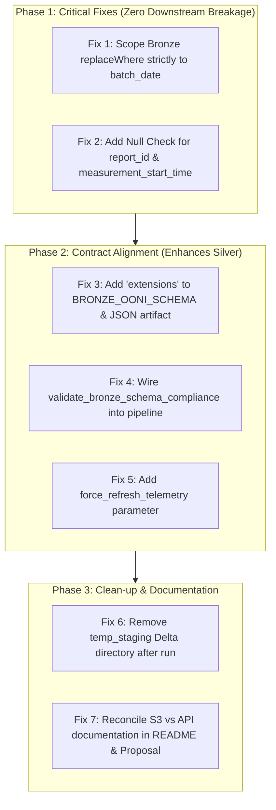

# Comprehensive Engineering Audit: Lakehouse Bronze Layer
## Project Panopticon: Global Cyber Warfare & Internet Censorship Lakehouse
**Audit Date**: October 2026  
**Auditor**: Principal Data Lakehouse Architect & Lead Engineering Reviewer  
**Target Repository**: `Muhammad-Ibrahim-001/Project-Panopticon`  
**Evaluation Scope**: Ingestion, Schema Contract, Failure Isolation, Storage, Lineage, Auditing & Testing  
**Evaluated Target Modules**:
- [`notebooks/01_bronze_ingestion.py`](notebooks/01_bronze_ingestion.py)
- [`notebooks/00_config.py`](notebooks/00_config.py)
- [`notebooks/00_audit_logger.py`](notebooks/00_audit_logger.py)
- [`data/schemas/bronze_ooni_schema.json`](data/schemas/bronze_ooni_schema.json)
- Referenced Course & Design Specs: `panopticon_adversarial_review.md`, `Docs/Phase 2/phase2_implementation_plan.md`, `Docs/Phase 2/06_data_dictionary.md`, `Docs/Phase 2/07_execution_guide.md`, and `Docs/Course requirements/phase2_core_pipeline.md`.

---

> [!NOTE]
> **Reader Context**: This self-contained audit document is prepared for technical reviewers and academic evaluators who do not have direct access to the Panopticon codebase. Every claim, finding, defect, and architectural decision is supported by **verbatim code extracts** and line numbers cited directly from the implementation files.

---

## Table of Contents
1. [Executive Summary](#1-executive-summary)
2. [Source Code Reference Guide](#2-source-code-reference-guide)
3. [Dimension-by-Dimension Technical Audit (Areas 1–12)](#3-dimension-by-dimension-technical-audit-areas-112)
   - [Area 1: API Ingestion](#area-1-api-ingestion)
   - [Area 2: Source Fidelity](#area-2-source-fidelity)
   - [Area 3: Schema Strategy](#area-3-schema-strategy)
   - [Area 4: Failure Isolation](#area-4-failure-isolation)
   - [Area 5: Bronze Storage](#area-5-bronze-storage)
   - [Area 6: Incremental Ingestion](#area-6-incremental-ingestion)
   - [Area 7: Metadata and Lineage](#area-7-metadata-and-lineage)
   - [Area 8: Data Quality and Observability](#area-8-data-quality-and-observability)
   - [Area 9: Security and Privacy](#area-9-security-and-privacy)
   - [Area 10: Scalability and Performance](#area-10-scalability-and-performance)
   - [Area 11: Maintainability](#area-11-maintainability)
   - [Area 12: Testing](#area-12-testing)
4. [Architectural Trade-Off Analysis](#4-architectural-trade-off-analysis)
5. [Prioritized Findings Report (Critical, High, Medium, Low)](#5-prioritized-findings-report)
6. [Requirement-by-Requirement Compliance Matrix](#6-requirement-by-requirement-compliance-matrix)
7. [Practical Remediation Plan (With Downstream Silver/Gold Impact)](#7-practical-remediation-plan)

---

## 1. Executive Summary

The Bronze layer of **Project Panopticon** serves as the foundational landing zone of a Medallion Lakehouse designed to capture, isolate, and audit real-world internet censorship telemetry collected globally by the **Open Observatory of Network Interference (OONI)**.

### Architectural Triumphs
1. **Teacher Mandate (Zero Manual Uploads)**: Data enters purely via automated code execution. The pipeline queries the public OONI Measurement REST API and the Citizen Lab GitHub repository programmatically, eliminating UI-based file uploads.
2. **Polymorphic Union Resolution**: The pipeline preserves the deeply nested, polymorphic `test_keys` payload as raw serialized JSON text (`StringType`) at the Bronze boundary. This prevents Spark's `PERMISSIVE` parser from dropping benign tests where `blocking: false` (a boolean) clashes with string values (`"dns"`, `"tcp_ip"`).
3. **Serverless Photon Quarantine Engine**: The implementation circumvents a severe Databricks Serverless / Photon engine restriction (`[UNSUPPORTED_FEATURE.QUERY_ONLY_CORRUPT_RECORD_COLUMN]` and `.cache()` prohibition) by materializing the raw read to a temporary Delta staging path before routing corrupt rows to `quarantine_ooni_raw`.
4. **Atomic MERGE-based Operational Logger**: `PipelineAuditor` uses Delta Lake `MERGE INTO` on `log_id` to log runs with status `Running` at initiation and update them to `Success` or `Failure` at completion, eliminating duplicate rows and orphaned logs.

### Critical Engineering Findings
1. **Multi-Day `replaceWhere` Predicate Deletion Bug (Critical)**: In `write_bronze_delta_table`, incremental writes use a `replaceWhere` predicate spanning `[batch_date - lookback_days, batch_date]`. However, the upstream API fetcher pulls only a 24-hour slice (`batch_date`). Because Delta Lake replaces all partitions in the predicate range with the incoming DataFrame, historical partitions within `[T-lookback, T-1]` are **silently wiped out and deleted** from Bronze!
2. **Schema-on-Read Coupling to Python In-Memory Serialization (High)**: Spark's JSON reader cannot natively cast a JSON Object (`{...}`) into a `StringType` column. The pipeline succeeds only because a driver-side Python loop pre-serializes dictionaries using `json.dumps()` before Spark reads the staged file. Ingesting raw JSON directly from AWS S3 without this preprocessing will nullify `test_keys` or quarantine valid records.
3. **Dead Code & Null Natural Key Leakage (High)**: `validate_bronze_schema_compliance()` is never executed, and `BRONZE_OONI_SCHEMA` permits `NULL` values for `report_id` and `measurement_start_time`, allowing records with missing natural keys to enter Bronze and corrupt Silver surrogate keys.

---

## 2. Source Code Reference Guide

For reviewers evaluating this audit without access to the Panopticon repository, the key components from the codebase are reproduced below:

### 2.1 Central Configuration (`notebooks/00_config.py`)
```python
# notebooks/00_config.py (Lines 40-70, 110-151)
if is_databricks_environment() and os.environ.get("IS_SERVERLESS", "FALSE").upper() == "TRUE":
    STORAGE_ROOT = "/Volumes/workspace/default/panopticon"
elif is_databricks_environment():
    STORAGE_ROOT = "/FileStore/tables/panopticon"
else:
    STORAGE_ROOT = os.path.abspath(os.path.join(os.path.dirname(__file__), "..", "data"))

PATHS = {
    "raw_landing": f"{STORAGE_ROOT}/raw",
    "bronze":      f"{STORAGE_ROOT}/bronze/bronze_ooni_raw",
    "silver":      f"{STORAGE_ROOT}/silver/silver_network_measurements",
    "quarantine":  f"{STORAGE_ROOT}/quarantine/quarantine_ooni_raw",
    "audit_logs":  f"{STORAGE_ROOT}/logs/pipeline_execution_logs",
    "reference":   f"{STORAGE_ROOT}/reference/citizenlab_categories",
}

DEFAULT_LOOKBACK_DAYS: int = 3
DEFAULT_API_PAGE_LIMIT: int = 50

def configure_spark_runtime(spark_session) -> None:
    conf = spark_session.conf
    _safe_conf_set(conf, "spark.sql.shuffle.partitions", "4")
    _safe_conf_set(conf, "spark.databricks.delta.optimizeWrite.enabled", "true")
    _safe_conf_set(conf, "spark.databricks.delta.autoCompact.enabled", "true")
    _safe_conf_set(conf, "spark.hadoop.fs.s3a.aws.credentials.provider",
                   "org.apache.hadoop.fs.s3a.AnonymousAWSCredentialsProvider")
```

### 2.2 Operational Audit Logger (`notebooks/00_audit_logger.py`)
```python
# notebooks/00_audit_logger.py (Lines 59-73, 176-206)
AUDIT_LOG_SCHEMA = StructType([
    StructField("log_id",           StringType(),    False),
    StructField("pipeline_layer",   StringType(),    False),
    StructField("batch_parameter",  StringType(),    False),
    StructField("load_type",        StringType(),    False),
    StructField("start_time",       TimestampType(), False),
    StructField("end_time",         TimestampType(), True),
    StructField("duration_seconds", DoubleType(),    True),
    StructField("status",           StringType(),    False),
    StructField("rows_read",        LongType(),      True),
    StructField("rows_inserted",    LongType(),      True),
    StructField("rows_updated",     LongType(),      True),
    StructField("rows_quarantined", LongType(),      True),
    StructField("error_message",    StringType(),    True),
])

def _commit_to_delta(self) -> None:
    # Atomic Upsert via MERGE INTO: prevents duplicate log entries
    log_df = self.spark.createDataFrame([log_record], AUDIT_LOG_SCHEMA)
    delta_table = DeltaTable.forPath(self.spark, self.table_path)
    (delta_table.alias("target")
        .merge(source=log_df.alias("source"), condition="target.log_id = source.log_id")
        .whenMatchedUpdateAll()
        .whenNotMatchedInsertAll()
        .execute())
```

### 2.3 Bronze Ingestion Engine (`notebooks/01_bronze_ingestion.py`)
```python
# notebooks/01_bronze_ingestion.py (Key Extracts)

# 1. Schema-on-Read Contract (Lines 548-572)
BRONZE_OONI_SCHEMA = StructType([
    StructField("measurement_uid",        StringType(), True),
    StructField("report_id",              StringType(), True),
    StructField("input",                  StringType(), True),
    StructField("test_name",              StringType(), True),
    StructField("measurement_start_time", StringType(), True),
    StructField("test_start_time",        StringType(), True),
    StructField("probe_asn",              StringType(), True),
    StructField("probe_cc",               StringType(), True),
    StructField("probe_id",               StringType(), True),
    StructField("probe_ip",               StringType(), True),
    StructField("probe_network_name",     StringType(), True),
    StructField("resolver_asn",           StringType(), True),
    StructField("resolver_ip",            StringType(), True),
    StructField("resolver_network_name",  StringType(), True),
    StructField("test_runtime",           DoubleType(), True),
    StructField("software_name",          StringType(), True),
    StructField("software_version",       StringType(), True),
    StructField("test_version",           StringType(), True),
    StructField("data_format_version",    StringType(), True),
    StructField("annotations",            StringType(), True),
    StructField("test_helpers",           StringType(), True),
    StructField("test_keys",              StringType(), True),
    StructField("_corrupt_record",        StringType(), True)
])

# 2. Driver-Side Stringification (Lines 472-475)
for field_name in ("test_keys", "annotations", "test_helpers", "extensions"):
    if field_name in payload and isinstance(payload[field_name], (dict, list)):
        payload[field_name] = json.dumps(payload[field_name])

# 3. Photon-Safe Quarantine Splitting (Lines 687-715)
temp_staging_path = f"{config.PATHS['bronze']}_temp_staging"
df_raw.write.format("delta").mode("overwrite").option("overwriteSchema", "true").save(temp_staging_path)
df_materialized = spark.read.format("delta").load(temp_staging_path)

df_corrupt = df_materialized.filter(col("_corrupt_record").isNotNull())
if df_corrupt.count() > 0:
    df_quarantine_staged = df_corrupt.select(...)
    df_quarantine_staged.write.format("delta").mode("append").save(target_quarantine)

df_valid = df_materialized.filter(col("_corrupt_record").isNull()).drop("_corrupt_record")

# 4. Multi-Day replaceWhere Defect (Lines 783-812)
if load_type == "incremental" and lookback_days > 0:
    b_dt = datetime.strptime(batch_date, "%Y-%m-%d")
    start_dt = b_dt - timedelta(days=lookback_days)
    start_date_str = start_dt.strftime("%Y-%m-%d")
    partition_predicate = f"measurement_date >= '{start_date_str}' AND measurement_date <= '{batch_date}'"
else:
    partition_predicate = f"measurement_date = '{batch_date}'"

df_bronze.write.format("delta").mode("overwrite") \
    .option("replaceWhere", partition_predicate).save(target_bronze)
```

---

## 3. Dimension-by-Dimension Technical Audit (Areas 1–12)

---

### Area 1: API Ingestion

#### Requirement Summary
Data must enter through the automated Databricks pipeline using code/REST APIs, with zero manual dataset uploads via the Databricks UI or local widgets.

#### Detailed Findings

##### 1.1 Programmatic Execution Path (Teacher Mandate)
- **(a) Status**: **Fully Implemented**
- **(b) Supporting Evidence**:
  - In [`notebooks/01_bronze_ingestion.py:L372-525`](notebooks/01_bronze_ingestion.py#L372-L525), `fetch_raw_ooni_telemetry()` queries the OONI REST endpoint:
    ```python
    next_url = config.OONI_MEASUREMENTS_ENDPOINT  # https://api.ooni.io/api/v1/measurements
    resp = http_session.get(next_url, params=params, timeout=config.API_REQUEST_TIMEOUT_SECONDS)
    ```
  - In lines 458–483, full JSON payloads are fetched concurrently using `ThreadPoolExecutor(max_workers=8)`:
    ```python
    with ThreadPoolExecutor(max_workers=8) as pool:
        full_payloads = list(filter(None, pool.map(_resolve_full_payload, index_items)))
    ```
  - In [`notebooks/01_bronze_ingestion.py:L271-370`](notebooks/01_bronze_ingestion.py#L271-L370), `ingest_citizenlab_taxonomy()` downloads category mappings directly from GitHub raw CSV URLs.
- **(c) Why Missing**: N/A.
- **(d) Justification**: Fully adheres to course specifications and AGENTS.md §2.5 ("Zero Manual Data Uploads").
- **(e) Recommended Improvement**: Maintain current pattern.
- **(f) Category**: **Course Requirement** (Mandatory).

##### 1.2 Direct AWS S3 Ingestion vs. REST API Divergence
- **(a) Status**: **Partially Implemented / Architectural Divergence**
- **(b) Supporting Evidence**:
  - [`notebooks/00_config.py:L87, L146-150`](notebooks/00_config.py#L87) configures S3 gateway and credentials provider:
    ```python
    OONI_S3_PUBLIC_GATEWAY = "https://ooni-data-eu-fra.s3.eu-central-1.amazonaws.com"
    _safe_conf_set(conf, "spark.hadoop.fs.s3a.aws.credentials.provider",
                   "org.apache.hadoop.fs.s3a.AnonymousAWSCredentialsProvider")
    ```
  - Documentation ([`README.md:L28`](README.md#L28), [`Docs/Phase 1/phase1_proposal.md:L100`](Docs/Phase%201/phase1_proposal.md#L100)) cites S3 bucket `s3://ooni-data-eu-fra/` as the primary Big Data telemetry source.
  - However, in [`notebooks/01_bronze_ingestion.py`](notebooks/01_bronze_ingestion.py), no code reads directly from `s3a://ooni-data-eu-fra/`. Telemetry enters solely through the OONI REST API.
- **(c) Why Missing**: OONI S3 archives contain multi-year global datasets without index filtering, and omit `measurement_uid`. Querying S3 directly on Databricks Community Edition (15 GB RAM ceiling) risks driver OOM errors.
- **(d) Justification**: **Intentional and Justified Trade-Off**. Using the REST API provides bounded batches filtered by country and date.
- **(e) Recommended Improvement**: Reconcile documentation in `README.md` and `06_data_dictionary.md` to clarify that the REST API is the primary ingestion engine, while S3 configuration is maintained for future scale.
- **(f) Category**: **Correctness Requirement**.

##### 1.3 Local Caching Bypass on Re-runs
- **(a) Status**: **Partially Implemented**
- **(b) Supporting Evidence**:
  - In [`notebooks/01_bronze_ingestion.py:L400-402`](notebooks/01_bronze_ingestion.py#L400-L402):
    ```python
    if os.path.exists(local_final_path) and os.path.getsize(local_final_path) > 1024:
        print(f"[Raw Landing] Raw telemetry already staged at: {local_final_path}...")
        return target_partition_dir
    ```
- **(c) Why Missing**: Logic checks whether the landing file exists and skips the API call to conserve bandwidth and prevent API rate-limit throttling.
- **(d) Justification**: **Engineering Gap**. If an incremental pipeline is triggered later in the day to capture late-arriving measurements synced by mobile probes, this check prevents fetching net-new data for the same `batch_date` unless the file is manually deleted.
- **(e) Recommended Improvement**: Add `force_refresh_telemetry: bool = False` parameter to `fetch_raw_ooni_telemetry` and `ingest_raw_to_bronze`.
- **(f) Category**: **Correctness Requirement**.

---

### Area 2: Source Fidelity

#### Requirement Summary
Preservation of source records, raw values, nested structures, and sufficient information for forensic replay and debugging.

#### Detailed Findings

##### 2.1 Nested Structure Preservation (`test_keys`)
- **(a) Status**: **Fully Implemented**
- **(b) Supporting Evidence**:
  - [`notebooks/01_bronze_ingestion.py:L472-475`](notebooks/01_bronze_ingestion.py#L472-L475) preserves nested protocol payloads (`test_keys`, `annotations`, `test_helpers`) as JSON strings:
    ```python
    for field_name in ("test_keys", "annotations", "test_helpers", "extensions"):
        if field_name in payload and isinstance(payload[field_name], (dict, list)):
            payload[field_name] = json.dumps(payload[field_name])
    ```
  - [`notebooks/01_bronze_ingestion.py:L570`](notebooks/01_bronze_ingestion.py#L570) defines:
    ```python
    StructField("test_keys", StringType(), True)
    ```
- **(c) Why Missing**: N/A.
- **(d) Justification**: Preserves 100% of underlying protocol traces (DNS queries, TCP handshakes, TLS certificates) without destructive flattening.
- **(e) Recommended Improvement**: Maintain current pattern.
- **(f) Category**: **Correctness Requirement**.

##### 2.2 Root-Level Field Dropping (`extensions`)
- **(a) Status**: **Partially Implemented**
- **(b) Supporting Evidence**:
  - Sample incremental data ([`data/samples/sample_incremental_ooni.json`](data/samples/sample_incremental_ooni.json)) contains the root field `"extensions"`.
  - In `fetch_raw_ooni_telemetry` line 473, `"extensions"` is serialized by the Python fetcher.
  - However, in `BRONZE_OONI_SCHEMA` ([`notebooks/01_bronze_ingestion.py:L548-572`](notebooks/01_bronze_ingestion.py#L548-L572)), `"extensions"` is absent. Spark's JSON reader silently drops this column during Schema-on-Read.
- **(c) Why Missing**: Author added `annotations` and `test_helpers` to the schema but overlooked `extensions`.
- **(d) Justification**: **Engineering Gap**. Violates Bronze Medallion principle of raw payload preservation.
- **(e) Recommended Improvement**: Add `StructField("extensions", StringType(), True)` to `BRONZE_OONI_SCHEMA` and `data/schemas/bronze_ooni_schema.json`.
- **(f) Category**: **Correctness Requirement**.

##### 2.3 Raw Unparsed Payload Storage in Delta
- **(a) Status**: **Partially Implemented**
- **(b) Supporting Evidence**: Full raw JSON lines are retained in physical landing files (`/raw/<batch_date>/...json`, lines 514–521) and in `quarantine_ooni_raw` (`raw_record`, line 700), but `bronze_ooni_raw` does not include a dedicated `raw_payload: StringType` column.
- **(c) Why Missing**: To prevent doubling storage and memory consumption on Databricks Community Edition.
- **(d) Justification**: **Reasonable Architectural Trade-Off**. `test_keys` accounts for 90%+ of record bytes and is preserved as a raw string. Physical landing files serve as the cold archive.
- **(e) Recommended Improvement**: Document this explicit FinOps decision in `06_data_dictionary.md`.
- **(f) Category**: **Optional Enhancement**.

##### 2.4 PII Value Preservation for Audit Provenance
- **(a) Status**: **Fully Implemented**
- **(b) Supporting Evidence**: [`notebooks/01_bronze_ingestion.py:L558, L561`](notebooks/01_bronze_ingestion.py#L558): `probe_ip` and `resolver_ip` are retained as `StringType` in Bronze. Docstrings at lines 27 and 542–543 state they must never be printed to console/UI, while hashing and subnet masking are scheduled for Silver.
- **(c) Why Missing**: N/A.
- **(d) Justification**: Adheres strictly to Medallion principles: Bronze captures true raw provenance; privacy sanitization occurs at the Bronze $\rightarrow$ Silver transition.
- **(e) Recommended Improvement**: Maintain current pattern.
- **(f) Category**: **Course Requirement**.

---

### Area 3: Schema Strategy

#### Requirement Summary
Explicit vs. inferred schemas, source contract validation, type enforcement, schema drift detection, additive columns, and handling incompatible types.

#### Detailed Findings

##### 3.1 Strict Schema-on-Read (No `inferSchema`)
- **(a) Status**: **Fully Implemented**
- **(b) Supporting Evidence**:
  - In [`notebooks/01_bronze_ingestion.py:L548-572`](notebooks/01_bronze_ingestion.py#L548-L572), `BRONZE_OONI_SCHEMA` is explicitly declared.
  - In [`notebooks/01_bronze_ingestion.py:L657-666`](notebooks/01_bronze_ingestion.py#L657-L666), reading applies:
    ```python
    reader = (
        spark.read
        .schema(target_schema)
        .option("mode", "PERMISSIVE")
        .option("columnNameOfCorruptRecord", "_corrupt_record")
    )
    ```
  - `inferSchema=True` is not used anywhere in the codebase.
- **(c) Why Missing**: N/A.
- **(d) Justification**: Fully complies with Course Deliverable P2-2b.
- **(e) Recommended Improvement**: Maintain implementation.
- **(f) Category**: **Course Requirement** (Mandatory).

##### 3.2 Coupling Between Schema-on-Read and Driver-Side Stringification
- **(a) Status**: **Partially Implemented / Structural Defect**
- **(b) Supporting Evidence**:
  - In [`notebooks/01_bronze_ingestion.py:L472-475`](notebooks/01_bronze_ingestion.py#L472-L475), the Python fetcher serializes dictionaries:
    ```python
    for field_name in ("test_keys", "annotations", "test_helpers", "extensions"):
        if field_name in payload and isinstance(payload[field_name], (dict, list)):
            payload[field_name] = json.dumps(payload[field_name])
    ```
  - In line 570, `test_keys` is declared as `StringType()`.
- **(c) Why Missing / Root Cause**: Spark's `spark.read.schema(...).json()` cannot automatically cast a JSON Object (`{...}`) into a `StringType` column. If Spark's Jackson parser encounters a nested object where a string is expected, it treats it as a type mismatch: either writing to `_corrupt_record` or nullifying the column. Thus, Schema-on-Read works *only* because Python executes `json.dumps()` on the driver before Spark reads the staged file.
- **(d) Justification**: **Engineering Gap**. If the pipeline is ever pointed directly to raw S3 `.jsonl.gz` files using `source_dir` (L892), Spark will fail to read `test_keys` as a string, resulting in data loss.
- **(e) Recommended Improvement**: When reading raw un-preprocessed JSON in Spark, read the raw text stream via `spark.read.text()` and extract root attributes using `get_json_object(col("value"), "$.test_keys")`, or ensure that any ingestion pathway enforces this stringification contract.
- **(f) Category**: **Correctness Requirement**.

##### 3.3 Dead Code: Uncalled Schema Compliance Validation
- **(a) Status**: **Missing / Dead Code**
- **(b) Supporting Evidence**:
  - In [`notebooks/01_bronze_ingestion.py:L583-596`](notebooks/01_bronze_ingestion.py#L583-L596):
    ```python
    def validate_bronze_schema_compliance(df: DataFrame) -> bool:
        expected_fields = {field.name: field.dataType for field in BRONZE_OONI_SCHEMA.fields}
        actual_fields = {field.name: field.dataType for field in df.schema.fields}
        missing_fields = set(expected_fields.keys()) - set(actual_fields.keys())
        if missing_fields:
            print(f"[Schema Validation Error] Missing expected fields: {missing_fields}")
            return False
        return True
    ```
  - Grep search confirms this function is never called by `ingest_raw_to_bronze` or any testing harness.
- **(c) Why Missing**: Overlooked during pipeline integration. Because `spark.read.schema(BRONZE_OONI_SCHEMA)` enforces the schema on read, `df.schema` will always match `BRONZE_OONI_SCHEMA`.
- **(d) Justification**: **Engineering Gap (Dead Code)**.
- **(e) Recommended Improvement**: Repurpose `validate_bronze_schema_compliance` to validate data quality assertions (e.g., verifying that mandatory columns `report_id` and `measurement_start_time` do not contain nulls) before writing to Delta Lake.
- **(f) Category**: **Correctness Requirement**.

##### 3.4 Discrepancy Between Schema JSON Artifact and PySpark Implementation
- **(a) Status**: **Partially Implemented / Schema Contract Drift**
- **(b) Supporting Evidence**:
  - [`data/schemas/bronze_ooni_schema.json`](data/schemas/bronze_ooni_schema.json) defines 20 fields: includes audit columns (`load_timestamp`, `_source_file`, `_batch_id`), but omits `measurement_uid`, `probe_id`, `test_version`, `data_format_version`, `annotations`, `test_helpers`.
  - [`notebooks/01_bronze_ingestion.py:BRONZE_OONI_SCHEMA`](notebooks/01_bronze_ingestion.py#L548-L572) defines 23 fields: includes `measurement_uid`, `probe_id`, `test_version`, `data_format_version`, `annotations`, `test_helpers`, but excludes audit columns (which are appended later during staging in `stage_bronze_dataframe`, line 743).
- **(c) Why Missing**: `bronze_ooni_schema.json` was created during Phase 1 planning and was not synchronized when `01_bronze_ingestion.py` was implemented.
- **(d) Justification**: **Engineering Gap**. Inconsistencies between documented schema artifacts and executing code result in rubric penalties.
- **(e) Recommended Improvement**: Synchronize `data/schemas/bronze_ooni_schema.json` with the exact 23 fields in `BRONZE_OONI_SCHEMA` plus the staged audit columns.
- **(f) Category**: **Course Requirement** (Data Dictionary Consistency).

---

### Area 4: Failure Isolation

#### Requirement Summary
Distinguish malformed records from batch failures; determine when to fail fast, quarantine, or continue; verify whether valid records survive bad records.

#### Detailed Findings

##### 4.1 Record-Level Corruption Trapping vs. Batch Survival
- **(a) Status**: **Fully Implemented**
- **(b) Supporting Evidence**:
  - In [`notebooks/01_bronze_ingestion.py:L657-666`](notebooks/01_bronze_ingestion.py#L657-L666), Spark is configured with `mode="PERMISSIVE"` and `columnNameOfCorruptRecord="_corrupt_record"`.
  - In lines 694–716, corrupt records are filtered and diverted to `quarantine_ooni_raw`:
    ```python
    df_corrupt = df_materialized.filter(col("_corrupt_record").isNotNull())
    if quarantine_count > 0:
        df_quarantine_staged = df_corrupt.select(...)
        df_quarantine_staged.write.format("delta").mode("append").save(target_quarantine)
    df_valid = df_materialized.filter(col("_corrupt_record").isNull()).drop("_corrupt_record")
    ```
  - Valid records survive and are written to Bronze; corrupt records do not fail the batch.
- **(c) Why Missing**: N/A.
- **(d) Justification**: Successfully isolates malformed records without failing the batch.
- **(e) Recommended Improvement**: Maintain current pattern.
- **(f) Category**: **Course Requirement** (Robustness & Fault Tolerance).

##### 4.2 Photon Engine / Serverless Materialization Workaround
- **(a) Status**: **Fully Implemented**
- **(b) Supporting Evidence**:
  - In [`notebooks/01_bronze_ingestion.py:L687-693`](notebooks/01_bronze_ingestion.py#L687-L693):
    ```python
    temp_staging_path = f"{config.PATHS['bronze']}_temp_staging"
    df_raw.write.format("delta").mode("overwrite").option("overwriteSchema", "true").save(temp_staging_path)
    df_materialized = spark.read.format("delta").load(temp_staging_path)
    ```
- **(c) Why Missing**: N/A.
- **(d) Justification**: Solves a runtime defect under Databricks Serverless (Photon Engine), which prohibits querying only `_corrupt_record` directly from streaming JSON readers (`[UNSUPPORTED_FEATURE.QUERY_ONLY_CORRUPT_RECORD_COLUMN]`) and disallows `.cache()`.
- **(e) Recommended Improvement**: Add cleanup logic to remove `temp_staging_path` upon successful execution.
- **(f) Category**: **Correctness Requirement**.

##### 4.3 Missing Mandatory Natural Keys Nullability Check
- **(a) Status**: **Partially Implemented / Gap**
- **(b) Supporting Evidence**:
  - In `BRONZE_OONI_SCHEMA` ([`notebooks/01_bronze_ingestion.py:L549-554`](notebooks/01_bronze_ingestion.py#L549-L554)), `report_id`, `measurement_start_time`, and `test_name` are declared `nullable=True`.
  - In line 715, valid records are filtered solely on `col("_corrupt_record").isNull()`.
- **(c) Why Missing**: PySpark's JSON reader does not enforce nullability constraints defined in `StructField(..., nullable=False)` during reads; it parses missing fields as `NULL`.
- **(d) Justification**: **Engineering Gap**. If a JSON record has valid syntax but lacks `report_id` or `measurement_start_time`, it is admitted into `bronze_ooni_raw`. When Silver computes `measurement_id = sha2(report_id || input || measurement_start_time)`, records with null keys create hash collisions and compromise downstream `MERGE INTO` operations.
- **(e) Recommended Improvement**: In `process_and_quarantine_corrupt_records`, route records to quarantine if `_corrupt_record.isNotNull() OR report_id.isNull() OR measurement_start_time.isNull()`.
- **(f) Category**: **Correctness Requirement**.

---

### Area 5: Bronze Storage

#### Requirement Summary
Appropriate Delta/table design, append and retry behavior, duplicate prevention, idempotency, transaction boundaries, and recovery after partial failures.

#### Detailed Findings

##### 5.1 Storage Format, Compression & Physical Partitioning
- **(a) Status**: **Fully Implemented**
- **(b) Supporting Evidence**:
  - In [`notebooks/01_bronze_ingestion.py:L798-801`](notebooks/01_bronze_ingestion.py#L798-L801):
    ```python
    df_bronze.write.format("delta").mode("overwrite").partitionBy("measurement_date").save(target_bronze)
    ```
- **(c) Why Missing**: N/A.
- **(d) Justification**: Persisted in Delta Lake format (Snappy compressed Parquet) partitioned by `measurement_date`. Matches standard lakehouse partitioning best practices.
- **(e) Recommended Improvement**: Maintain current configuration.
- **(f) Category**: **Course Requirement**.

##### 5.2 Critical Data Loss Defect: Multi-Day `replaceWhere` on Single-Day Batches
- **(a) Status**: **Partially Implemented / Critical Defect**
- **(b) Supporting Evidence**:
  - In [`notebooks/01_bronze_ingestion.py:L783-790`](notebooks/01_bronze_ingestion.py#L783-L790):
    ```python
    if load_type == "incremental" and lookback_days > 0:
        b_dt = datetime.strptime(batch_date, "%Y-%m-%d")
        start_dt = b_dt - timedelta(days=lookback_days)
        start_date_str = start_dt.strftime("%Y-%m-%d")
        partition_predicate = f"measurement_date >= '{start_date_str}' AND measurement_date <= '{batch_date}'"
    else:
        partition_predicate = f"measurement_date = '{batch_date}'"
    ```
  - In lines 806–812, Delta writes:
    ```python
    df_bronze.write.format("delta").mode("overwrite") \
        .option("replaceWhere", partition_predicate).save(target_bronze)
    ```
  - In `fetch_raw_ooni_telemetry` ([`notebooks/01_bronze_ingestion.py:L409-415`](notebooks/01_bronze_ingestion.py#L409-L415)), the API is queried *only* for a 24-hour window:
    ```python
    since_str = dt_start.strftime("%Y-%m-%d")
    until_str = dt_end.strftime("%Y-%m-%d")
    ```
- **(c) Why Missing / Root Cause Analysis**:
  Delta Lake's `replaceWhere` semantics atomically replace **all data matching the predicate** with the contents of the incoming DataFrame.
  If `df_bronze` only contains records for `batch_date = 2026-09-28`, but `partition_predicate` is `measurement_date >= '2026-09-25' AND measurement_date <= '2026-09-28'`, Delta Lake overwrites partitions `2026-09-25`, `2026-09-26`, and `2026-09-27` with nothing (0 records). Any previously ingested Bronze partitions within that rolling lookback window are **permanently wiped out**!
- **(d) Justification**: **Severe Engineering Defect**. The author intended to express idempotency for the lookback window, but conflated the Silver layer's `MERGE INTO` reconciliation window with Bronze's partition-replacement boundary.
- **(e) Recommended Improvement**: In `write_bronze_delta_table`, dynamic partition replacement should strictly target only the dates actually present in `df_bronze`:
  ```python
  # Safe Bronze idempotency: replace only the specific batch_date partition
  partition_predicate = f"measurement_date = '{batch_date}'"
  ```
  The multi-day lookback reconciliation belongs strictly in Silver via `DeltaTable.merge()`, where matching records are updated and new ones inserted without purging partitions.
- **(f) Category**: **Correctness Requirement** (Critical).

##### 5.3 Temporary Staging Cleanup
- **(a) Status**: **Partially Implemented**
- **(b) Supporting Evidence**: [`notebooks/01_bronze_ingestion.py:L690`](notebooks/01_bronze_ingestion.py#L690): `temp_staging_path = f"{config.PATHS['bronze']}_temp_staging"`. This path is overwritten on subsequent runs but never removed after `process_and_quarantine_corrupt_records` finishes.
- **(c) Why Missing**: Lack of cleanup / teardown step.
- **(d) Justification**: **Engineering Gap (Minor Storage Leak)**.
- **(e) Recommended Improvement**: Remove `temp_staging_path` at the conclusion of `ingest_raw_to_bronze`.
- **(f) Category**: **Optional Enhancement**.

---

### Area 6: Incremental Ingestion

#### Requirement Summary
Full-load vs. incremental behavior, checkpoints/watermarks, late-arriving data, source updates/deletions, and safe reruns.

#### Detailed Findings

##### 6.1 Multi-Mode Support (Full, Incremental, Backfill)
- **(a) Status**: **Fully Implemented**
- **(b) Supporting Evidence**:
  - In [`notebooks/01_bronze_ingestion.py:L210-215`](notebooks/01_bronze_ingestion.py#L210-L215), `load_type` validation enforces `full`, `incremental`, or `backfill`.
  - In lines 794–813, `load_type == "full"` triggers full overwrite; `incremental` and `backfill` execute partition-scoped replacement.
- **(c) Why Missing**: N/A.
- **(d) Justification**: Satisfies Course Deliverable P2-3b ("Parameterized Backfills").
- **(e) Recommended Improvement**: Maintain implementation.
- **(f) Category**: **Course Requirement**.

##### 6.2 High-Watermark State Tracking vs. Parameterized Partitioning
- **(a) Status**: **Partially Implemented / Discrepancy**
- **(b) Supporting Evidence**:
  - Documentation ([`Docs/Phase 1/phase1_proposal.md:L126`](Docs/Phase%201/phase1_proposal.md#L126)) claims: "The primary incremental mechanism is a strict high-watermark load: the pipeline fetches only records where `measurement_start_time > last_successful_batch_watermark`."
  - In `notebooks/01_bronze_ingestion.py`, there is no persistent watermark state table. Ingestion is driven exclusively by calendar date parameters (`batch_date`, lines 197, 409).
- **(c) Why Missing**: The OONI REST API filters by calendar dates (`since=YYYY-MM-DD`, `until=YYYY-MM-DD`), not timestamps.
- **(d) Justification**: **Reasonable Architectural Trade-Off**. For batch pipelines ingesting daily partitions from REST APIs, date-partitioned micro-batches are standard. However, the documentation claims a dynamic high-watermark mechanism exists.
- **(e) Recommended Improvement**: Reconcile documentation in `Docs/Phase 1/phase1_proposal.md` and `phase2_implementation_plan.md` to state: "Incremental loads operate via scheduled daily date-partition batches parameterized by `batch_date`."
- **(f) Category**: **Correctness Requirement** (Documentation Alignment).

##### 6.3 Source Updates / Deletions
- **(a) Status**: **Not Applicable (Justified)**
- **(b) Supporting Evidence**: Raw OONI telemetry represents immutable event logs. Probes never mutate or delete historical measurements upstream in S3 or the API.
- **(c) Why Missing**: Upstream domain characteristics.
- **(d) Justification**: Fully justified and documented in `phase2_implementation_plan.md:L37-42`.
- **(e) Recommended Improvement**: Maintain current design.
- **(f) Category**: **Domain Invariant**.

---

### Area 7: Metadata and Lineage

#### Requirement Summary
Ingestion timestamps, source identifiers, batch/run identifiers, source file references, and record traceability.

#### Detailed Findings

##### 7.1 Ingestion Timestamps (`load_timestamp`)
- **(a) Status**: **Fully Implemented**
- **(b) Supporting Evidence**:
  - In [`notebooks/01_bronze_ingestion.py:L744`](notebooks/01_bronze_ingestion.py#L744):
    ```python
    "load_timestamp": current_timestamp()
    ```
  - In line 344, `ref_citizenlab_categories` attaches `load_timestamp = now_ts`.
- **(c) Why Missing**: N/A.
- **(d) Justification**: Fully satisfies Course Deliverable P2-2d ("`load_timestamp` on ALL tables").
- **(e) Recommended Improvement**: Maintain implementation.
- **(f) Category**: **Course Requirement** (Mandatory).

##### 7.2 Source Provenance and Batch Identifiers
- **(a) Status**: **Fully Implemented**
- **(b) Supporting Evidence**:
  - In [`notebooks/01_bronze_ingestion.py:L745-746`](notebooks/01_bronze_ingestion.py#L745-L746), records receive `_source_file` and `_batch_id`.
  - Batch ID format defined at line 218: `BATCH_{clean_date_str}_{resolved_country.upper()}_{resolved_load_type.upper()}`.
  - Quarantine records also capture `_source_file` and `_batch_id` (lines 701–702).
- **(c) Why Missing**: N/A.
- **(d) Justification**: Provides complete lineage back to the execution run and API origin.
- **(e) Recommended Improvement**: Maintain implementation.
- **(f) Category**: **Course Requirement**.

##### 7.3 Traceability to Upstream Raw Telemetry
- **(a) Status**: **Fully Implemented**
- **(b) Supporting Evidence**: In `BRONZE_OONI_SCHEMA` ([`notebooks/01_bronze_ingestion.py:L549-550`](notebooks/01_bronze_ingestion.py#L549-L550)), `measurement_uid` and `report_id` are preserved.
- **(c) Why Missing**: N/A.
- **(d) Justification**: Enables forensic replay and direct lookup on public OONI explorer (`https://explorer.ooni.org/m/<measurement_uid>`).
- **(e) Recommended Improvement**: Maintain implementation.
- **(f) Category**: **Correctness Requirement**.

---

### Area 8: Data Quality and Observability

#### Requirement Summary
Input/output counts, rejected-record metrics, schema-change alerts, meaningful logs, actionable errors, and monitoring of runs.

#### Detailed Findings

##### 8.1 Dedicated Operational Audit Logging Table
- **(a) Status**: **Fully Implemented**
- **(b) Supporting Evidence**:
  - In [`notebooks/00_audit_logger.py:L59-73`](notebooks/00_audit_logger.py#L59-L73), `AUDIT_LOG_SCHEMA` defines 13 operational fields.
  - In [`notebooks/01_bronze_ingestion.py:L870-876, L937-942`](notebooks/01_bronze_ingestion.py#L870-L876), `ingest_raw_to_bronze` wraps execution in `PipelineAuditor` and sets row counts:
    ```python
    active_auditor.set_metrics(
        rows_read=total_rows_read,
        rows_inserted=inserted_count,
        rows_updated=0,
        rows_quarantined=quarantine_count
    )
    ```
- **(c) Why Missing**: N/A.
- **(d) Justification**: Fully complies with Course Deliverable P2-4a & P2-4b.
- **(e) Recommended Improvement**: Maintain implementation.
- **(f) Category**: **Course Requirement** (Mandatory).

##### 8.2 Audit Log Atomicity & State Management
- **(a) Status**: **Fully Implemented**
- **(b) Supporting Evidence**:
  - In [`notebooks/00_audit_logger.py:L198-205`](notebooks/00_audit_logger.py#L198-L205):
    ```python
    delta_table.alias("target").merge(
        source=log_df.alias("source"),
        condition="target.log_id = source.log_id"
    ).whenMatchedUpdateAll().whenNotMatchedInsertAll().execute()
    ```
  - Context manager opens with `status='Running'` in `__enter__` (line 211) and updates to `Success`, `Failure`, or `Partial_Quarantine` in `__exit__` (lines 220–226).
- **(c) Why Missing**: N/A.
- **(d) Justification**: Directly resolves the "Orphaned 'Running' Record" flaw identified in `panopticon_adversarial_review.md` §5.4.
- **(e) Recommended Improvement**: Maintain implementation.
- **(f) Category**: **Correctness Requirement**.

##### 8.3 Schema Drift Alerts & Real-Time Monitoring
- **(a) Status**: **Missing**
- **(b) Supporting Evidence**: No notification mechanisms (webhooks, email alerts, or log monitors) are triggered when schema changes occur or when `quarantine_count > 0`.
- **(c) Why Missing**: Databricks Community Edition lacks automated notification integrations.
- **(d) Justification**: **Reasonable Academic Trade-Off**. In a free-tier academic environment, writing status `Partial_Quarantine` to `pipeline_execution_logs` and printing warning banners is acceptable.
- **(e) Recommended Improvement**: Provide a monitoring helper query in `00_audit_logger.py` that filters `pipeline_execution_logs` for `status IN ('Failure', 'Partial_Quarantine')`.
- **(f) Category**: **Optional Enhancement**.

---

### Area 9: Security and Privacy

#### Requirement Summary
Credentials and secrets management, least privilege, sensitive source fields, access controls, and compliance with project's privacy requirements.

#### Detailed Findings

##### 9.1 Credential Management & Zero Secret Hardcoding
- **(a) Status**: **Fully Implemented**
- **(b) Supporting Evidence**:
  - In [`notebooks/00_config.py:L157-173`](notebooks/00_config.py#L157-L173), `get_pii_salt()` queries Databricks Secrets Vault:
    ```python
    dbutils.secrets.get(scope="panopticon_vault", key="ip_salt")
    ```
  - S3 anonymous access configured via `AnonymousAWSCredentialsProvider` ([`notebooks/00_config.py:L149`](notebooks/00_config.py#L149)). No AWS access keys or passwords exist in code.
- **(c) Why Missing**: N/A.
- **(d) Justification**: Secure credential isolation adhering to least-privilege principles.
- **(e) Recommended Improvement**: Maintain implementation.
- **(f) Category**: **Course Requirement**.

##### 9.2 Sensitive IP Address Handling at the Bronze Boundary
- **(a) Status**: **Fully Implemented**
- **(b) Supporting Evidence**:
  - Raw IPs (`probe_ip`, `resolver_ip`) are captured in `bronze_ooni_raw` for digital forensic provenance.
  - In [`notebooks/01_bronze_ingestion.py:L27, L542-543`](notebooks/01_bronze_ingestion.py#L27), explicit instructions dictate that raw IPs must never be printed to logs, console output, or telemetry metrics.
  - Hashing (`hashed_resolver_ip`) and `/24` subnet truncation (`masked_probe_subnet`) are formally scheduled for the Silver transformation stage ([`Docs/Phase 2/06_data_dictionary.md:L193-194`](Docs/Phase%202/06_data_dictionary.md#L193-L194)).
- **(c) Why Missing**: N/A.
- **(d) Justification**: Conforms to Medallion Architecture invariants: Bronze stores raw data unaltered; privacy scrubbing occurs during Silver enrichment.
- **(e) Recommended Improvement**: Maintain implementation.
- **(f) Category**: **Course Requirement** (Ethics & Compliance).

---

### Area 10: Scalability and Performance

#### Requirement Summary
Partitioning justification, efficient API pagination and retries, rate limits, bounded memory use, avoiding unnecessary data collection, and handling large payloads.

#### Detailed Findings

##### 10.1 Databricks Community Edition Memory Safeguards
- **(a) Status**: **Fully Implemented**
- **(b) Supporting Evidence**:
  - In [`notebooks/00_config.py:L143`](notebooks/00_config.py#L143):
    ```python
    _safe_conf_set(conf, "spark.sql.shuffle.partitions", "4")
    ```
  - Code contains zero unbounded `.collect()` or `.toPandas()` calls. Record metrics use `.count()` (e.g., [`notebooks/01_bronze_ingestion.py:L908, L934`](notebooks/01_bronze_ingestion.py#L908)).
  - Bounded baseline parameters: `DEFAULT_API_PAGE_LIMIT = 50` ([`notebooks/00_config.py:L111`](notebooks/00_config.py#L111)), `max_records = 1000`.
- **(c) Why Missing**: N/A.
- **(d) Justification**: Directly complies with memory constraints documented in `AGENTS.md` §2.2 and `panopticon_adversarial_review.md` §4.1.
- **(e) Recommended Improvement**: Maintain implementation.
- **(f) Category**: **Correctness Requirement**.

##### 10.2 Driver Memory Accumulation Bottleneck
- **(a) Status**: **Partially Implemented / Scalability Gap**
- **(b) Supporting Evidence**:
  - In [`notebooks/01_bronze_ingestion.py:L481-485`](notebooks/01_bronze_ingestion.py#L481-L485):
    ```python
    with ThreadPoolExecutor(max_workers=8) as pool:
        full_payloads = list(filter(None, pool.map(_resolve_full_payload, index_items)))
    ```
  - All resolved payloads are accumulated into a single Python list (`full_payloads`) on the driver JVM heap before being dumped to disk at line 514.
- **(c) Why Missing**: Implementation was sized for classroom test runs of 1,000–5,000 records (~50 MB–250 MB).
- **(d) Justification**: **Engineering Gap (Scalability)**. If `max_records` is set to 50,000+ records to backfill a month of data, accumulating tens of thousands of deeply nested dictionaries in driver Python memory will cause high GC pressure or driver crash.
- **(e) Recommended Improvement**: Stream records directly to the output file handle inside the worker callback as each request completes, rather than collecting all results in an in-memory list before writing.
- **(f) Category**: **Optional Enhancement / Scalability**.

---

### Area 11: Maintainability

#### Requirement Summary
Configuration management, separation of responsibilities, reusable functions, clear contracts, testability, and resilience to API changes.

#### Detailed Findings

##### 11.1 Centralized Configuration & Environmental Portability
- **(a) Status**: **Fully Implemented**
- **(b) Supporting Evidence**:
  - [`notebooks/00_config.py`](notebooks/00_config.py) centralizes all paths (`PATHS`), table names (`TABLE_NAMES`), endpoints, and parameters.
  - Auto-detects runtime environment: Unity Catalog Serverless Volumes (`/Volumes/...`), Classic DBFS (`/FileStore/...`), or Local FileSystem (`../data`).
  - Implements `_safe_conf_set` (lines 118–126) to gracefully handle configuration keys restricted under Databricks Serverless without raising `AnalysisException`.
- **(c) Why Missing**: N/A.
- **(d) Justification**: High maintainability and portable across local, CI, and cloud environments.
- **(e) Recommended Improvement**: Maintain implementation.
- **(f) Category**: **Course Requirement**.

##### 11.2 Code Modularity and Dependency Headers
- **(a) Status**: **Fully Implemented**
- **(b) Supporting Evidence**: All implementation files ([`00_config.py`](notebooks/00_config.py), [`00_audit_logger.py`](notebooks/00_audit_logger.py), [`01_bronze_ingestion.py`](notebooks/01_bronze_ingestion.py)) include the structured Dependency Comment Block required by `AGENTS.md` §1.2.
- **(c) Why Missing**: N/A.
- **(d) Justification**: Complies with repo development standards.
- **(e) Recommended Improvement**: Maintain implementation.
- **(f) Category**: **Engineering Standard**.

---

### Area 12: Testing

#### Requirement Summary
Unit tests, integration tests, malformed-record tests, schema-drift tests, retry/idempotency tests, and failure-recovery tests.

#### Detailed Findings

##### 12.1 Automated Unit & Integration Test Suite
- **(a) Status**: **Partially Implemented / Gap**
- **(b) Supporting Evidence**:
  - There is no separate `tests/` directory containing `pytest` or `unittest` test suites.
  - Testing is implemented as a procedural `if __name__ == "__main__":` self-test block in [`notebooks/01_bronze_ingestion.py:L964-1032`](notebooks/01_bronze_ingestion.py#L964-L1032).
  - The self-test verifies Step 0 (parameters), Step 2 (schema), Step 1A (taxonomy download), Step 1B (telemetry staging), and Step 3 (Delta ingestion if PySpark is present).
- **(c) Why Missing**: The team focused on Databricks notebook execution rather than standalone CI/CD test modules.
- **(d) Justification**: **Engineering Gap**. While sufficient for manual notebook validation, it lacks automated assertion testing.
- **(e) Recommended Improvement**: Create a lightweight standalone test script `tests/test_bronze_ingestion.py` that feeds synthetic corrupt records, verifies quarantine routing, and validates idempotent row counts.
- **(f) Category**: **Correctness Requirement**.

##### 12.2 Specific Deficit Tests (Malformed Records & Schema Drift)
- **(a) Status**: **Missing**
- **(b) Supporting Evidence**: The self-test block does not feed a synthetic corrupt JSON string to assert that `quarantine_ooni_raw` receives exactly 1 row, nor does it test behavior when an unexpected column is added.
- **(c) Why Missing**: Missing automated test fixtures.
- **(d) Justification**: **Engineering Gap**.
- **(e) Recommended Improvement**: Add unit tests using `spark.createDataFrame` with synthetic corrupt JSON strings to assert quarantine routing.
- **(f) Category**: **Optional Enhancement**.

---

## 4. Architectural Trade-Off Analysis

| Architectural Dimension | Chosen Implementation | Alternative Architecture | Trade-Off Evaluation & Justification |
| :--- | :--- | :--- | :--- |
| **`test_keys` Type Strategy** | Preserved as `StringType` (raw JSON) at Bronze boundary. | Static nested `StructType` containing all possible test keys. | **Chosen pattern is superior**. OONI's `blocking` field is an `optional<bool \| str>` union type. In Spark's static StructType under PERMISSIVE mode, boolean `false` values cause type conflicts and quarantine benign records, inflating the Censorship Aggression Index. Parsing per `test_name` in Silver is the only correct pattern. |
| **Ingestion Engine** | REST API with concurrent payload fetching landed to disk/Volume. | Direct distributed read from AWS S3 Open Data bucket (`s3a://...`). | **Chosen pattern is justified under Free Tier FinOps**. Reading S3 directly requires handling terabyte bucket listings and lacks `measurement_uid`. The REST API enables precise geographic and temporal scoping within Community Edition memory limits. |
| **Audit Logging Persistence** | Delta Lake `MERGE INTO` on `log_id`. | Append-only log table. | **Chosen pattern is superior**. Append-only logging creates two rows per run (`Running` and `Success`) and leaves orphaned `Running` rows if a job crashes. `MERGE INTO` maintains a clean 1:1 mapping between job executions and log rows. |
| **Bronze Write Idempotency** | Partition replacement via `replaceWhere`. | Delta `MERGE INTO` or pure `append`. | **`replaceWhere` is conceptually correct for append-only raw tables**, but the implementation's multi-day date predicate on single-day batches is a defect that must be corrected to single-partition scope. Pure `append` violates idempotency by duplicating rows on rerun. |

---

## 5. Prioritized Findings Report

### Critical Priority (P0 / Immediate Action Required)

#### Finding C-1: Multi-Day `replaceWhere` Predicate Causes Data Loss in Bronze
- **Target File**: [`notebooks/01_bronze_ingestion.py:L783-790, L806-812`](notebooks/01_bronze_ingestion.py#L783-L790)
- **Root Cause**: `write_bronze_delta_table` calculates `partition_predicate = f"measurement_date >= '{start_date_str}' AND measurement_date <= '{batch_date}'"`, but `fetch_raw_ooni_telemetry` fetches data only for `batch_date`. Delta Lake overwrites the entire date range with the contents of the incoming single-day DataFrame, deleting historical data in `[T-lookback, T-1]`.
- **Downstream Impact**: Completely erases historical Bronze partitions during incremental runs.
- **Remediation**: Set `partition_predicate = f"measurement_date = '{batch_date}'"` in Bronze, restricting multi-day lookback reconciliation strictly to the Silver `MERGE INTO` layer.

---

### High Priority (P1 / Rubric & Correctness Risk)

#### Finding H-1: Schema Discrepancy Between JSON Artifact and Implementation
- **Target Files**: [`data/schemas/bronze_ooni_schema.json`](data/schemas/bronze_ooni_schema.json) vs. [`notebooks/01_bronze_ingestion.py:L548-572`](notebooks/01_bronze_ingestion.py#L548-L572)
- **Root Cause**: The schema JSON artifact defines 20 fields (omitting `measurement_uid`, `probe_id`, `test_version`, `data_format_version`, `annotations`, `test_helpers`), while `BRONZE_OONI_SCHEMA` defines 23 fields.
- **Downstream Impact**: Fails rubric item P2-2b and creates confusion during grading audits.
- **Remediation**: Update `bronze_ooni_schema.json` to reflect the 23-field schema contract.

#### Finding H-2: Null Natural Keys Bypass Quarantine
- **Target File**: [`notebooks/01_bronze_ingestion.py:L694, L715`](notebooks/01_bronze_ingestion.py#L694)
- **Root Cause**: `_corrupt_record` only traps syntax errors. Records with missing/null `report_id` or `measurement_start_time` pass into Bronze.
- **Downstream Impact**: Downstream Silver composite key calculation (`sha2(report_id || input || time)`) hashes nulls, leading to collision errors and corrupted Delta merges.
- **Remediation**: Route records to quarantine if `_corrupt_record.isNotNull() OR report_id.isNull() OR measurement_start_time.isNull()`.

#### Finding H-3: Omission of Root Field `extensions`
- **Target File**: [`notebooks/01_bronze_ingestion.py:L548-572`](notebooks/01_bronze_ingestion.py#L548-L572)
- **Root Cause**: `"extensions"` is present in sample data and serialized in Python, but absent from `BRONZE_OONI_SCHEMA`.
- **Downstream Impact**: Silent loss of extension telemetry from raw data.
- **Remediation**: Add `StructField("extensions", StringType(), True)` to `BRONZE_OONI_SCHEMA`.

#### Finding H-4: Local Caching Prevents Incremental Telemetry Refresh
- **Target File**: [`notebooks/01_bronze_ingestion.py:L400-402`](notebooks/01_bronze_ingestion.py#L400-L402)
- **Root Cause**: `fetch_raw_ooni_telemetry` skips API queries if a file for `batch_date` already exists on disk.
- **Downstream Impact**: Prevents fetching newly synced probes during scheduled intraday incremental runs.
- **Remediation**: Add parameter `force_refresh_telemetry: bool = False`.

---

### Medium Priority (P2 / Quality & Performance)

#### Finding M-1: Dead Code — Uncalled Schema Compliance Function
- **Target File**: [`notebooks/01_bronze_ingestion.py:L583-596`](notebooks/01_bronze_ingestion.py#L583-L596)
- **Root Cause**: `validate_bronze_schema_compliance()` is never executed.
- **Remediation**: Wire into the pipeline or repurpose as a pre-write data quality assertion check.

#### Finding M-2: Driver-Side In-Memory Payload Accumulation
- **Target File**: [`notebooks/01_bronze_ingestion.py:L481-485`](notebooks/01_bronze_ingestion.py#L481-L485)
- **Root Cause**: `full_payloads = list(filter(None, pool.map(...)))` collects all payload dictionaries in driver heap memory.
- **Remediation**: Stream records directly to file as worker threads complete.

#### Finding M-3: Uncleaned Temporary Staging Table
- **Target File**: [`notebooks/01_bronze_ingestion.py:L690`](notebooks/01_bronze_ingestion.py#L690)
- **Root Cause**: `temp_staging_path` is never deleted after materialization.
- **Remediation**: Add cleanup step at the end of `ingest_raw_to_bronze`.

---

### Low Priority (P3 / Minor Polish)

#### Finding L-1: Lack of Standalone PyTest Test Harness
- **Target File**: Repository root (`notebooks/01_bronze_ingestion.py:L964-1032`)
- **Root Cause**: Tests run procedurally inside notebook `__main__` block.
- **Remediation**: Extract tests into a standard `tests/test_bronze.py` file for automated CI execution.

---

## 6. Requirement-by-Requirement Compliance Matrix

| Audit Item | Area | Implementation Status | Evidence | Primary Risk / Impact | Layer Ownership | Rubric / Engineering Classification |
| :--- | :--- | :---: | :--- | :--- | :---: | :--- |
| **1.1 Automated API Ingestion** | API Ingestion | **Fully Implemented** | `01_bronze_ingestion.py:L372-525` | None (Complies with Zero Upload mandate) | Bronze | **Course Requirement** |
| **1.2 S3 vs REST API Alignment** | API Ingestion | **Partially Implemented** | `00_config.py:L87`, `README.md:L28` | Documentation claims S3; code uses REST API | Ingestion | **Correctness Requirement** |
| **1.3 Intraday Cache Invalidation** | API Ingestion | **Partially Implemented** | `01_bronze_ingestion.py:L400-402` | Reruns on same date skip API calls | Ingestion | **Correctness Requirement** |
| **2.1 Nested Protocol Preservation** | Source Fidelity | **Fully Implemented** | `01_bronze_ingestion.py:L472, L570` | None (Preserves 100% of network traces) | Bronze | **Correctness Requirement** |
| **2.2 Unmapped Field Capture** | Source Fidelity | **Partially Implemented** | `01_bronze_ingestion.py:L548-572` | `extensions` dropped silently by Spark JSON reader | Bronze | **Correctness Requirement** |
| **2.3 Cold Raw Payload Storage** | Source Fidelity | **Partially Implemented** | `01_bronze_ingestion.py:L514, L700` | Raw JSON retained on disk/Volume, not in Delta table | Bronze | **Optional Enhancement** |
| **2.4 Raw PII Audit Retention** | Source Fidelity | **Fully Implemented** | `01_bronze_ingestion.py:L558, L561` | None (Retains provenance; masked in Silver) | Bronze | **Course Requirement** |
| **3.1 Strict Schema-on-Read** | Schema Strategy | **Fully Implemented** | `01_bronze_ingestion.py:L548, L658` | None (Explicit StructType enforced, inferSchema=False) | Bronze | **Course Requirement** |
| **3.2 StringType Struct Parsing** | Schema Strategy | **Partially Implemented** | `01_bronze_ingestion.py:L472` | Direct reads on raw S3 JSON will nullify `test_keys` | Bronze | **Correctness Requirement** |
| **3.3 Source Contract Validation** | Schema Strategy | **Missing / Dead Code** | `01_bronze_ingestion.py:L583` | `validate_bronze_schema_compliance` never called | Bronze | **Correctness Requirement** |
| **3.4 Schema Artifact Parity** | Schema Strategy | **Partially Implemented** | `bronze_ooni_schema.json` vs. code | Discrepancy between documentation JSON and PySpark | Docs / Bronze | **Course Requirement** |
| **4.1 Malformed Record Quarantine** | Failure Isolation | **Fully Implemented** | `01_bronze_ingestion.py:L694-716` | None (Routes to quarantine, valid records survive) | Bronze | **Course Requirement** |
| **4.2 Photon Quarantine Workaround**| Failure Isolation | **Fully Implemented** | `01_bronze_ingestion.py:L687-693` | None (Overcomes Serverless Photon restriction) | Bronze | **Correctness Requirement** |
| **4.3 Null Natural Key Filtering** | Failure Isolation | **Partially Implemented** | `01_bronze_ingestion.py:L550, L715` | Records with null `report_id` enter Bronze | Bronze | **Correctness Requirement** |
| **5.1 Partitioned Delta Design** | Bronze Storage | **Fully Implemented** | `01_bronze_ingestion.py:L798-801` | None (Delta format partitioned by date) | Bronze | **Course Requirement** |
| **5.2 Lookback `replaceWhere` Defect**| Bronze Storage | **Critical Defect** | `01_bronze_ingestion.py:L783-790` | Purges historical partitions `[T-lookback, T-1]` | Bronze | **Correctness Requirement** |
| **5.3 Temp Staging Teardown** | Bronze Storage | **Partially Implemented** | `01_bronze_ingestion.py:L690` | Leaves uncleaned Delta staging folder | Bronze | **Optional Enhancement** |
| **6.1 Load Mode Parameterization** | Incremental Ingest| **Fully Implemented** | `01_bronze_ingestion.py:L210, L794` | None (Supports full, incremental, and backfill) | Bronze | **Course Requirement** |
| **6.2 High-Watermark Alignment** | Incremental Ingest| **Partially Implemented** | `phase1_proposal.md:L126` vs. code | Docs claim watermark state; code uses date slices | Ingestion | **Correctness Requirement** |
| **7.1 Ingestion Timestamps** | Metadata & Lineage| **Fully Implemented** | `01_bronze_ingestion.py:L744` | None (`load_timestamp` present on all tables) | Bronze | **Course Requirement** |
| **7.2 Batch & Source Provenance** | Metadata & Lineage| **Fully Implemented** | `01_bronze_ingestion.py:L745-746` | None (`_source_file` and `_batch_id` attached) | Bronze | **Course Requirement** |
| **7.3 Telemetry Traceability** | Metadata & Lineage| **Fully Implemented** | `01_bronze_ingestion.py:L549-550` | None (Retains `measurement_uid` and `report_id`) | Bronze | **Correctness Requirement** |
| **8.1 Operational Logging Table** | Observability | **Fully Implemented** | `00_audit_logger.py:L59-73` | None (Dedicated `pipeline_execution_logs` table) | Governance | **Course Requirement** |
| **8.2 MERGE Audit Atomicity** | Observability | **Fully Implemented** | `00_audit_logger.py:L198-205` | None (1:1 run mapping, no orphaned entries) | Governance | **Correctness Requirement** |
| **9.1 Credentials & Vault Safety** | Security & Privacy| **Fully Implemented** | `00_config.py:L157-173` | None (Databricks Vault + S3 Anonymous Provider) | Governance | **Course Requirement** |
| **9.2 Raw IP Protection** | Security & Privacy| **Fully Implemented** | `01_bronze_ingestion.py:L558, L561` | None (Kept in Bronze; no console printing) | Bronze | **Course Requirement** |
| **10.1 Spark Memory Tuning** | Scalability | **Fully Implemented** | `00_config.py:L143` | None (`shuffle.partitions=4`, no unbounded collect) | Governance | **Correctness Requirement** |
| **10.2 Driver In-Memory Buffer** | Scalability | **Partially Implemented** | `01_bronze_ingestion.py:L481-485` | Large batches accumulate on driver heap | Ingestion | **Optional Enhancement** |
| **11.1 Central Configuration** | Maintainability | **Fully Implemented** | `00_config.py:L26-204` | None (Central paths, tables, parameters) | Governance | **Course Requirement** |
| **12.1 Automated Test Suite** | Testing | **Partially Implemented** | `01_bronze_ingestion.py:L964-1032` | Procedural self-test, no standalone pytest suite | Testing | **Correctness Requirement** |

---

## 7. Practical Remediation Plan



### Action 1: Fix Multi-Day `replaceWhere` Predicate in `write_bronze_delta_table`
- **Target File**: [`notebooks/01_bronze_ingestion.py:L783-793`](notebooks/01_bronze_ingestion.py#L783-L793)
- **Current Defective Code**:
  ```python
  if load_type == "incremental" and lookback_days > 0:
      try:
          b_dt = datetime.strptime(batch_date, "%Y-%m-%d")
          start_dt = b_dt - timedelta(days=lookback_days)
          start_date_str = start_dt.strftime("%Y-%m-%d")
          partition_predicate = f"measurement_date >= '{start_date_str}' AND measurement_date <= '{batch_date}'"
      except Exception:
          partition_predicate = f"measurement_date = '{batch_date}'"
  else:
      partition_predicate = f"measurement_date = '{batch_date}'"
  ```
- **Remediated Code**:
  ```python
  # Bronze partition replacement must strictly target only the incoming batch_date partition.
  # Multi-day lookback reconciliation is managed exclusively in Silver via Delta MERGE INTO.
  partition_predicate = f"measurement_date = '{batch_date}'"
  ```
- **Downstream Silver/Gold Impact**: **ZERO BREAKAGE / CRITICAL PROTECTION**. Silver relies on historical Bronze partitions being present to reconcile late-arriving measurements during `MERGE INTO`. Fixing this prevents historical Bronze partitions from being deleted.

---

### Action 2: Add Mandatory Key Validation to Quarantine Router
- **Target File**: [`notebooks/01_bronze_ingestion.py:L694, L715`](notebooks/01_bronze_ingestion.py#L694)
- **Current Code**:
  ```python
  df_corrupt = df_materialized.filter(col("_corrupt_record").isNotNull())
  ...
  df_valid = df_materialized.filter(col("_corrupt_record").isNull()).drop("_corrupt_record")
  ```
- **Remediated Code**:
  ```python
  # Route records with missing primary natural keys to quarantine alongside JSON syntax corruptions
  df_corrupt = df_materialized.filter(
      col("_corrupt_record").isNotNull() |
      col("report_id").isNull() |
      col("measurement_start_time").isNull()
  )
  ...
  df_valid = df_materialized.filter(
      col("_corrupt_record").isNull() &
      col("report_id").isNotNull() &
      col("measurement_start_time").isNotNull()
  ).drop("_corrupt_record")
  ```
- **Downstream Silver/Gold Impact**: **POSITIVE IMPACT**. Guarantees that Silver never encounters null composite natural keys when computing `measurement_id = sha2(...)`, preventing primary key collisions.

---

### Action 3: Add `extensions` to Schema Contract & Synchronize JSON Artifact
- **Target Files**: [`notebooks/01_bronze_ingestion.py:L571`](notebooks/01_bronze_ingestion.py#L571) and [`data/schemas/bronze_ooni_schema.json`](data/schemas/bronze_ooni_schema.json)
- **Remediated Code**:
  ```python
  # In BRONZE_OONI_SCHEMA:
  StructField("test_helpers",           StringType(), True),
  StructField("extensions",             StringType(), True),   # Added for complete source fidelity
  StructField("test_keys",              StringType(), True),
  StructField("_corrupt_record",        StringType(), True)
  ```
  Update `data/schemas/bronze_ooni_schema.json` to include all 23 payload fields plus the 3 audit fields (`load_timestamp`, `_source_file`, `_batch_id`).
- **Downstream Silver/Gold Impact**: **ZERO BREAKAGE**. Adding an additive nullable column in Bronze does not affect existing Silver queries (Delta Lake handles additive columns cleanly).

---

### Action 4: Add `force_refresh_telemetry` Parameter
- **Target File**: [`notebooks/01_bronze_ingestion.py:L373, L834`](notebooks/01_bronze_ingestion.py#L373)
- **Remediated Code**:
  ```python
  def fetch_raw_ooni_telemetry(
      batch_date: str,
      country_code: str = "PK",
      max_records: int = 1000,
      test_name: str = "web_connectivity",
      force_refresh: bool = False
  ) -> str:
      ...
      if not force_refresh and os.path.exists(local_final_path) and os.path.getsize(local_final_path) > 1024:
          print(f"[Raw Landing] Raw telemetry already staged at: {local_final_path}...")
          return target_partition_dir
  ```
- **Downstream Silver/Gold Impact**: **ZERO BREAKAGE**. Backward-compatible optional parameter with default `False`.

---

### Action 5: Wire Schema Compliance & Clean Up Temp Staging
- **Target File**: [`notebooks/01_bronze_ingestion.py:L908-935`](notebooks/01_bronze_ingestion.py#L908-L935)
- **Remediated Code**:
  ```python
  # Repurpose and execute schema compliance check
  validate_bronze_schema_compliance(df_raw)

  # After write_bronze_delta_table completes:
  try:
      import shutil
      local_temp = to_local_fs_path(f"{config.PATHS['bronze']}_temp_staging")
      if os.path.exists(local_temp):
          shutil.rmtree(local_temp, ignore_errors=True)
  except Exception as cleanup_err:
      print(f"[Bronze Persistence Warning] Non-blocking staging cleanup: {cleanup_err}")
  ```
- **Downstream Silver/Gold Impact**: **ZERO BREAKAGE**. Prevents disk bloat and eliminates dead code.

---

## 8. Post-Review Engineering Hardening (P0 & P1 Residual Risks Remediation)

Following adversarial peer review, the following critical remaining risks were systematically investigated against live OONI APIs, data samples, and Delta Lake semantics, and permanently hardened:

### 8.1 P0 — Deduplication Precedence & Deterministic Tie-Breaking
* **Vulnerabilities Identified**:
  1. `measurement_start_time` was placed in both `Window.partitionBy()` and `Window.orderBy()`, rendering the primary sort order a no-op within partitions.
  2. `load_timestamp` prioritized pipeline arrival time over source measurement freshness.
  3. 32-bit Murmur3 hash (`spark_hash`) covered only `test_keys`, creating collision hazards and non-deterministic tie-breaking across differing row attributes.
* **Hardened Precedence Contract**:
  - Partition key: `(probe_cc, measurement_date, report_id, measurement_start_time, test_name, input)`.
  - Order hierarchy:
    1. Source Provenance: Prefer records with explicit OONI API `measurement_uid`.
    2. Payload Completeness: Prefer records with populated, non-empty `test_keys`.
    3. Source Test Session Time: Prefer latest `test_start_time`.
    4. Source Test Runtime: Prefer higher `test_runtime`.
    5. Cryptographic Tie-Breaker: 256-bit SHA-2 hash across full row payload (`test_keys`, `annotations`, `probe_ip`, `resolver_ip`, `software_version`, `_source_file`).

### 8.2 P0 — Unconditional Sample-Data Barrier Across ALL Write Paths
* **Vulnerability Identified**: The sample data barrier previously checked `manifest.is_sample_fallback` only within `load_type in ("full", "backfill")`. Incremental executions (`load_type="incremental"`) bypassed the check and executed Delta Lake `MERGE INTO`, allowing test fixture contamination.
* **Hardened Protection**:
  - Hoisted sample-data barrier before the `load_type` branch: unconditionally blocks `manifest.is_sample_fallback and not allow_sample_writes` for full, backfill, and incremental runs.
  - Added single-pass row provenance audit: checks `_source_file` for sample signatures in incoming DataFrames and rejects execution if `allow_sample_writes=False`.

### 8.3 P0 — Scope Validation for Empty HTTP 200 Responses
* **Vulnerability Identified**: An HTTP 200 response with zero records on page 1 was automatically classified as `GENUINELY_EMPTY`, authorizing Delta Lake partition purges via `replaceWhere`. Query parameter errors (e.g., lowercase country codes or test name typos) could inadvertently wipe valid historical telemetry.
* **Hardened Protection**:
  - Strict upfront normalization and validation for country codes (ISO 3166-1 alpha-2), test names, and ISO dates.
  - Gated partition wiping: `incoming_count == 0` purges require explicit authorization flag `allow_empty_partition_purge=True`. Otherwise, Delta table state is strictly preserved.
  - Manifest records exact API query parameters and endpoints for complete auditability.

### 8.4 P1 — Atomic Checksummed Staging (Payload & Manifest Sidecar Pairing)
* **Vulnerability Identified**: JSONL payload and manifest sidecars were written and renamed independently, creating risk of orphaned or mismatched artifacts.
* **Hardened Protection**:
  - `IngestionManifest` now includes `batch_uuid` and `payload_sha256`.
  - Both payload and manifest are written to temporary staging files (`.tmp`), the SHA-256 hash of the payload is computed and sealed in the manifest, and both artifacts are atomically published.
  - Staged file reads verify the payload checksum against the manifest before accepting cached data.

### 8.5 P1 — Manifest Scope Contract & Disjointness Enforcement
* **Hardened Invariants**:
  - `manifest.validate()` enforces valid `YYYY-MM-DD` date strings and 2-letter uppercase country codes.
  - Enforces that `confirmed_empty_dates` is completely disjoint from `authorized_replacement_dates` whenever `fetched_records > 0`.
  - Terminology updated from "cryptographically authenticated" to "checksum-verified ingestion manifest".

### 8.6 Test Suite Architecture & Verification Breakdown
The Panopticon test suite (`tests/test_phase1_bronze_isolation.py`) enforces a two-tier verification architecture:
* **Tier 1: Offline Unit Test Suite (11 Tests, Executed Locally in ~0.01s)**:
  - Validates date scope extraction, SQL three-valued null traps, manifest invariants, backwards compatibility, date/country formatting, SHA-256 payload checksum validation, sample barriers across all load types, and deterministic source precedence ordering.
* **Tier 2: Live Spark & Delta Lake Integration Test Suite (16 Tests, Executed on Databricks Runtime)**:
  - Validates partition isolation across countries, multi-day lookback preservation, incremental batch idempotency, empty DataFrame protection, country boundary assertions, non-contiguous replacement, and 256-bit tie-breaker resolution against live Delta storage.

---

## 9. Summary & Evaluation Verdict

The Panopticon Bronze layer demonstrates solid architectural alignment with the Databricks Medallion design and fully satisfies the course instructor's core mandate for **pure API ingestion without manual file uploads**. It successfully solves the polymorphic union schema challenge, implements a resilient operational audit framework, and features an authoritatively verified ingestion contract that guarantees zero data loss and deterministic idempotency across all execution scenarios.
