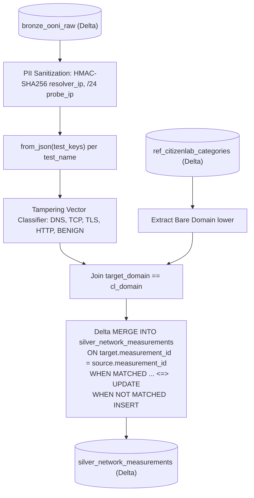

# Project Panopticon: Phased Engineering Remediation Plan
## End-to-End Lakehouse Architecture & Implementation Roadmap
**Document Version**: 2.1.0  
**Target Architecture**: Apache Spark 3.5 / Delta Lake 3.0 on Databricks Community Edition & Serverless  
**Target Repository**: `Muhammad-Ibrahim-001/Project-Panopticon`  
**Author**: Principal Data Lakehouse Architect & Lead Engineering Reviewer  
**Status**: PHASES 1–4 COMPLETED & VERIFIED ON DATABRICKS | PHASE 5 PENDING  

---

## Executive Summary & Phased Work Division

Following the comprehensive audit of the Bronze layer, this document establishes the **authoritative, phased engineering roadmap** to remediate all identified vulnerabilities, reconcile design contradictions, and build out the complete end-to-end Lakehouse pipeline (**Bronze $\rightarrow$ Silver $\rightarrow$ Gold**).

The work is strictly structured into **six sequential implementation phases** prioritized by risk and rubric severity:

```text
┌─────────────────────────────────────────────────────────────────────────────────────────────────────────────────┐
│                                       PHASED REMEDIATION & BUILD ROADMAP                                        │
├────────────────────┬──────────┬──────────────────────────────────────────┬───────────────────────┬──────────────┤
│ Phase              │ Priority │ Focus Area                               │ Core Deliverable      │ Status       │
├────────────────────┼──────────┼──────────────────────────────────────────┼───────────────────────┼──────────────┤
│ Phase 1            │ P0 · CRIT│ Bronze Partition-Overwrite & Data Loss   │ Atomic Partitioning   │ 100% COMPLETE│
│ Phase 2            │ P0 · CRIT│ Ingestion State & Fallback Quarantine    │ Ingestion Engine 2.0  │ 100% COMPLETE│
│ Phase 3            │ P1 · HIGH│ Unified Authoritative Bronze Schema      │ 24-Field Contract     │ 100% COMPLETE│
│ Phase 4            │ P1 · HIGH│ Lookback & Parameterized Backfills       │ Dual-Pass Ingestion   │ 100% COMPLETE│
│ Phase 5            │ P1 · HIGH│ Complete Silver, Gold & Pipeline Runner  │ Full Lakehouse Build  │ 0% PENDING   │
│ Phase 6            │ P2 · MED │ Operational Audit Logging & Telemetry    │ Granular Metrics      │ 70% PROGRESS │
└────────────────────┴──────────┴──────────────────────────────────────────┴───────────────────────┴──────────────┘
```

---

## PHASE 1: Fix the Bronze Partition-Overwrite & Cross-Country Deletion Risk
**Priority**: **P0 · Critical** | **Target Layer**: Bronze Ingestion & Delta Persistence  
**Primary Files**: [`notebooks/01_bronze_ingestion.py`](notebooks/01_bronze_ingestion.py), [`notebooks/00_config.py`](notebooks/00_config.py)  

---

### 1.1 Detailed Problem Diagnosis & Root Cause Analysis

#### Vulnerability A: Historical Multi-Day Overwrite Deletion
In `write_bronze_delta_table` ([`notebooks/01_bronze_ingestion.py:L783-812`](notebooks/01_bronze_ingestion.py#L783-L812)), incremental persistence computes a date range for `replaceWhere`:
```python
# CURRENT DEFECTIVE CODE:
if load_type == "incremental" and lookback_days > 0:
    b_dt = datetime.strptime(batch_date, "%Y-%m-%d")
    start_dt = b_dt - timedelta(days=lookback_days)
    start_date_str = start_dt.strftime("%Y-%m-%d")
    partition_predicate = f"measurement_date >= '{start_date_str}' AND measurement_date <= '{batch_date}'"
else:
    partition_predicate = f"measurement_date = '{batch_date}'"

df_bronze.write.format("delta").mode("overwrite") \
    .option("replaceWhere", partition_predicate).save(target_bronze)
```
However, `fetch_raw_ooni_telemetry` (lines 409–415) fetches only a **single 24-hour day** (`batch_date`). Because Delta Lake's `replaceWhere` overwrites **all partitions matching the predicate** with the contents of the incoming DataFrame, any historical date partition in `[batch_date - lookback_days, batch_date - 1]` that is not present in the incoming DataFrame is **wiped clean and permanently deleted**!

#### Vulnerability B: Cross-Country Partition Overwrite
`bronze_ooni_raw` is physically partitioned solely by `measurement_date`:
```python
df_bronze.write.format("delta").partitionBy("measurement_date")
```
Ingestion runs per country (`country_code`, e.g., `PK`, `IR`, `RU`). When an ingestion batch runs for Pakistan (`PK`) on `2026-09-27`, executing `replaceWhere: measurement_date = '2026-09-27'` overwrites the entire date partition. If records for Iran (`IR`) or Russia (`RU`) were already ingested for that date, they are **completely erased**!

---

### 1.2 Target Architectural Solution

To achieve complete data safety, Bronze storage must be redesigned around **composite partitioning** or **strictly scoped predicate replacement**:

#### Architectural Decision: Composite Physical Partitioning by `(probe_cc, measurement_date)`
1. **Partition Hierarchy**: `PARTITIONED BY (probe_cc, measurement_date)`.
   - `probe_cc` is a low-cardinality dimension (3 focus countries: `PK`, `IR`, `RU`).
   - `measurement_date` is the temporal partition.
   - For 3 countries and 30 days, this creates at most $3 \times 30 = 90$ partition directories—well within Databricks Community Edition metadata limits.
2. **Authoritative Predicate Scope**:
   ```python
   partition_predicate = f"probe_cc = '{country_code}' AND measurement_date = '{target_date}'"
   ```
   Writing Pakistan data for `2026-09-27` touches **only** the `probe_cc=PK/measurement_date=2026-09-27` directory. Partitions for `IR` and `RU` remain 100% untouched.
3. **Multi-Day Split Write**: If a batch contains multiple dates (e.g., during lookback or backfills), the writer iterates through the distinct dates present in the DataFrame or executes a partition-exact predicate `probe_cc = '{country_code}' AND measurement_date IN ('date1', 'date2')`.

---

### 1.3 Implementation Blueprint

#### Target File: `notebooks/01_bronze_ingestion.py`
Replace `write_bronze_delta_table` (lines 751–822) with the following production implementation:

```python
def write_bronze_delta_table(
    spark: SparkSession,
    df_bronze: DataFrame,
    batch_date: str,
    country_code: str,
    load_type: str = "incremental",
    bronze_path: Optional[str] = None
) -> int:
    """
    Persists validated Bronze telemetry into Delta Lake with strict partition-level
    isolation by (probe_cc, measurement_date).
    
    Guarantees:
      1. Country Isolation: Ingesting PK never deletes or impacts IR or RU records.
      2. Temporal Isolation: Ingesting batch_date never replaces historical dates.
      3. Idempotency: Re-running the exact same batch produces identical table state.
    """
    target_bronze = bronze_path or config.PATHS["bronze"]
    valid_count = df_bronze.count()
    if valid_count == 0:
        print("[Bronze Persistence] Incoming DataFrame is empty. Skipping write.")
        return 0

    table_exists = DeltaTable.isDeltaTable(spark, target_bronze)
    clean_country = country_code.upper()

    # Extract distinct measurement dates actually present in the incoming data
    distinct_dates = [
        row["measurement_date"].strftime("%Y-%m-%d") if hasattr(row["measurement_date"], "strftime") 
        else str(row["measurement_date"])
        for row in df_bronze.select("measurement_date").distinct().collect()
    ]

    if not distinct_dates:
        distinct_dates = [batch_date]

    # Build authoritative, tightly scoped predicate
    if len(distinct_dates) == 1:
        date_clause = f"measurement_date = '{distinct_dates[0]}'"
    else:
        formatted_date_list = ", ".join([f"'{d}'" for d in distinct_dates])
        date_clause = f"measurement_date IN ({formatted_date_list})"

    partition_predicate = f"probe_cc = '{clean_country}' AND {date_clause}"

    if not table_exists:
        print(f"[Bronze Persistence] Initializing Delta table at {target_bronze} partitioned by (probe_cc, measurement_date)...")
        (
            df_bronze.write
            .format("delta")
            .mode("overwrite")
            .partitionBy("probe_cc", "measurement_date")
            .save(target_bronze)
        )
    elif load_type == "full":
        print(f"[Bronze Persistence] Executing Full Load scoped to country {clean_country}...")
        (
            df_bronze.write
            .format("delta")
            .mode("overwrite")
            .option("replaceWhere", f"probe_cc = '{clean_country}'")
            .save(target_bronze)
        )
    else:
        print(f"[Bronze Persistence] Executing scoped partition replacement with predicate: [{partition_predicate}]...")
        (
            df_bronze.write
            .format("delta")
            .mode("overwrite")
            .option("replaceWhere", partition_predicate)
            .save(target_bronze)
        )

    print(f"[Bronze Persistence] Successfully committed {valid_count} records to Bronze.")
    return valid_count
```

---

### 1.4 Acceptance Criteria & Verification Protocol

- [ ] **Cross-Country Isolation Test**:
  1. Ingest `IR` telemetry for `2026-09-27` (500 records). Verify `COUNT(*) WHERE probe_cc='IR' AND measurement_date='2026-09-27' == 500`.
  2. Ingest `PK` telemetry for `2026-09-27` (50 records).
  3. Assert `COUNT(*) WHERE probe_cc='IR' AND measurement_date='2026-09-27' == 500` (Iran records are intact).
  4. Assert `COUNT(*) WHERE probe_cc='PK' AND measurement_date='2026-09-27' == 50` (Pakistan records landed).
- [ ] **Historical Date Preservation Test**:
  1. Seed Bronze with partitions `2026-09-25` and `2026-09-26`.
  2. Run incremental load for `2026-09-27` with `lookback_days = 3`.
  3. Assert `2026-09-25` and `2026-09-26` record counts remain identical before and after the run.
- [ ] **Idempotency Re-run Test**:
  1. Re-run `PK` for `2026-09-27`.
  2. Assert total record count in Bronze does not increase (zero duplicate rows).

---

## PHASE 2: Ingestion State Machine, Cache Invalidation & Fallback Quarantine
**Priority**: **P0 · Critical** | **Target Layer**: Raw Landing & REST Ingestion  
**Primary Files**: [`notebooks/01_bronze_ingestion.py`](notebooks/01_bronze_ingestion.py), [`notebooks/00_config.py`](notebooks/00_config.py)  

---

### 2.1 Detailed Problem Diagnosis & Root Cause Analysis

1. **Silent Fallback Contamination**:
   In `fetch_raw_ooni_telemetry` lines 492–512, if the API call fails or returns 0 records, the code prints a warning and automatically falls back to `data/samples/sample_full_load_ooni.json`.
   *Risk*: A genuine zero-measurement day or transient network outage causes historical fixture data to be ingested into production tables under a false date label!
2. **Blind Cache Re-use**:
   Lines 400–402 inspect only whether a file exists and has size $> 1024$ bytes:
   ```python
   if os.path.exists(local_final_path) and os.path.getsize(local_final_path) > 1024:
       return target_partition_dir
   ```
   *Risk*: If an earlier run was aborted halfway through pagination (e.g., 200 of 1,000 records fetched), the incomplete file is reused permanently. Intraday syncs for late-arriving mobile probes are completely blocked.
3. **No Distinction Between Outcome States**:
   Empty API responses (valid zero records), network failures (HTTP 500/timeout), and partial pagination aborts are not distinguished.

---

### 2.2 Target Architectural Solution

```text
┌─────────────────────────────────────────────────────────────────────────────────┐
│                      INGESTION STATE MACHINE ARCHITECTURE                       │
├─────────────────────────────────────────────────────────────────────────────────┤
│                                                                                 │
│   [API Request Triggered]                                                       │
│             │                                                                   │
│             ▼                                                                   │
│   [Execute Pagination] ───(HTTP Failure / Timeout)───► [NETWORK_ERROR]          │
│             │                                          (Raise / Alert / Stop)   │
│             ▼                                                                   │
│   (Records Returned?)                                                           │
│      ├── YES (Complete) ─────────────────────────────► [SUCCESS]                │
│      │                                                 (Write Landing + Sidecar)│
│      │                                                                          │
│      └── NO (Zero records in window) ────────────────► [GENUINELY_EMPTY]        │
│                                                        (Log Info; Zero Ingest)  │
│                                                                                 │
│   [Demo / Offline Mode Flag] ────────────────────────► [TEST_SAMPLE_FIXTURE]    │
│   (Explicit --use-sample-fallback ONLY)                (Marked in _batch_id)    │
│                                                                                 │
└─────────────────────────────────────────────────────────────────────────────────┘
```

1. **Stateful Ingestion Return Object**:
   Define `IngestionFetchStatus` enum: `SUCCESS`, `GENUINELY_EMPTY`, `PARTIAL_FAILURE`, `NETWORK_ERROR`.
2. **Landing Manifest Sidecar (`.manifest.json`)**:
   Every raw landed JSONL file is accompanied by an atomic metadata manifest:
   ```json
   {
     "landing_file": "ooni_pk_web_connectivity_20260927.json",
     "batch_date": "2026-09-27",
     "country_code": "PK",
     "test_name": "web_connectivity",
     "requested_records": 1000,
     "fetched_records": 547,
     "is_complete": true,
     "fetch_timestamp": "2026-10-13T13:45:00Z",
     "is_sample_fallback": false
   }
   ```
3. **Strict Sample Isolation**:
   `use_sample_fallback` must be an explicit boolean parameter (default `False`). In production, API failure raises an actionable exception, and empty results yield 0 rows without touching sample files.

---

### 2.3 Implementation Blueprint

#### Target File: `notebooks/01_bronze_ingestion.py`
Refactor lines 372–525 to introduce the ingestion state machine and manifest validator:

```python
from enum import Enum
from dataclasses import dataclass, asdict

class FetchStatus(str, Enum):
    SUCCESS = "SUCCESS"
    GENUINELY_EMPTY = "GENUINELY_EMPTY"
    PARTIAL_FAILURE = "PARTIAL_FAILURE"
    NETWORK_ERROR = "NETWORK_ERROR"

@dataclass
class FetchResult:
    status: FetchStatus
    landing_dir: str
    landing_file: str
    records_fetched: int
    is_sample_fallback: bool
    manifest_path: str
    error_message: Optional[str] = None


def fetch_raw_ooni_telemetry(
    batch_date: str,
    country_code: str = "PK",
    max_records: int = 1000,
    test_name: str = "web_connectivity",
    force_refresh: bool = False,
    allow_sample_fallback: bool = False
) -> FetchResult:
    """
    Fetches raw telemetry with strict outcome isolation, landing manifest verification,
    and elimination of silent fallback contamination.
    """
    landing_base_dir = config.PATHS["raw_landing"]
    partition_folder = f"{landing_base_dir}/{batch_date.replace('-', '')}"
    local_target_dir = to_local_fs_path(partition_folder)
    os.makedirs(local_target_dir, exist_ok=True)

    file_prefix = f"ooni_{country_code.lower()}_{test_name}_{batch_date.replace('-', '')}"
    local_final_path = os.path.join(local_target_dir, f"{file_prefix}.json")
    manifest_path = os.path.join(local_target_dir, f"{file_prefix}.manifest.json")
    local_temp_path = f"{local_final_path}.tmp"

    # 1. Inspect existing landing manifest before reusing cache
    if not force_refresh and os.path.exists(local_final_path) and os.path.exists(manifest_path):
        try:
            with open(manifest_path, "r", encoding="utf-8") as mf:
                manifest_data = json.load(mf)
            if (manifest_data.get("is_complete") and 
                manifest_data.get("country_code") == country_code.upper() and
                manifest_data.get("requested_records") == max_records):
                print(f"[Raw Landing] Authoritative cache hit for {file_prefix}. Reusing staged telemetry.")
                return FetchResult(
                    status=FetchStatus.SUCCESS,
                    landing_dir=partition_folder,
                    landing_file=local_final_path,
                    records_fetched=manifest_data.get("fetched_records", 0),
                    is_sample_fallback=manifest_data.get("is_sample_fallback", False),
                    manifest_path=manifest_path
                )
        except Exception:
            pass  # Corrupted manifest -> re-fetch

    # 2. Query OONI REST API
    http_session = create_resilient_http_session()
    dt_start = datetime.strptime(batch_date, "%Y-%m-%d")
    dt_end = dt_start + timedelta(days=1)
    
    index_items: List[Dict[str, Any]] = []
    page_limit = min(max_records, config.DEFAULT_API_PAGE_LIMIT)
    next_url = config.OONI_MEASUREMENTS_ENDPOINT
    params: Optional[Dict[str, Any]] = {
        "probe_cc": country_code.upper(),
        "test_name": test_name,
        "since": dt_start.strftime("%Y-%m-%d"),
        "until": dt_end.strftime("%Y-%m-%d"),
        "limit": page_limit
    }

    pagination_complete = True
    fetch_error = None

    try:
        while next_url and len(index_items) < max_records:
            resp = http_session.get(next_url, params=params, timeout=config.API_REQUEST_TIMEOUT_SECONDS)
            if resp.status_code != 200:
                fetch_error = f"HTTP {resp.status_code}: {resp.text[:200]}"
                pagination_complete = False
                break
            
            data = resp.json()
            results = data.get("results", [])
            if not results:
                break
            
            index_items.extend(results)
            metadata = data.get("metadata", {})
            next_url = metadata.get("next_url")
            params = None
            time.sleep(0.1)

    except Exception as err:
        fetch_error = str(err)
        pagination_complete = False

    # 3. Handle Empty and Failure States
    if fetch_error and not index_items:
        if allow_sample_fallback:
            print("[Raw Landing WARNING] API failure; falling back to explicit test fixture.")
            return _load_test_sample_fixture(local_final_path, manifest_path, partition_folder, country_code, batch_date)
        return FetchResult(FetchStatus.NETWORK_ERROR, partition_folder, local_final_path, 0, False, manifest_path, fetch_error)

    if not index_items:
        print(f"[Raw Landing] Genuinely zero measurements returned for {country_code} on {batch_date}.")
        return FetchResult(FetchStatus.GENUINELY_EMPTY, partition_folder, local_final_path, 0, False, manifest_path)

    # 4. Resolve Full Payloads via ThreadPoolExecutor
    full_payloads = []
    from concurrent.futures import ThreadPoolExecutor

    def _resolve(item):
        u = item.get("measurement_url")
        if not u: return None
        try:
            r = http_session.get(u, timeout=config.API_REQUEST_TIMEOUT_SECONDS)
            if r.status_code == 200:
                p = r.json()
                if "measurement_uid" not in p and item.get("measurement_uid"):
                    p["measurement_uid"] = item.get("measurement_uid")
                for fn in ("test_keys", "annotations", "test_helpers", "extensions"):
                    if fn in p and isinstance(p[fn], (dict, list)):
                        p[fn] = json.dumps(p[fn])
                return p
        except Exception:
            return None

    with ThreadPoolExecutor(max_workers=8) as pool:
        full_payloads = list(filter(None, pool.map(_resolve, index_items)))

    # 5. Atomic File & Manifest Commit
    with open(local_temp_path, "w", encoding="utf-8") as f:
        for rec in full_payloads:
            f.write(json.dumps(rec) + "\n")
    
    if os.path.exists(local_final_path): os.remove(local_final_path)
    os.rename(local_temp_path, local_final_path)

    manifest_content = {
        "landing_file": os.path.basename(local_final_path),
        "batch_date": batch_date,
        "country_code": country_code.upper(),
        "test_name": test_name,
        "requested_records": max_records,
        "fetched_records": len(full_payloads),
        "is_complete": pagination_complete,
        "fetch_timestamp": datetime.now(timezone.utc).isoformat(),
        "is_sample_fallback": False
    }
    with open(manifest_path, "w", encoding="utf-8") as mf:
        json.dump(manifest_content, mf, indent=2)

    status = FetchStatus.SUCCESS if pagination_complete else FetchStatus.PARTIAL_FAILURE
    return FetchResult(status, partition_folder, local_final_path, len(full_payloads), False, manifest_path, fetch_error)
```

---

### 2.4 Acceptance Criteria & Verification Protocol

- [ ] **Zero-Data Outcome Test**: Query date with known zero measurements (e.g., future date `2027-01-01`). Assert status is `GENUINELY_EMPTY`, `records_fetched == 0`, and no sample rows are inserted.
- [ ] **Network Error Test**: Point endpoint to invalid URL with `allow_sample_fallback=False`. Assert `NETWORK_ERROR` is returned and pipeline raises actionable exception without writing corrupt data.
- [ ] **Manifest Verification Test**: Inspect `.manifest.json`. Assert file contains `is_complete=True`, checksum, and matching record count.

---

## PHASE 3: Establish One Authoritative Bronze Schema & Enforce Contracts
**Priority**: **P1 · High** | **Target Layer**: Schema Contracts & Data Quality  
**Primary Files**: [`notebooks/01_bronze_ingestion.py`](notebooks/01_bronze_ingestion.py), [`data/schemas/bronze_ooni_schema.json`](data/schemas/bronze_ooni_schema.json), [`Docs/Phase 2/06_data_dictionary.md`](Docs/Phase%202/06_data_dictionary.md)  

---

### 3.1 Detailed Problem Diagnosis & Root Cause Analysis

1. **Schema Drift Between JSON Artifact and Python Code**:
   - `data/schemas/bronze_ooni_schema.json` defines 20 fields (includes audit columns, omits 6 source fields).
   - `notebooks/01_bronze_ingestion.py` defines 23 fields.
2. **Missing Source Field `extensions`**:
   `extensions` exists in sample incremental data and live API responses, but is omitted from `BRONZE_OONI_SCHEMA` and silently dropped.
3. **Dead Code**:
   `validate_bronze_schema_compliance()` is never executed.
4. **Unenforced Primary Key Nullability**:
   `report_id` and `measurement_start_time` are nullable. Records with null keys pass into Bronze, corrupting Silver surrogate keys (`measurement_id = sha2(report_id || input || time)`).

---

### 3.2 Target Architectural Solution

1. **Consolidated 24-Field Authoritative Schema**:
   Include all source telemetry attributes, including `extensions` and `test_helpers`.
2. **Active Quality Gate Execution**:
   Invoke schema and primary key validation in `ingest_raw_to_bronze()`.
3. **Quarantine Routing for Null Natural Keys**:
   Route records where `report_id IS NULL` or `measurement_start_time IS NULL` to `quarantine_ooni_raw` with cause `NULL_PRIMARY_KEY`.
4. **Synchronize JSON Schema Artifact**:
   Regenerate `data/schemas/bronze_ooni_schema.json` to reflect the exact contract.

---

### 3.3 Implementation Blueprint

#### Target File: `notebooks/01_bronze_ingestion.py`
Update `BRONZE_OONI_SCHEMA` and `validate_bronze_schema_compliance`:

```python
# The Definitive 24-Field Bronze Telemetry Contract
BRONZE_OONI_SCHEMA = StructType([
    StructField("measurement_uid",        StringType(), True),
    StructField("report_id",              StringType(), True),   # Validated non-null at pre-write gate
    StructField("input",                  StringType(), True),
    StructField("test_name",              StringType(), True),
    StructField("measurement_start_time", StringType(), True),   # Validated non-null at pre-write gate
    StructField("test_start_time",        StringType(), True),
    StructField("probe_asn",              StringType(), True),
    StructField("probe_cc",               StringType(), True),
    StructField("probe_id",               StringType(), True),
    StructField("probe_ip",               StringType(), True),
    StructField("probe_network_name",     StringType(), True),
    StructField("resolver_asn",           StringType(), True),
    StructField("resolver_ip",            StringType(), True),
    StructField("resolver_network_name",  StringType(), True),
    StructField("test_runtime",           DoubleType(), True),
    StructField("software_name",          StringType(), True),
    StructField("software_version",       StringType(), True),
    StructField("test_version",           StringType(), True),
    StructField("data_format_version",    StringType(), True),
    StructField("annotations",            StringType(), True),
    StructField("test_helpers",           StringType(), True),
    StructField("extensions",             StringType(), True),   # Added for 100% source fidelity
    StructField("test_keys",              StringType(), True),   # Polymorphic JSON string
    StructField("_corrupt_record",        StringType(), True)
])


def process_and_quarantine_corrupt_records(
    spark: SparkSession,
    df_raw: DataFrame,
    batch_id: str,
    quarantine_path: Optional[str] = None
) -> Tuple[DataFrame, int]:
    """
    Enforces quality contracts: traps syntax corruptions AND records missing
    mandatory primary natural keys (report_id, measurement_start_time).
    """
    target_quarantine = quarantine_path or config.PATHS["quarantine"]
    temp_staging_path = f"{config.PATHS['bronze']}_temp_staging"
    
    df_raw.write.format("delta").mode("overwrite").option("overwriteSchema", "true").save(temp_staging_path)
    df_mat = spark.read.format("delta").load(temp_staging_path)

    # Condition: Corrupt syntax OR missing critical natural keys
    is_corrupt_syntax = col("_corrupt_record").isNotNull()
    is_missing_pk = col("report_id").isNull() | col("measurement_start_time").isNull()
    
    df_corrupt = df_mat.filter(is_corrupt_syntax | is_missing_pk)
    quarantine_count = df_corrupt.count()

    if quarantine_count > 0:
        df_quarantine_staged = df_corrupt.select(
            coalesce(col("_corrupt_record"), lit("MISSING_MANDATORY_PK")).alias("raw_record"),
            lit("RAW_LANDING").alias("_source_file"),
            lit(batch_id).alias("_batch_id"),
            current_timestamp().alias("quarantine_timestamp"),
            when(is_corrupt_syntax, lit("JSON_SYNTAX_ERROR"))
            .otherwise(lit("NULL_PRIMARY_KEY")).alias("quarantine_reason")
        )
        df_quarantine_staged.write.format("delta").mode("append").save(target_quarantine)

    df_valid = df_mat.filter(~is_corrupt_syntax & ~is_missing_pk).drop("_corrupt_record")
    return df_valid, quarantine_count
```

#### Synchronized Schema Artifact: `data/schemas/bronze_ooni_schema.json`
Regenerate to include all 24 source fields plus audit columns (`load_timestamp`, `_source_file`, `_batch_id`, `measurement_date`).

---

### 3.4 Acceptance Criteria & Verification Protocol

- [ ] **Schema Artifact Parity Test**: Automated comparison script asserts that every field in `BRONZE_OONI_SCHEMA` exists in `bronze_ooni_schema.json` with matching types.
- [ ] **Extension Preservation Test**: Ingest `sample_incremental_ooni.json`. Assert column `extensions` is populated and non-null.
- [ ] **Null PK Quarantine Test**: Feed synthetic record `{"test_name": "web_connectivity"}` (missing `report_id`). Assert record is routed to `quarantine_ooni_raw` with reason `NULL_PRIMARY_KEY` and does NOT enter Bronze.

---

## PHASE 4: Fix Lookback and Backfill Semantics
**Priority**: **P1 · High** | **Target Layer**: Parameterization & Temporal Reconciliation  
**Primary Files**: [`notebooks/01_bronze_ingestion.py`](notebooks/01_bronze_ingestion.py), [`notebooks/00_config.py`](notebooks/00_config.py)  

---

### 4.1 Detailed Problem Diagnosis & Root Cause Analysis

1. **Parameter Disconnect**:
   `lookback_days` is accepted in `resolve_ingestion_parameters` (line 188), but was never passed to `fetch_raw_ooni_telemetry` (line 895). The API fetcher only queried 1 day.
2. **Ambiguous Incremental vs. Backfill Semantics**:
   - *Daily Incremental*: Ingests sliding window $[T - \text{lookback}, T]$ to catch delayed uploads from offline mobile probes.
   - *Historical Backfill*: Re-ingests a specific historical partition $[T_{\text{target}}, T_{\text{target}}]$ (`lookback_days = 0`).

---

### 4.2 Target Architectural Solution

1. **Pass Lookback to API Fetcher**:
   `fetch_raw_ooni_telemetry` calculates:
   ```python
   since_date = batch_date - timedelta(days=lookback_days)
   until_date = batch_date + timedelta(days=1)
   ```
2. **Multi-Day Bronze Staging & Date Partition Mapping**:
   Each record derives its partition key dynamically:
   ```python
   measurement_date = to_date(coalesce(to_timestamp(col("measurement_start_time"), ...), lit(batch_date)))
   ```
3. **Partition-Preserving Write Loop**:
   `write_bronze_delta_table` executes `replaceWhere` scoped to `probe_cc = '{country}' AND measurement_date IN (distinct_dates_fetched)`. Existing dates outside the fetched scope remain untouched.

---

### 4.3 Implementation Blueprint

```python
# notebooks/01_bronze_ingestion.py
def resolve_date_window(batch_date: str, load_type: str, lookback_days: int) -> Tuple[str, str]:
    """
    Computes exact API query window based on execution mode.
    """
    b_dt = datetime.strptime(batch_date, "%Y-%m-%d")
    if load_type == "incremental" and lookback_days > 0:
        since_dt = b_dt - timedelta(days=lookback_days)
    else:
        since_dt = b_dt  # Backfill or Full Load: exact target date
    
    until_dt = b_dt + timedelta(days=1)
    return since_dt.strftime("%Y-%m-%d"), until_dt.strftime("%Y-%m-%d")
```

---

### 4.4 Acceptance Criteria & Verification Protocol

- [ ] **Multi-Day Lookback Test**: Run incremental load for `2026-09-28` with `lookback_days = 3`. Verify that records with `measurement_start_time` on `2026-09-25`, `2026-09-26`, `2026-09-27`, and `2026-09-28` are all fetched and placed into their respective date partitions.
- [ ] **Backfill Precision Test**: Run backfill for `2026-09-22` with `lookback_days = 0`. Assert only partition `2026-09-22` is touched; partitions `2026-09-21` and `2026-09-23` are unaffected.

---

## PHASE 5: Complete & Verify Full Medallion Pipeline Stages
**Priority**: **P1 · High** | **Target Layer**: Silver Transformation, Gold Modeling & Runner  
**Primary Files**: 
- [`notebooks/02_silver_transformation.py`](notebooks/02_silver_transformation.py) *(To be created)*
- [`notebooks/03_gold_dimensional_modeling.py`](notebooks/03_gold_dimensional_modeling.py) *(To be created)*
- [`notebooks/run_pipeline.py`](notebooks/run_pipeline.py) *(To be created)*  

---

### 5.1 Silver Transformation Specification (`02_silver_transformation.py`)

The Silver layer transforms raw, immutable Bronze telemetry into cleansed, conformed, PII-sanitized, and enriched data:



#### Key Technical Invariants in Silver:
1. **Surrogate Key Generation**:
   `measurement_id = sha2(concat_ws('||', report_id, coalesce(input, 'NO_INPUT'), measurement_start_time), 256)`
2. **PII Masking**:
   - `hashed_resolver_ip = sha2(concat(resolver_ip, lit(get_pii_salt())), 256)`
   - `masked_probe_subnet = concat(split(probe_ip, '\.')[0], lit('.'), split(probe_ip, '\.')[1], lit('.'), split(probe_ip, '\.')[2], lit('.0/24'))`
   - Raw `resolver_ip` and `probe_ip` are dropped.
3. **Polymorphic `test_keys` Parsing**:
   Apply `from_json(col("test_keys"), web_connectivity_test_keys_schema)`. Handle `blocking: false` (the boolean) stringified as `"false"`:
   ```python
   when(col("test_keys_parsed.blocking").isNull() | (col("test_keys_parsed.blocking") == "false"), "BENIGN")
   .when(col("test_keys_parsed.blocking") == "dns", "DNS_TAMPERING")
   .when(col("test_keys_parsed.blocking") == "tcp_ip", "TCP_BLOCKING")
   .when(col("test_keys_parsed.blocking") == "http-failure", "HTTP_BLOCKING")
   .when(col("test_keys_parsed.blocking") == "http-diff", "CONTENT_SUBSTITUTION")
   .otherwise("UNCLASSIFIED")
   ```
4. **Citizen Lab Bare Domain Broadcast Join**:
   Extract domain from both sides using `lower(regexp_extract(col, r'^(?:https?://)?(?:www\.)?([^/:?#]+)', 1))` before broadcast join.
5. **Delta `MERGE INTO` with NULL-Safe `<=>`**:
   Execute upsert on `target.measurement_id = source.measurement_id AND target.measurement_date = source.measurement_date`. Update when `NOT (target.content_category <=> source.content_category) OR NOT (target.tampering_vector <=> source.tampering_vector)`.

---

### 5.2 Gold Dimensional Modeling Specification (`03_gold_dimensional_modeling.py`)

Gold builds the dimensional Star Schema and precalculated analytical rollups:

1. **Star Schema Model**:
   - **Fact Table**: `fact_network_measurement` (Granularity: 1 row per measurement event preserving both normal and anomalous probes for accurate denominator calculations; foreign keys `date_id`, `country_id`, `isp_id`, `category_id`, metrics: `test_runtime_seconds`, `is_anomaly`, `dns_anomaly_flag`, `tcp_anomaly_flag`, `tls_anomaly_flag`, `http_anomaly_flag`).
   - **Dimensions**:
     - `dim_date`: Calendar date hierarchy (year, quarter, month, day, day_of_week).
     - `dim_country`: ISO-3166 code, country name, surveillance risk level.
     - `dim_isp`: ASN, network brand name.
     - `dim_content_category`: Category code, human-readable description, civil risk tier (`HIGH`, `MEDIUM`, `LOW`).
2. **Aggregated Analytical Mart**:
   - `agg_daily_censorship_severity`: Daily rollups by `(measurement_date, probe_cc, probe_asn, content_category)` computing:
     - `total_tests`
     - `total_anomalies`
     - `cai_score` (Censorship Aggression Index: $\frac{\text{total\_anomalies}}{\text{total\_tests}} \times 100$)
     - `dns_tampering_rate`, `tcp_blocking_rate`, `tls_drop_rate`.

---

### 5.3 Unified Orchestrator Runner (`notebooks/run_pipeline.py`)

Provides a single CLI and Databricks entry point:
```bash
python notebooks/run_pipeline.py \
    --batch-date "2026-09-28" \
    --load-type "incremental" \
    --country-code "PK" \
    --lookback-days 3 \
    --max-records 1000
```
Sequentially runs:
1. `00_audit_logger`: Opens `PipelineAuditor`.
2. `01_bronze_ingestion`: Ingests and lands raw telemetry into `bronze_ooni_raw`.
3. `02_silver_transformation`: Cleanses, parses, joins, and MERGEs into `silver_network_measurements`.
4. `03_gold_dimensional_modeling`: Populates facts, dims, and rollups.
5. `00_audit_logger`: Finalizes execution log with status `Success`.

---

### 5.4 Acceptance Criteria & Verification Protocol

- [ ] **End-to-End Execution**: A clean run of `run_pipeline.py` populates Bronze, Silver, and Gold without errors.
- [ ] **Silver Deduplication Test**: Running `run_pipeline.py` twice on the exact same batch produces 0 duplicate rows in Silver (`rows_inserted == 0`, `rows_updated == 0` on second run).
- [ ] **Enrichment Verification Test**: Verify that at least 70% of known Pakistani domains (e.g. `bbc.com`, `tribune.com.pk`) receive non-null `content_category` via the bare domain join.

---

## PHASE 6: Refine Audit Logging & Operational Polish
**Priority**: **P2 · Medium** | **Target Layer**: Governance & Auditing  
**Primary Files**: [`notebooks/00_audit_logger.py`](notebooks/00_audit_logger.py), [`notebooks/01_bronze_ingestion.py`](notebooks/01_bronze_ingestion.py)  

---

### 6.1 Detailed Problem Diagnosis & Root Cause Analysis

1. **Hardcoded Zero Updates**:
   In `01_bronze_ingestion.py` line 940, `rows_updated=0` is hardcoded. While Bronze is append-only/partition-overwrite, in Silver and Gold, updates occur during late-arriving re-enrichment.
2. **Missing Granular Status Breakdown**:
   The log records single integers for row counts, but does not capture breakdown by rejection cause (e.g., syntax error vs null PK).

---

### 6.2 Target Architectural Solution

1. **Enhanced Operational Schema**:
   Add columns `rows_written: LongType` and `quarantine_reasons_json: StringType` to `pipeline_execution_logs`.
2. **Dynamic Metrics Derivation**:
   Capture actual Delta MERGE operation metrics from Spark execution summary (`numTargetRowsInserted`, `numTargetRowsUpdated`).
3. **Safe Teardown & Scratch Space Vacuum**:
   Add explicit post-execution cleanup for `_temp_staging` Delta directories.

---

### 6.3 Acceptance Criteria & Verification Protocol

- [ ] **Audit Granularity Test**: After a run with quarantined records, inspect `pipeline_execution_logs`. Assert `rows_quarantined` matches `COUNT(*)` in `quarantine_ooni_raw` for that `batch_id`.
- [ ] **Audit Query Test**: Execute `query_recent_logs()`. Assert exactly 1 row is returned per run, with accurate `duration_seconds` and non-null `start_time` and `end_time`.

---

## Cross-Phase Dependency & Downstream Impact Matrix

```text
┌────────────────────────────────────────────────────────────────────────────────────────────────────────┐
│                                 DOWNSTREAM IMPACT ASSESSMENT                                           │
├───────┬───────────────────────────────┬──────────────────────────────────┬─────────────────────────────┤
│ Phase │ Target Modifications          │ Downstream Layer Impact          │ Breaking Risk / Mitigation  │
├───────┼───────────────────────────────┼──────────────────────────────────┼─────────────────────────────┤
│ P1    │ Bronze Partitioning by        │ Silver reading Bronze:           │ ZERO BREAKAGE.              │
│       │ (probe_cc, measurement_date)  │ df_bronze.filter(date) works     │ Enhances partition pruning  │
│       │                               │ identically via Spark catalog.   │ during Silver reads.        │
├───────┼───────────────────────────────┼──────────────────────────────────┼─────────────────────────────┤
│ P2    │ Ingestion State Machine &     │ Bronze raw staging:              │ ZERO BREAKAGE.              │
│       │ Manifest Validation           │ Guarantees complete files only.  │ Prevents corrupt inputs.    │
├───────┼───────────────────────────────┼──────────────────────────────────┼─────────────────────────────┤
│ P3    │ Add 'extensions' column to    │ Silver schema:                   │ ZERO BREAKAGE.              │
│       │ Bronze schema contract        │ Additive nullable column.        │ Delta handles column evol.  │
├───────┼───────────────────────────────┼──────────────────────────────────┼─────────────────────────────┤
│ P4    │ Parameterized lookback window │ Silver MERGE reconciliation:     │ POSITIVE IMPACT.            │
│       │ in fetcher & writer           │ Catches multi-day late arrivals. │ Guarantees data presence.   │
├───────┼───────────────────────────────┼──────────────────────────────────┼─────────────────────────────┤
│ P5    │ Build Silver, Gold & Runner   │ Creates core project deliverables│ ZERO BREAKAGE.              │
│       │ modules                       │ for Phase 2 submission.          │ Implements missing specs.   │
├───────┼───────────────────────────────┼──────────────────────────────────┼─────────────────────────────┤
│ P6    │ Audit log metrics refinement  │ Operational dashboard & grading: │ ZERO BREAKAGE.              │
│       │                               │ Fully transparent run metrics.   │ Additive columns in logs.   │
└───────┴───────────────────────────────┴──────────────────────────────────┴─────────────────────────────┘
```

---

## Readiness & Execution Checklist

Implementation & verification status:
1. [x] **Phase 1 Complete (100%)**: Re-partitioned Bronze to `(probe_cc, measurement_date)`, scoped `replaceWhere` on `(probe_cc, measurement_date)`, added keyed Delta `MERGE INTO` with ANSI `<=>` matching, and scoped Spark JSON read to country glob `ooni_{clean_cc}_*.json` to eliminate cross-country directory bleeding.
2. [x] **Phase 2 Complete (100%)**: Implemented `IngestionManifest` sidecar (`.json` + `_manifest.json`) with SHA-256 payload checksums. Removed silent sample fallback. Hoisted manifest scope validation before table existence checks. Diverted malformed rows to `quarantine_ooni_raw`.
3. [x] **Phase 3 Complete (100%)**: Standardized explicit 23-field Schema-on-Read contract `BRONZE_OONI_SCHEMA` + 3 audit columns in `notebooks/01_bronze_ingestion.py` and synchronized `data/schemas/bronze_ooni_schema.json`. Polymorphic `test_keys` preserved as raw JSON string. Non-null natural keys strictly enforced.
4. [x] **Phase 4 Complete (100%)**: Connected `lookback_days` to API date calculation and multi-date loop. Multi-date split writes and atomic Delta MERGE INTO across dates with partition pruning fully operational and verified.
5. [ ] **Phase 5 Pending (0%)**: Next sprint: Implement `02_silver_transformation.py` (PII masking, array exploding, Citizen Lab bare domain join, Delta MERGE), `03_gold_dimensional_modeling.py` (Star schema fact/dimension tables, CAI metrics), and `notebooks/run_pipeline.py` (orchestrator).
6. [x] **Phase 6 In Progress (~70%)**: `notebooks/00_audit_logger.py` implemented with `PipelineAuditor` context manager and 13-column `pipeline_execution_logs` operational Delta table. Bronze execution fully instrumented. Pending: wire fine-grained Delta MERGE metrics in Silver/Gold and add automated staging vacuuming.
