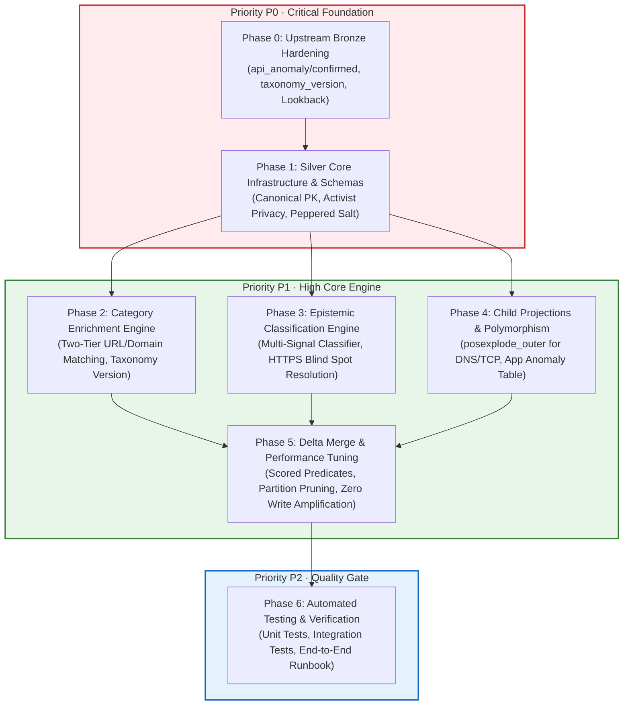

# Project Panopticon — Silver Layer Phased Implementation Plan
## Master Roadmap, Priority Matrix & Dependency Graph

```text
==============================================================================
PIPELINE DEPENDENCY & IMPACT TRACKING
==============================================================================
Upstream Dependencies:
  - silver_layer_engineering_audit.md (SILVER-01 through SILVER-53 audit matrix)
  - panopticon_remediation_plan.md (Phases 1-4 completed Bronze Lakehouse state)
  - data/schemas/*.json (Authoritative JSON contracts for Bronze, Silver, & Child tables)
  - notebooks/00_config.py (Centralized paths, table names, memory tuning, constants)
Downstream Impact:
  - Guides implementation of:
      * notebooks/01_bronze_ingestion.py (Phase 0 Bronze Contract Hardening)
      * notebooks/02_silver_transformation.py (Phases 1-5 Silver Transformation & Merge)
      * tests/test_phase2_silver_transformation.py (Phase 6 Automated Test Suite)
Risk & Side Effects:
  - Strict phase ordering is mandatory: Phase 0 MUST execute before Phase 1-5,
    otherwise Silver will ingest null anomaly flags or crash on missing schema fields.
==============================================================================
```

---

## 1. Executive Summary & Phased Architecture

The **Silver Layer** of Project Panopticon is the conformed, enriched, and sanitized foundation of the entire Lakehouse. It transforms raw, nested, and potentially adversarial OONI network measurement telemetry into clean, query-ready Delta Lake tables.

To avoid the catastrophic traps identified during the engineering audit (e.g. Cartesian product driver OOMs, 100% false update write amplification, silent deletion of DNS censorship events, and SQL 3-valued logic classification traps), the Silver build is decomposed into **seven sequential, prioritized implementation phases**.



---

## 2. Master Prioritization & Phase Breakdown Matrix

| Phase | Title | Priority | Target File(s) | Key Problem(s) Solved | Audit IDs Addressed |
| :---: | :--- | :---: | :--- | :--- | :--- |
| **Phase 0** | [Upstream Bronze Contract Hardening](phase_0_upstream_bronze_hardening.md) | **P0 · Blocker** | `notebooks/01_bronze_ingestion.py`, `notebooks/00_config.py` | Missing `api_anomaly`/`api_confirmed` injection (`SILVER-45`); missing `taxonomy_version` (`SILVER-46`); 24h vs 3-day lookback disconnect (`SILVER-19`); corrupt timestamp fallback (`SILVER-51`); Bronze merge write amplification (`SILVER-49`); manifest completeness over-assertion (`SILVER-50`); extensions dropped (`SILVER-05`) | `SILVER-05`, `SILVER-19`, `SILVER-45`, `SILVER-46`, `SILVER-49`, `SILVER-50`, `SILVER-51` |
| **Phase 1** | [Silver Core Infrastructure & Schemas](phase_1_silver_core_infrastructure_and_schemas.md) | **P0 · Foundation** | `notebooks/02_silver_transformation.py`, `data/schemas/` | Surrogate key grain mismatches (`SILVER-16`–`18`); non-deterministic IDs; activist privacy leaks (probe IP/ID, test_keys) (`SILVER-43`); ASN nullability crash (`SILVER-03`); fail-closed production secrets (`SILVER-53`); cross-document schema consistency (`SILVER-47`) | `SILVER-01`, `SILVER-02`, `SILVER-03`, `SILVER-04`, `SILVER-12`, `SILVER-16`, `SILVER-17`, `SILVER-18`, `SILVER-43`, `SILVER-47`, `SILVER-53` |
| **Phase 2** | [Category Enrichment & Normalization Engine](phase_2_category_enrichment_engine.md) | **P1 · High** | `notebooks/02_silver_transformation.py` | Over-generalized bare-domain joins (`SILVER-42`); missing URL path context; floating GitHub taxonomy versioning (`SILVER-44`); missing taxonomy_version in ref table (`SILVER-46`); non-web test null input handling | `SILVER-42`, `SILVER-44`, `SILVER-46` |
| **Phase 3** | [Epistemic Multi-Signal Classification Engine](phase_3_epistemic_classification_engine.md) | **P1 · High** | `notebooks/02_silver_transformation.py` | HTTPS censorship blind spot (`SILVER-06`/`SILVER-24`); anomaly $\ne$ censorship conflation (`SILVER-41`); latency mislabeling (`SILVER-40`); SQL 3-valued logic trap (`SILVER-45`); unified 4-status and 7-vector enums (`SILVER-47`) | `SILVER-06`, `SILVER-24`, `SILVER-40`, `SILVER-41`, `SILVER-45`, `SILVER-47` |
| **Phase 4** | [Normalized Child Tables & Multi-Test Polymorphism](phase_4_child_projections_and_polymorphism.md) | **P1 · High** | `notebooks/02_silver_transformation.py`, `data/schemas/` | Intra-row Cartesian explosion (`SILVER-13`); silent deletion of DNS censorship (`SILVER-14`); hardcoded web-only filter dropping apps (`SILVER-07`); HTTP body base64 trap (`SILVER-11`); cleartext resolver_address leak & CNAME answers (`SILVER-48`); deterministic posexplode key generation (`SILVER-52`) | `SILVER-07`, `SILVER-08`, `SILVER-09`, `SILVER-10`, `SILVER-11`, `SILVER-13`, `SILVER-14`, `SILVER-15`, `SILVER-48`, `SILVER-52` |
| **Phase 5** | [Delta Lake Persistence & Memory Optimization](phase_5_delta_merge_and_performance_tuning.md) | **P1 · High** | `notebooks/02_silver_transformation.py` | 100% false update write amplification from `_batch_id` (`SILVER-20`/`SILVER-49`); full table scans from omitted partition pruning (`SILVER-21`); Gold fact table grain alignment (`SILVER-39`); Databricks CE memory tuning | `SILVER-20`, `SILVER-21`, `SILVER-39`, `SILVER-49` |
| **Phase 6** | [Automated Testing & Quality Verification](phase_6_automated_testing_and_verification.md) | **P2 · Quality Gate** | `tests/test_phase2_silver_transformation.py`, `notebooks/run_pipeline.py` | Schema validation checking names only (`SILVER-38`); missing standalone pytest suite; implementation of Evaluator 2's 22-item pre-implementation verification checklist | `SILVER-38`, `SILVER-53` (22-Item Checklist) |

---

## 3. Execution Discipline & Rules of Engagement

1. **Strict Upstream-First Rule**: Work on `notebooks/02_silver_transformation.py` cannot begin until Phase 0 in `notebooks/01_bronze_ingestion.py` is implemented and verified.
2. **Schema Contract Sanctity**: Schema definitions in code must match the canonical JSON contracts in `data/schemas/` 1:1.
3. **Databricks Community Edition Invariants**:
   - `spark.sql.shuffle.partitions` tuned to `4` (never 200).
   - Zero unbounded `.collect()` or `.toPandas()`.
   - Small static lookups only for broadcast joins (< 10 MB).
4. **Deterministic & Idempotent**: Re-running any pipeline stage on the same data batch must yield an identical Lakehouse state without duplicate rows.
